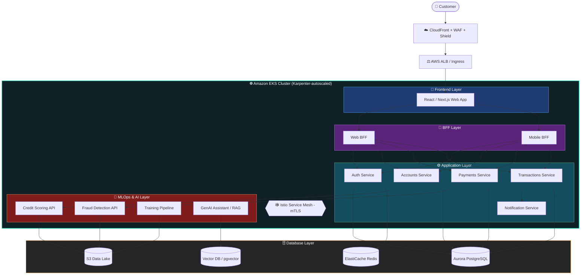
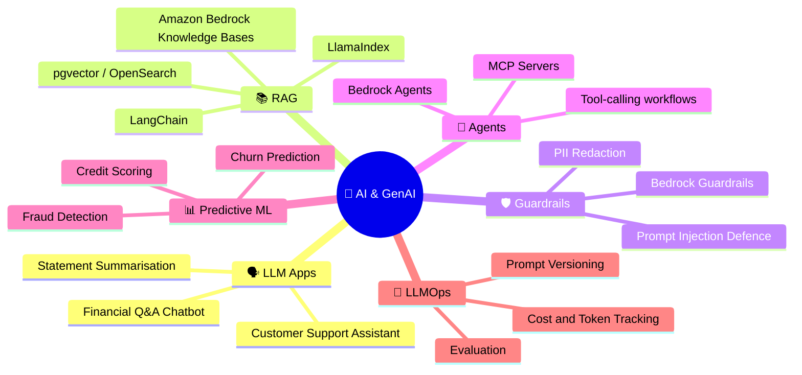
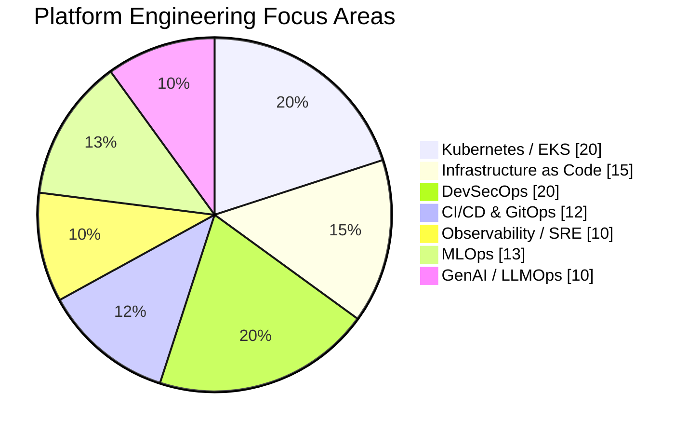
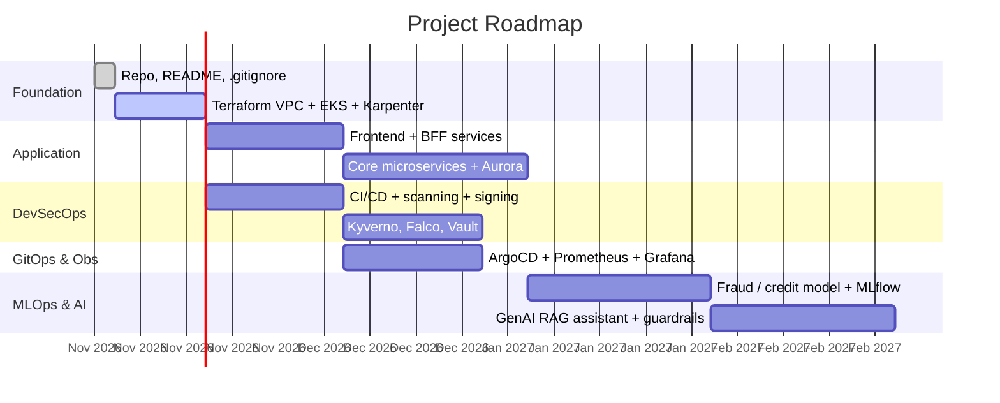

<div align="center">


[](https://git.io/typing-svg)


</div>

---

## 🌟 About This Project

> **This repository is a replica of the FinTech platform from my past projects and professional work experience.**

It is an **EKS-based, multi-tier FinTech platform** made of four layers: **Frontend → BFF → Application → Database**. It also includes an **MLOps** layer with several microservices for model training and data prediction, plus **AI / GenAI** services.

The project **will be upgraded over time**. Each upgrade showcases a modern tool, skill or concept, with **DevSecOps security** as the main concern throughout. It mirrors the toolset and skillset expected of a **Platform Engineer / Senior DevOps Engineer in a FinTech organisation**.

> ⚠️ **Note:** this README describes the target architecture. The [Roadmap](#-roadmap) shows what is done and what is planned. Items marked ✅ exist in the repo and items marked 🔜 are planned.

---

## 🏗️ High-Level Architecture



---

## 🔐 DevSecOps Pipeline

```mermaid
flowchart LR
    DEV[👨‍💻 Commit] --> PRE[🪝 pre-commit<br/>gitleaks]
    PRE --> SAST[🔍 SAST<br/>SonarQube · Semgrep]
    SAST --> SCA[📦 SCA<br/>Trivy · Snyk]
    SCA --> BUILD[🐳 Docker Build]
    BUILD --> SCAN[🛡️ Image Scan<br/>Trivy · Grype]
    SCAN --> SBOM[📄 SBOM + Sign<br/>Syft · Cosign]
    SBOM --> IAC[🏗️ IaC Scan<br/>Checkov · tfsec]
    IAC --> GIT[📂 GitOps Repo]
    GIT --> ARGO[🐙 ArgoCD]
    ARGO --> ADM[🚧 Admission<br/>Kyverno · OPA]
    ADM --> RUN[☸️ EKS Runtime]
    RUN --> FALCO[🦅 Falco<br/>Runtime Security]
    RUN --> OBS[📊 Prometheus · Grafana · Loki]

    style DEV fill:#4facfe,color:#000
    style SAST fill:#f7971e,color:#000
    style SCA fill:#f7971e,color:#000
    style SCAN fill:#ff416c,color:#fff
    style SBOM fill:#c471f5,color:#fff
    style IAC fill:#f7971e,color:#000
    style ARGO fill:#ef7b4d,color:#fff
    style ADM fill:#ff416c,color:#fff
    style RUN fill:#326ce5,color:#fff
    style FALCO fill:#00c9a7,color:#000
```



---

## 🤖 MLOps Lifecycle

```mermaid
flowchart LR
    DATA[(📥 Raw Data<br/>S3 Data Lake)] --> ING[🔄 Ingestion<br/>Airflow · Kafka]
    ING --> FEAT[🧮 Feature Store<br/>Feast]
    FEAT --> TRAIN[🏋️ Training<br/>Kubeflow · SageMaker]
    TRAIN --> TRACK[📒 Tracking<br/>MLflow]
    TRACK --> REG[🗃️ Model Registry]
    REG --> SERVE[🚀 Serving<br/>KServe · Seldon]
    SERVE --> API[🔌 Prediction APIs<br/>Fraud · Credit]
    API --> MON[📈 Monitoring<br/>Evidently · Prometheus]
    MON -->|drift detected| TRAIN

    style DATA fill:#232526,color:#fff
    style TRAIN fill:#7f1d1d,color:#fff
    style TRACK fill:#0194e2,color:#fff
    style SERVE fill:#134e5e,color:#fff
    style MON fill:#f7971e,color:#000
```



---

## 🧠 AI / GenAI Capabilities



---

## 🧰 Tech Stack

### ☁️ AWS Infrastructure
| Area | Tools |
|---|---|
| **Compute / Containers** | Amazon EKS, **Karpenter**, Fargate, ECR, EC2 Spot |
| **Networking** | VPC, Subnets, NAT, Transit Gateway, PrivateLink, Route 53, CloudFront, ALB/NLB |
| **Data** | Aurora PostgreSQL, ElastiCache Redis, S3, DynamoDB, MSK (Kafka) |
| **Security** | IAM, IRSA / Pod Identity, KMS, Secrets Manager, GuardDuty, Security Hub, WAF, Shield, Inspector, Config |
| **Observability** | CloudWatch, X-Ray, Managed Prometheus, Managed Grafana |
| **AI / ML** | Bedrock, SageMaker, Comprehend, Textract |

### 🏗️ Infrastructure as Code & GitOps
| Area | Tools |
|---|---|
| **IaC** | **Terraform**, Terragrunt, Crossplane (planned) |
| **GitOps** | ArgoCD, Argo Rollouts, Argo Workflows, Helm, Kustomize |
| **CI/CD** | GitHub Actions, Jenkins, Tekton |

### 🛡️ DevSecOps
| Area | Tools |
|---|---|
| **Secrets** | Gitleaks, HashiCorp Vault, External Secrets Operator |
| **SAST / DAST** | SonarQube, Semgrep, OWASP ZAP |
| **Container / Supply chain** | Trivy, Grype, Syft (SBOM), **Cosign**, SLSA |
| **IaC scanning** | Checkov, tfsec, KICS |
| **Policy** | **Kyverno**, OPA Gatekeeper, Pod Security Standards |
| **Runtime** | Falco, Tetragon, Istio mTLS, Network Policies, Cilium |
| **Compliance** | PCI-DSS, SOC 2, CIS Benchmarks (kube-bench) |

### 📊 Observability & Reliability
Prometheus · Grafana · Loki · Tempo · OpenTelemetry · Alertmanager · PagerDuty · SLO/SLI · Chaos Mesh · Velero · k6

### 🤖 MLOps & AI
MLflow · Kubeflow · KServe · Feast · Airflow · Evidently · SageMaker · Bedrock · LangChain · LlamaIndex · pgvector · Ray

---

## 📊 Skill Coverage



---

## 🗺️ Roadmap



| Status | Item |
|:--:|---|
| ✅ | Repository scaffold, README, `.gitignore` |
| ✅ | Terraform: VPC, EKS cluster, Karpenter IAM and controller |
| ✅ | Karpenter NodePool / EC2NodeClass starter manifests |
| 🔜 | Frontend, BFF and application microservices |
| 🔜 | CI/CD with scanning, SBOM and image signing |
| 🔜 | ArgoCD GitOps, Kyverno policies, Falco |
| 🔜 | Observability stack (Prometheus, Grafana, Loki, Tempo) |
| 🔜 | MLOps pipeline (MLflow, KServe, Feast, Airflow) |
| 🔜 | GenAI assistant with RAG and guardrails |

---

## 📁 Repository Structure

```text
FinTech-Enterprise-Project/
├── terraform/            # AWS infra: VPC, EKS, Karpenter
├── k8s/
│   └── karpenter/        # NodePool + EC2NodeClass
├── .gitignore
└── README.md
```

---

## 🚀 Getting Started

```bash
cd terraform
cp terraform.tfvars.example terraform.tfvars   # edit values
terraform init
terraform plan
terraform apply

aws eks update-kubeconfig --name fintech-enterprise-eks --region us-east-1
kubectl apply -f ../k8s/karpenter/
```

> 💸 This creates billable AWS resources (EKS control plane, NAT gateway, EC2). Run `terraform destroy` when you are done.

---

<div align="center">

### 👩‍💻 Built by a DevOps engineer, for DevOps engineers

⭐ Star this repo to follow along as it grows.


</div>
