<div align="center">


[](https://git.io/typing-svg)


</div>

---

## 🎬 Architecture at a Glance

> **20 animated diagrams.** Every moving dot is real traffic, a query, an event or state flowing through the platform.

### 🏛️ Architecture

#### 1. FinTech infrastructure layers

<div align="center">

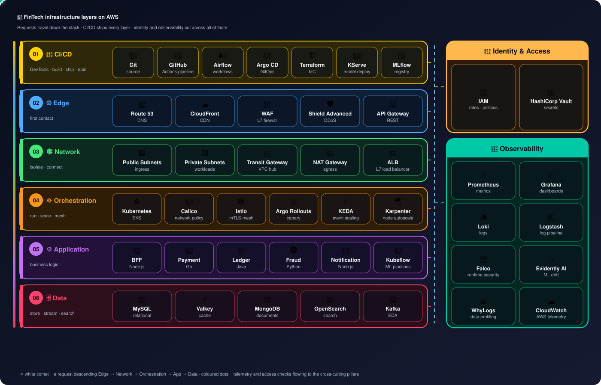

<sub>Six layers plus identity and observability pillars · the comet is a request travelling down the stack</sub>

</div>

#### 2. Regional architecture

<div align="center">

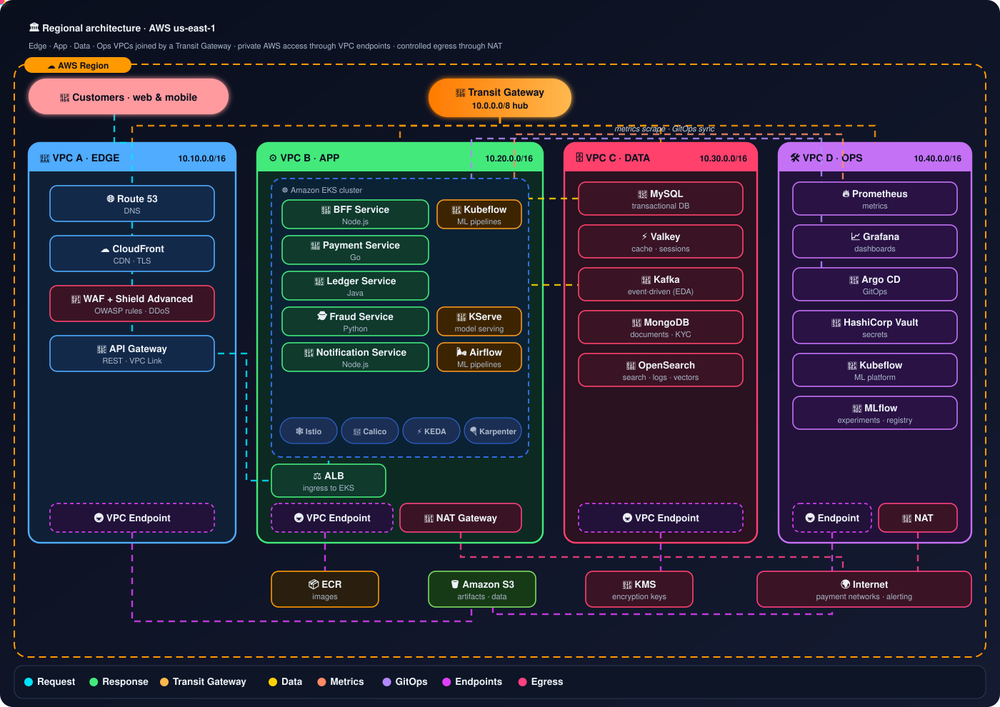

<sub>Edge, app, data and ops VPCs on one Transit Gateway · request, data, metrics, GitOps, endpoint and egress traffic</sub>

</div>

#### 3. Hub-and-spoke network

<div align="center">

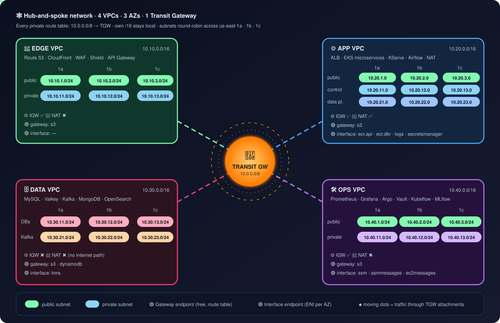

<sub>Every subnet per AZ · traffic moving through each Transit Gateway attachment</sub>

</div>

### 🚦 Traffic & Requests

#### 4. Live traffic flow

<div align="center">

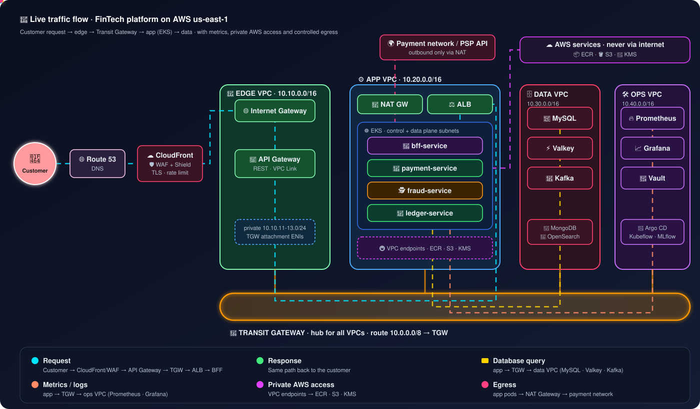

<sub>Six traffic types moving through the platform at once</sub>

</div>

#### 5. Payment request hop by hop

<div align="center">


<sub>Every network hop of one payment, step by step</sub>

</div>

#### 6. Payment flow through the services

<div align="center">


<sub>BFF → Payment → Fraud (KServe) → Ledger → Kafka → Notification · low and high risk</sub>

</div>

#### 7. How a packet picks its path

<div align="center">


<sub>Six packets, six destinations: local, S3, ECR/KMS, Transit Gateway, NAT, dropped</sub>

</div>

#### 8. Transit Gateway route lookup

<div align="center">


<sub>How a pod in the app VPC reaches MySQL in the data VPC</sub>

</div>

### 🧩 Services & Data

#### 9. Microservices calls, events and data

<div align="center">

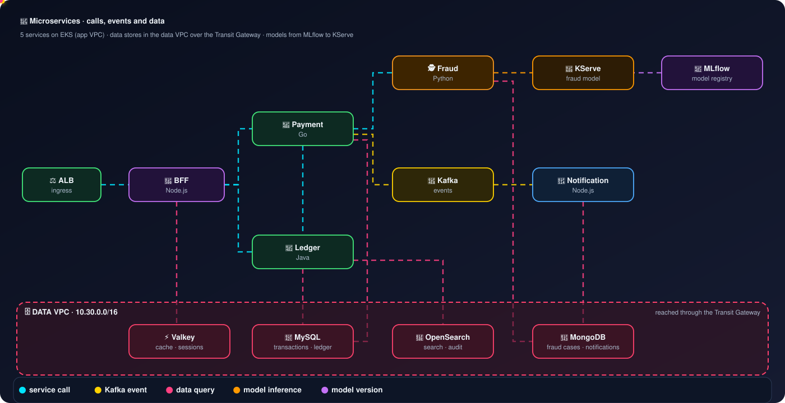

<sub>Service calls, Kafka events, data queries and model inference</sub>

</div>

### 🛡️ Security & Identity

#### 10. Security checkpoints and layers

<div align="center">


<sub>A clean request passes 9 gates · a malicious one is blocked at the WAF</sub>

</div>

#### 11. IAM roles per environment

<div align="center">

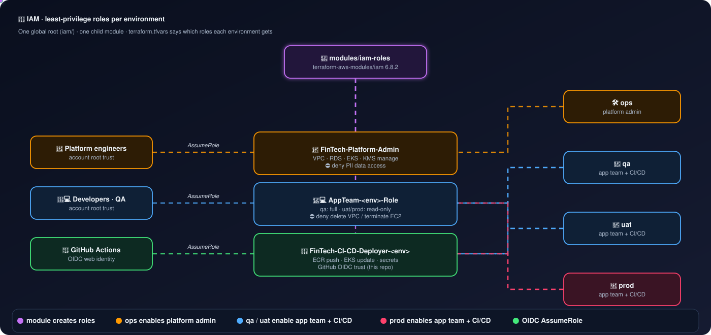

<sub>Who assumes which role, and which environment enables it</sub>

</div>

#### 12. GitHub Actions to AWS with OIDC

<div align="center">


<sub>Short-lived credentials, no stored keys</sub>

</div>

### 🔁 Delivery & Infrastructure as Code

#### 13. CI/CD and GitOps

<div align="center">

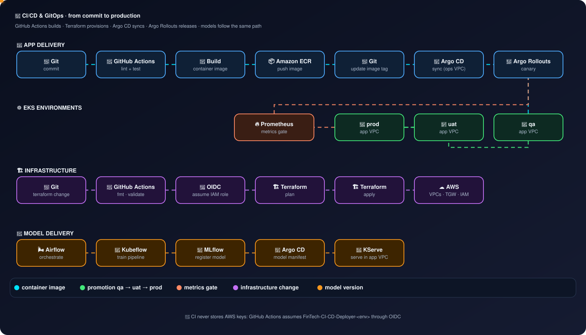

<sub>App images, infrastructure changes and models flowing to production</sub>

</div>

#### 14. Terraform for_each to four VPCs

<div align="center">

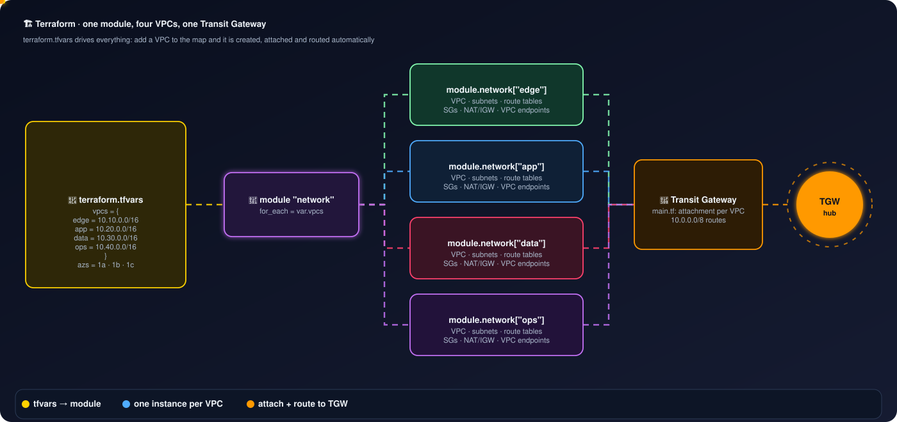

<sub>terraform.tfvars → module → 4 VPCs → Transit Gateway</sub>

</div>

#### 15. VPC endpoints

<div align="center">

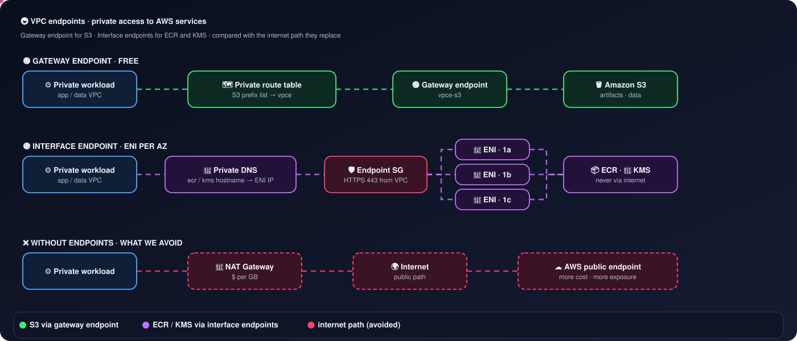

<sub>Gateway vs Interface endpoints, and the internet path they replace</sub>

</div>

#### 16. Multi state file backend

<div align="center">

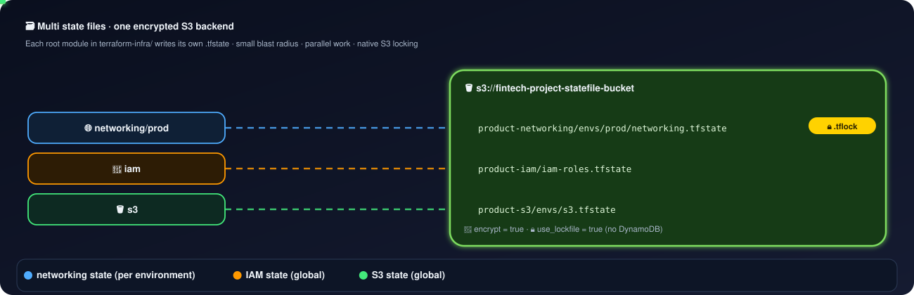

<sub>Every stack writes its own state into one encrypted S3 bucket</sub>

</div>

#### 17. Native S3 state locking

<div align="center">


<sub>One writer at a time, no DynamoDB</sub>

</div>

### 🔭 Operations & MLOps

#### 18. Observability

<div align="center">

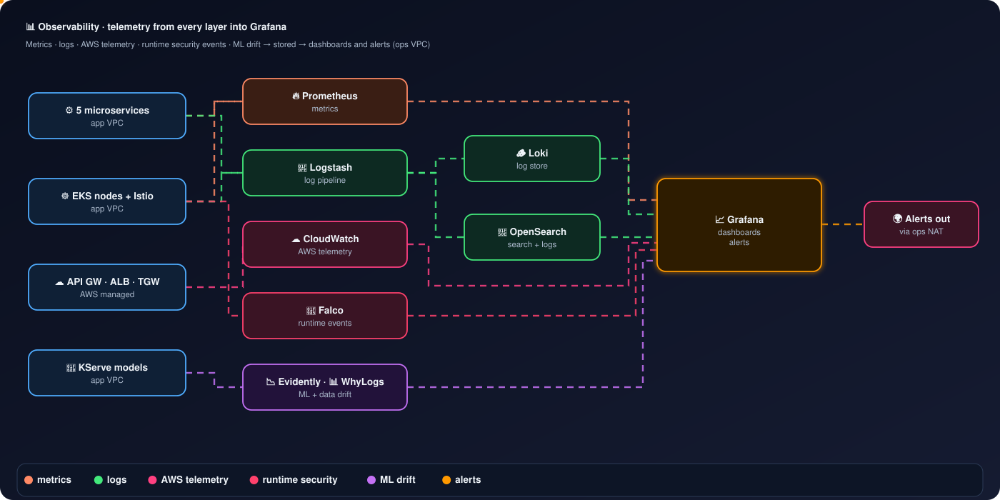

<sub>Metrics, logs, AWS telemetry, runtime security and ML drift into Grafana</sub>

</div>

#### 19. MLOps continuous training loop

<div align="center">

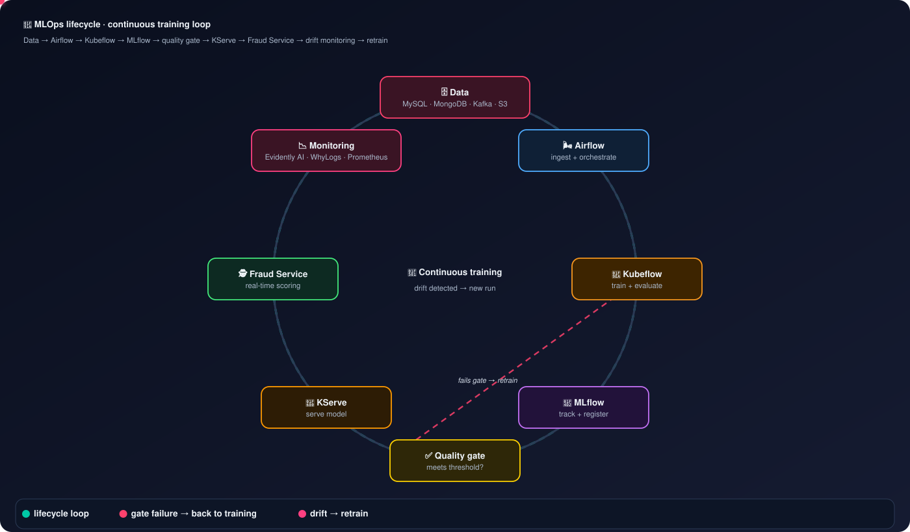

<sub>Train → register → serve → monitor → retrain</sub>

</div>

### 🗺️ Roadmap

#### 20. Roadmap

<div align="center">


<sub>Done, in progress and planned, layer by layer</sub>

</div>

---

## 📑 Table of Contents

- [Architecture at a Glance](#-architecture-at-a-glance)
- [About](#-about-this-project)
- [Project Overview & Architecture](#%EF%B8%8F-project-overview--architecture)
- [Tech Stack](#-tech-stack)
- [Live Traffic Flow](#-live-traffic-flow)
- [Microservices](#-microservices)
- [Request Flow](#-request-flow-making-a-payment)
- [Security by Layer](#%EF%B8%8F-security-by-layer)
- [CI/CD & GitOps](#-cicd--gitops)
- [MLOps](#-mlops-lifecycle)
- [Observability](#-observability)
- [Infrastructure Build: Networking & IAM](#%EF%B8%8F-infrastructure-build-networking--iam)
- [Roadmap](#%EF%B8%8F-roadmap)

---

## 🌟 About This Project

> **This repository is a replica of the FinTech platform from my past projects and professional work experience.**

It is an **AWS FinTech platform on Amazon EKS** built from **6 infrastructure layers** (CI/CD & DevTools → Edge → Network → Orchestration → Application → Data) plus two cross-cutting pillars (**Identity & Access** and **Observability**). It runs across **4 VPCs** (edge, app, data, ops) joined by a **Transit Gateway**.

- 🌐 **Edge:** Route 53, CloudFront, WAF, Shield Advanced and API Gateway
- ⚙️ **Microservices:** **5** services on EKS: BFF (Node.js), Payment (Go), Ledger (Java), Fraud (Python) and Notification (Node.js)
- 🗄️ **Data:** MySQL, Valkey, MongoDB, OpenSearch and Kafka
- 🛠️ **Ops:** Prometheus, Grafana, Argo CD, Vault, Kubeflow and MLflow
- 🤖 **MLOps:** Airflow, Kubeflow, MLflow and KServe for fraud scoring, monitored by Evidently AI and WhyLogs

The project grows in stages. Each stage adds a layer of the architecture below, with security built in at every layer.

<div align="center">

| ⚙️ Microservices | 🧱 Layers | 🏢 VPCs | 🧰 Tools | ☁️ Region |
|:---:|:---:|:---:|:---:|:---:|
| **5** | **6 + 2 pillars** | **4** | **48** | **us-east-1** |

</div>

---

## 🗺️ Project Overview & Architecture

<div align="center">

[](https://git.io/typing-svg)

</div>

### 🧰 Tech Stack

**48 tools**, every one of them shown in the two diagrams above, grouped exactly like the layers.

#### 🚀 01 · CI/CD & DevTools

<sub>Build, test and ship apps, infrastructure and ML models</sub>


#### 🌐 02 · Edge

<sub>First contact for every request</sub>


#### 🕸️ 03 · Network

<sub>Isolate, connect and load-balance traffic</sub>


#### ☸️ 04 · Orchestration

<sub>Run, scale, secure and roll out workloads</sub>


#### ⚙️ 05 · Application

<sub>Business logic and ML pipelines</sub>


#### 🗄️ 06 · Data

<sub>Store, cache, search and stream</sub>


#### 🔑 · Identity & Access

<sub>Least privilege and secrets across every layer</sub>


#### 🔭 · Observability

<sub>Metrics, logs, runtime security and ML drift across every layer</sub>


#### ☁️ · Shared AWS Services

<sub>Reached privately through VPC endpoints</sub>


<details>
<summary><b>📋 Every tool and what it does (table)</b></summary>

| Layer | Tool | Role in this project |
|---|---|---|
| CI/CD & DevTools | **Git** | source control |
| CI/CD & DevTools | **GitHub Actions** | CI pipelines |
| CI/CD & DevTools | **Apache Airflow** | ML & data workflows |
| CI/CD & DevTools | **Argo CD** | GitOps delivery |
| CI/CD & DevTools | **Terraform** | infrastructure as code |
| CI/CD & DevTools | **KServe** | model serving |
| CI/CD & DevTools | **MLflow** | experiments & registry |
| Edge | **Route 53** | DNS |
| Edge | **CloudFront** | CDN · TLS |
| Edge | **AWS WAF** | L7 firewall |
| Edge | **Shield Advanced** | DDoS protection |
| Edge | **API Gateway** | REST API front door |
| Network | **Amazon VPC** | 4 VPCs |
| Network | **Public Subnets** | internet-facing |
| Network | **Private Subnets** | workloads & data |
| Network | **Transit Gateway** | VPC hub |
| Network | **NAT Gateway** | outbound only |
| Network | **ALB** | L7 load balancer |
| Network | **VPC Endpoints** | private AWS access |
| Orchestration | **Amazon EKS** | Kubernetes |
| Orchestration | **Calico** | network policy |
| Orchestration | **Istio** | mTLS service mesh |
| Orchestration | **Argo Rollouts** | canary · blue-green |
| Orchestration | **KEDA** | event-driven pod scaling |
| Orchestration | **Karpenter** | node autoscaling |
| Application | **Node.js** | BFF · Notification |
| Application | **Go** | Payment |
| Application | **Java** | Ledger |
| Application | **Python** | Fraud |
| Application | **Kubeflow** | ML pipelines |
| Data | **MySQL** | transactions · ledger |
| Data | **Valkey** | cache · sessions |
| Data | **MongoDB** | documents |
| Data | **OpenSearch** | search · logs |
| Data | **Apache Kafka** | event-driven (EDA) |
| Identity & Access | **AWS IAM** | roles · policies |
| Identity & Access | **HashiCorp Vault** | secrets |
| Identity & Access | **AWS KMS** | encryption keys |
| Observability | **Prometheus** | metrics |
| Observability | **Grafana** | dashboards · alerts |
| Observability | **Loki** | logs |
| Observability | **Logstash** | log pipeline |
| Observability | **Falco** | runtime security |
| Observability | **Evidently AI** | model drift |
| Observability | **WhyLogs** | data profiling |
| Observability | **CloudWatch** | AWS telemetry |
| Shared AWS Services | **Amazon ECR** | container images |
| Shared AWS Services | **Amazon S3** | artifacts · data · state |

**Total: 48 tools**

</details>

### 📋 Layers at a glance

| # | Layer | Tools | Purpose |
|:-:|---|---|---|
| 01 | 🚀 **CI/CD & DevTools** | Git · GitHub Actions · Airflow · Argo CD · Terraform (IaC) · KServe · MLflow | Build, test, ship apps, infrastructure and ML models |
| 02 | 🌐 **Edge** | Route 53 (DNS) · CloudFront (CDN) · AWS WAF · AWS Shield Advanced · API Gateway (REST) | First contact: DNS, caching, L7 filtering, DDoS protection, API front door |
| 03 | 🕸️ **Network** | Public subnets · Private subnets · AWS Transit Gateway · NAT Gateway · ALB · VPC endpoints | Isolate, connect and load-balance traffic |
| 04 | ☸️ **Orchestration** | Kubernetes (EKS) · Calico · Istio · Argo Rollouts · KEDA · Karpenter | Run, scale, secure and progressively deliver workloads |
| 05 | ⚙️ **Application** | BFF (Node.js) · Payment (Go) · Ledger (Java) · Fraud (Python) · Notification (Node.js) · Kubeflow ML Pipelines | Business logic and ML pipelines |
| 06 | 🗄️ **Data** | MySQL · Valkey · MongoDB · OpenSearch · Kafka (event-driven architecture) | Store, cache, search and stream data |
| 🔑 | **Identity & Access** | AWS IAM (roles, policies) · HashiCorp Vault | Least privilege and secrets, across every layer |
| 🔭 | **Observability** | Prometheus · Grafana · Loki · Logstash · Falco · Evidently AI · WhyLogs · CloudWatch | Metrics, logs, runtime security and ML/data drift, across every layer |

### 🗺️ VPC breakdown

| VPC | What runs there | How it connects |
|---|---|---|
| 🚪 **VPC A · Edge** `10.10.0.0/16` | Route 53 · CloudFront · WAF + Shield Advanced · API Gateway | Internet-facing. API Gateway forwards to the app VPC's ALB (VPC Link via Transit Gateway) |
| ⚙️ **VPC B · App** `10.20.0.0/16` | ALB → Amazon EKS: BFF, Payment, Ledger, Fraud, Notification services · KServe · Airflow · Kubeflow · Istio · Calico · KEDA · Karpenter | Transit Gateway to data and ops · VPC endpoints to ECR and S3 · NAT Gateway for outbound calls |
| 🗄️ **VPC C · Data** `10.30.0.0/16` | MySQL · Valkey · Kafka · MongoDB · OpenSearch | Private only. Reached through the Transit Gateway · VPC endpoints to KMS and S3 |
| 🛠️ **VPC D · Ops** `10.40.0.0/16` | Prometheus · Grafana · Argo CD · HashiCorp Vault · Kubeflow · MLflow | Scrapes metrics and syncs GitOps through the Transit Gateway · VPC endpoint to S3 · NAT for alerting |
| 🔀 **Transit Gateway** | Hub for all 4 VPCs | `10.0.0.0/8 → TGW` in every route table |
| ☁️ **Shared AWS services** | Amazon ECR · Amazon S3 · AWS KMS | Reached privately through VPC endpoints, never over the internet |

---

## 🚦 Live Traffic Flow

> 🎬 Animated diagram: [4. Live traffic flow](#4-live-traffic-flow) in the gallery at the top.

### 🛣️ Hop by hop: one payment request through the network

> 🎬 Animated diagram: [5. Payment request hop by hop](#5-payment-request-hop-by-hop) in the gallery at the top.

### 🧭 How a packet picks its path (route table decision)

> 🎬 Animated diagram: [7. How a packet picks its path](#7-how-a-packet-picks-its-path) in the gallery at the top.

### 🛡️ Security checkpoints on the way in

> 🎬 Animated diagram: [10. Security checkpoints and layers](#10-security-checkpoints-and-layers) in the gallery at the top.

---

## 🧩 Microservices

All five services run on **Amazon EKS in the app VPC**, behind the **ALB**, inside the **Istio** mesh with **Calico** network policies. **KEDA** scales pods on load and Kafka lag, and **Karpenter** adds nodes.

<div align="center">

| # | Service | Language | Responsibility | Calls | Data (data VPC) |
|:-:|---|:-:|---|---|---|
| 1 | 🔀 **BFF Service** | Node.js | Single API for web and mobile; aggregates and shapes responses | Payment, Ledger | Valkey (sessions, cache) |
| 2 | 💸 **Payment Service** | Go | Payment initiation and orchestration | Fraud, Ledger, Kafka | MySQL |
| 3 | 📒 **Ledger Service** | Java | Double-entry ledger and balances | – | MySQL, OpenSearch (search, audit) |
| 4 | 🕵️ **Fraud Service** | Python | Real-time fraud scoring | KServe model | MongoDB (fraud cases) |
| 5 | 🔔 **Notification Service** | Node.js | Email, SMS and push from payment events | – | Kafka (consumer), MongoDB |

</div>

| ML component | Where | Role |
|---|---|---|
| 🚀 **KServe** | app VPC (EKS) | Serves the fraud model to the Fraud Service |
| 🌬️ **Airflow** | app VPC (EKS) | Orchestrates data and training workflows |
| 🧪 **Kubeflow** | app + ops VPCs | ML pipelines: train and evaluate |
| 📒 **MLflow** | ops VPC | Experiment tracking and model registry |

### 🕸️ Service Dependency Map

> 🎬 Animated diagram: [9. Microservices calls, events and data](#9-microservices-calls-events-and-data) in the gallery at the top.

---

## 💸 Request Flow: Making a Payment

> 🎬 Animated diagram: [6. Payment flow through the services](#6-payment-flow-through-the-services) in the gallery at the top.

---

## 🛡️ Security by Layer

Every layer in the architecture adds its own control, and nothing depends on a single defence.

> 🎬 Animated diagram: [10. Security checkpoints and layers](#10-security-checkpoints-and-layers) in the gallery at the top.

---

## 🔁 CI/CD & GitOps

**GitHub Actions** builds, **Terraform** provisions, **Argo CD** (ops VPC) syncs and **Argo Rollouts** releases progressively onto **EKS** (app VPC). Models follow the same path through **Airflow → Kubeflow → MLflow → KServe**.

> 🎬 Animated diagram: [13. CI/CD and GitOps](#13-cicd-and-gitops) in the gallery at the top.

> 🔐 CI never stores AWS keys: GitHub Actions assumes the `FinTech-CI-CD-Deployer-<env>` IAM role through **GitHub OIDC**, as defined in the IAM module below.

---

## 🤖 MLOps Lifecycle

> 🎬 Animated diagram: [19. MLOps continuous training loop](#19-mlops-continuous-training-loop) in the gallery at the top.

---

## 📊 Observability

The **ops VPC** collects telemetry from every layer over the **Transit Gateway**.

> 🎬 Animated diagram: [18. Observability](#18-observability) in the gallery at the top.

---

## 🏗️ Infrastructure Build: Networking & IAM

<div align="center">

[](https://git.io/typing-svg)


</div>

This section documents what has been **built so far** in `terraform-infra/`.

### 📂 Terraform layout

Every stack follows the same pattern: **reusable child modules** in `modules/`, and **root modules** where you run `terraform`.

- 🌍 **Global stacks** (one root, no environments): `s3/`, `iam/` and, later, `ecr/`
- 🧪 **Environment stacks** (one root per environment): `networking/prod/`, and future stacks such as EKS

```text
terraform-infra/
├── modules/                       # CHILD MODULES: reusable building blocks
│   ├── networking/                #   VPC, subnets, NAT, security groups, VPC endpoints
│   ├── s3-bucket/                 #   versioned buckets with lifecycle rules
│   └── iam-roles/                 #   platform, app-team and CI/CD roles
│       ├── main.tf                #   the resources
│       ├── variables.tf           #   inputs the module accepts
│       ├── outputs.tf             #   values the module returns
│       └── versions.tf            #   Terraform + AWS provider versions
│
├── s3/                            # ROOT (global): all buckets
├── iam/                           # ROOT (global): all roles for every environment
├── networking/
│   └── prod/                      # ROOT (per environment): 4 VPCs + Transit Gateway
│
└── every root module contains:
    ├── backend.tf                 #   where the state file is stored (S3)
    ├── providers.tf               #   AWS provider + region
    ├── variables.tf               #   inputs this stack accepts
    ├── terraform.tfvars           #   the values (edit here)
    ├── locals.tf                  #   values worked out from the inputs
    ├── main.tf                    #   calls the child module
    └── outputs.tf                 #   values printed after apply
```

| File | Question it answers |
|---|---|
| `terraform.tfvars` | **What** values does this stack use? |
| `variables.tf` | **Which** inputs exist, and what type are they? |
| `locals.tf` | What can be **worked out** from those inputs? |
| `main.tf` | **What** gets built, and from which module? |
| `outputs.tf` | What do we **get back** after apply? |
| `backend.tf` / `providers.tf` | **Where** is the state, and which AWS region? |

### 🧭 Build Journey

> 🎬 Animated diagram: [20. Roadmap](#20-roadmap) in the gallery at the top.

---

### 🌐 Networking: 4 VPCs + Transit Gateway

One reusable module (`terraform-infra/modules/networking/`) is called **once per VPC** from the root module (`terraform-infra/networking/prod/`) with `for_each`. Each VPC gets its own subnets, route tables, security groups and VPC endpoints. A **Transit Gateway** (in the root `main.tf`) joins them all.

> 🎬 Animated diagram: [3. Hub-and-spoke network](#3-hub-and-spoke-network) in the gallery at the top.

| VPC | CIDR | Public subnets | Private subnets | NAT | Gateway endpoints | Interface endpoints |
|---|---|:-:|:-:|:-:|---|---|
| 🚪 **edge** | `10.10.0.0/16` | 3 | 3 | – | s3 | – |
| ⚙️ **app** | `10.20.0.0/16` | 3 | 6 (EKS control + data plane) | ✅ | s3 | ecr.api, ecr.dkr, logs, secretsmanager |
| 🗄️ **data** | `10.30.0.0/16` | – | 6 (DBs + Kafka/Valkey) | – | s3, dynamodb | kms |
| 🛠️ **ops** | `10.40.0.0/16` | 3 | 3 | – | s3 | ssm, ssmmessages, ec2messages |

**In simple words:**
- 🏢 Each **VPC is a separate building** with its own address range. The `10.10 / 10.20 / 10.30 / 10.40` CIDRs never overlap, so they can all be joined.
- 🔀 The **Transit Gateway is the central hub** that connects the buildings. Every private route table has one route, `10.0.0.0/8 → TGW`, and traffic inside a VPC stays local because its own `/16` is more specific.
- 🌐 **Public subnets** face the internet through an **Internet Gateway**.
- 🔐 **Private subnets** can't be reached from outside. Apps, databases and monitoring live here.
- 🔁 **NAT Gateway** (app): pods can call out, for example to a payment network, but nothing can come in.
- 🚇 **VPC endpoints** are private tunnels to AWS services, so ECR, S3, Secrets Manager and KMS are reached **without the internet**.
- 🗄️ The **data VPC has no internet path at all**. It's reachable only through the TGW.
- 🏗️ Subnets go **round-robin across 3 AZs** (1a → 1b → 1c → 1a …), so 6 subnets give 2 per AZ, and the first 3 (one per AZ) host the TGW attachment and endpoint ENIs.

#### 🔀 How the root module creates all 4 VPCs

> 🎬 Animated diagram: [14. Terraform for_each to four VPCs](#14-terraform-for_each-to-four-vpcs) in the gallery at the top.

#### 🚇 VPC endpoints: Gateway vs Interface

> 🎬 Animated diagram: [15. VPC endpoints](#15-vpc-endpoints) in the gallery at the top.

**How the endpoint code works** (`network/main.tf`):

| Resource | What it does |
|---|---|
| `data.aws_region.current` | Reads the provider's region, so endpoint names are never hardcoded |
| `aws_vpc_endpoint.gateway` | `for_each = toset(var.gateway_endpoints)` creates one free Gateway endpoint per service and attaches it to the private route tables |
| `aws_security_group.endpoint_sg` | Created only if `interface_endpoints` isn't empty. Allows HTTPS 443 from the VPC CIDR |
| `aws_vpc_endpoint.interface` | `for_each = toset(var.interface_endpoints)` places an ENI in the first private subnet of each AZ (`private_subnet_ids_per_az`). `private_dns_enabled = true` means application code needs **no changes** |

```hcl
# Per-VPC input: just two simple lists
gateway_endpoints   = ["s3", "dynamodb"]
interface_endpoints = ["secretsmanager", "kms"]
```

#### 🔀 Transit Gateway: how VPCs talk to each other

> 🎬 Animated diagram: [8. Transit Gateway route lookup](#8-transit-gateway-route-lookup) in the gallery at the top.

| Block (`networking/prod/main.tf`) | What it does |
|---|---|
| `aws_ec2_transit_gateway.main` | The hub router. Every attachment auto-associates and auto-propagates its CIDR |
| `aws_ec2_transit_gateway_vpc_attachment.vpc` | `for_each = local.vpcs` plugs every VPC in using one private subnet per AZ |
| `aws_route.private_to_tgw` | `10.0.0.0/8 → TGW` in every private route table |
| `aws_route.public_to_tgw` | The same route in public route tables (edge, app, ops) |

> ➕ **Reusable:** add a VPC to `terraform.tfvars` and it's created, attached to the TGW and routed automatically.

#### 📦 What one `terraform apply` creates

| Resource | Count |
|---|:-:|
| VPCs | 4 |
| Subnets (9 public + 18 private) | 27 |
| Route tables (3 public + 4 private) | 7 |
| Internet Gateways / NAT Gateway / Elastic IP | 3 / 1 / 1 |
| Security groups (public, private, endpoint) | 10 |
| Gateway endpoints | 5 |
| Interface endpoints | 8 |
| Transit Gateway / attachments / TGW routes | 1 / 4 / 7 |

> 💰 **Cost note:** Gateway endpoints are free. Interface endpoints cost about $7.30 per AZ per month each (8 × 3 AZs ≈ $175 per month), the NAT Gateway about $33 per month, and TGW attachments about $36 per month each (≈ $146 per month), all before data charges.

---

### 🔐 IAM: Least-Privilege Roles per Environment

A **child module** (`terraform-infra/modules/iam-roles/`) wraps `terraform-aws-modules/iam/aws//modules/iam-role` **v6.8.2** and defines three roles. One **global root** (`terraform-infra/iam/`) calls it once per entry in `terraform.tfvars` (`platform`, `qa`, `uat`, `prod`), and each entry turns on only the roles that environment needs.

> 🎬 Animated diagram: [11. IAM roles per environment](#11-iam-roles-per-environment) in the gallery at the top.

#### 🤖 How GitHub Actions gets AWS access (no stored keys)

> 🎬 Animated diagram: [12. GitHub Actions to AWS with OIDC](#12-github-actions-to-aws-with-oidc) in the gallery at the top.

---

### 🗃️ Multi State Files in One Remote Backend

Every stack keeps its **own state file** inside a single encrypted S3 bucket, **`fintech-project-statefile-bucket`**. Locking uses Terraform's **native S3 lock file** (`use_lockfile = true`), so no DynamoDB table is needed.

> 🎬 Animated diagram: [16. Multi state file backend](#16-multi-state-file-backend) in the gallery at the top.

**Why split the state?**
- 💥 **Smaller blast radius:** a bad apply on QA IAM can't touch prod networking.
- ⚡ **Faster plans:** each stack only refreshes its own resources.
- 🔒 **Parallel work:** different teams or pipelines lock different files.
- 🧑‍⚖️ **Access control:** bucket policies can restrict who reads which prefix.

| Stack | State key |
|---|---|
| 🌐 networking/prod | `product-networking/envs/prod/networking.tfstate` |
| 🔐 iam | `product-iam/iam-roles.tfstate` |
| 🪣 s3 | `product-s3/envs/s3.tfstate` |

#### 🔒 How native S3 locking protects state

> 🎬 Animated diagram: [17. Native S3 state locking](#17-native-s3-state-locking) in the gallery at the top.

---

### 📌 Pinned Versions

| Component | Version | Where |
|---|---|---|
| Terraform | `>= 1.17.1` | every module `versions.tf` + CI (`terraform_version: "1.17.1"`) |
| AWS provider | `~> 6.72` (locked at 6.72.0) | every module `versions.tf` + `.terraform.lock.hcl` |
| terraform-aws-modules/iam | `6.8.2` | `modules/iam-roles/main.tf` (all 3 roles) |

### ✅ Fixes Applied During the Build

- 🐞 `availability_zones.all.name` → `.names` (public subnets)
- 🐞 Restored the missing `resource "aws_security_group" "public"` header around dangling `dynamic` blocks
- 🐞 Variable typos: `sting` → `string`, `cidr_block` → `cidr_blocks`, `Environment` default `{}` → `"prod"`
- 🛡️ Private SG no longer hardcodes `0.0.0.0/0` ingress. Rules now come from the root module (VPC CIDR only)
- 🔁 VPC endpoint code rewritten: no hardcoded region, no fragile `slice()`, no `[0]` index crash, descriptions + tags added (clears the KICS findings)
- 📌 Pinned latest Terraform, AWS provider and IAM module versions everywhere
- 🗺️ CIDRs re-planned to `10.10 / 10.20 / 10.30 / 10.40` with edge subnets fixed to sit inside `10.10.0.0/16`
- 🏗️ Subnets now round-robin across 3 AZs, and TGW and endpoints use one subnet per AZ
- 🐞 `outputs.tf`: `aws.subnet` → `aws_subnet`, added CIDR, public subnet and route table outputs
- 🔐 `product-prod-role` now uses real module inputs (`enable_product_role`, `enable_cicd_role`)
- 🪣 `stage/s3` has its own state key, no longer sharing prod's
- 📂 Restructured into `terraform-infra/`: child modules in `modules/` (main · variables · outputs · versions) and identical root folders (backend · providers · variables · terraform.tfvars · locals · main · outputs)
- 🔐 IAM is one global root: `terraform.tfvars` lists which roles each environment gets, the module runs once per entry, and the account ID is read automatically (`aws_caller_identity`)

### 🚀 How to Deploy the Networking Stack

```bash
cd terraform-infra/networking/prod
terraform init -reconfigure          # connect to the S3 backend
terraform plan -out=network.tfplan   # review: 4 VPCs, 27 subnets, 13 endpoints, 1 TGW
terraform apply network.tfplan
```

### 🔜 Next Up

- [x] Transit Gateway connecting edge ↔ app ↔ data ↔ ops
- [x] Separate state key for `stage/s3`
- [x] Fix `product-prod-role` role flags
- [ ] VPC Flow Logs (PCI-DSS / SOC 2)
- [ ] Lock down the default security group (CIS 5.4)
- [ ] EKS subnet tags (`kubernetes.io/role/elb`, `internal-elb`)
- [ ] `default_tags` in the provider + unique route table names
- [ ] TGW segmentation (separate route tables so edge can't reach data directly)
- [ ] EKS + Karpenter in the app VPC

---

## 🗺️ Roadmap

> 🎬 Animated diagram: [20. Roadmap](#20-roadmap) in the gallery at the top.

| Status | Item |
|:--:|---|
| ✅ | Repository, README and animated architecture diagrams |
| ✅ | Terraform remote backend: multi state files in S3 with native locking |
| ✅ | IAM: reusable child module and roles for ops, qa, uat and prod (GitHub OIDC for CI/CD) |
| ✅ | Network: 4 VPCs (edge, app, data, ops), VPC endpoints and Transit Gateway |
| 🚧 | Network hardening: Flow Logs, default SG lockdown, EKS subnet tags, default tags |
| 🔜 | Edge: Route 53, CloudFront, WAF, Shield Advanced, API Gateway |
| 🔜 | Orchestration: EKS, Karpenter, KEDA, Calico, Istio |
| 🔜 | Data: MySQL, Valkey, MongoDB, OpenSearch, Kafka |
| 🔜 | Application: BFF, Payment, Ledger, Fraud and Notification services |
| 🔜 | Delivery: GitHub Actions, Argo CD, Argo Rollouts |
| 🔜 | Identity and observability: Vault, Falco, Prometheus, Grafana, Loki, Logstash, CloudWatch |
| 🔜 | MLOps: Airflow, Kubeflow, MLflow, KServe, Evidently AI, WhyLogs |

---

## 📁 Repository Structure

```text
FinTech-Enterprise-Project/
├── .github/workflows/        # Terraform CI pipelines (GitHub OIDC → AWS)
├── docs/diagrams/            # 20 animated SVG diagrams used in this README
├── terraform-infra/
│   ├── modules/              # child modules: network · s3-bucket · iam-roles
│   ├── networking/prod/      # root: 4 VPCs + Transit Gateway
│   ├── s3/                   # root: compliance buckets
│   └── iam/                  # root: all IAM roles (no environments)
├── .gitignore
└── README.md
```

---

<div align="center">

### 👩‍💻 Built by a DevOps engineer, for DevOps engineers

⭐ Star this repo to follow along as it grows.


</div>
