<div align="center">


[](https://git.io/typing-svg)


</div>

---

## 📑 Table of Contents

- [About](#-about-this-project)
- [Project Overview & Architecture](#%EF%B8%8F-project-overview--architecture)
- [Architecture](#%EF%B8%8F-high-level-architecture)
- [Live Traffic Flow](#-live-traffic-flow)
- [The 14 Microservices](#-the-14-microservices)
- [AWS Infrastructure](#%EF%B8%8F-aws-infrastructure-layout)
- [Request Flow](#-request-flow-making-a-payment)
- [Platform Layers](#-platform-layers)
- [DevSecOps](#-devsecops-pipeline)
- [GitOps & Delivery](#-gitops--delivery)
- [Security Layers](#%EF%B8%8F-defence-in-depth)
- [MLOps](#-mlops-lifecycle)
- [AI / GenAI](#-ai--genai-capabilities)
- [Observability](#-observability)
- [Tech Stack](#-tech-stack)
- [Infrastructure Build: Networking & IAM](#%EF%B8%8F-infrastructure-build-networking--iam)
- [Roadmap](#%EF%B8%8F-roadmap)

---

## 🌟 About This Project

> **This repository is a replica of the FinTech platform from my past projects and professional work experience.**

It is an **EKS-based, multi-tier FinTech platform** made up of **14 microservices** across five layers: **Frontend → BFF → Application → Database**, plus an **MLOps / AI** layer for model training and data prediction.

The project **will be upgraded over time**. Each upgrade showcases a modern tool, skill or concept, with **DevSecOps security** as the main concern throughout. It mirrors the toolset and skillset expected of a **Platform Engineer / Senior DevOps Engineer in a FinTech organisation**.

> ⚠️ **Note:** this README describes the target architecture. The [Roadmap](#%EF%B8%8F-roadmap) shows what is done (✅), in progress (🚧) and planned (🔜).

<div align="center">

| 🧩 Microservices | 🏛️ Layers | 🔐 Security Controls | 🤖 ML / AI Services | ☁️ AWS Services |
|:---:|:---:|:---:|:---:|:---:|
| **14** | **5** | **20+** | **4** | **25+** |

</div>

---

## 🗺️ Project Overview & Architecture

<div align="center">

[](https://git.io/typing-svg)

</div>

### 🧱 FinTech Infrastructure Layers (AWS)

<div align="center">


</div>

| # | Layer | Tools | Purpose |
|:-:|---|---|---|
| 01 | 🚀 **CI/CD & DevTools** | Git · GitHub Actions · Airflow · Argo CD · Terraform (IaC) · KServe · MLflow | Build, test, ship apps, infrastructure and ML models |
| 02 | 🌐 **Edge** | Route 53 (DNS) · CloudFront (CDN) · AWS WAF · AWS Shield Advanced · API Gateway (REST) | First contact: DNS, caching, L7 filtering, DDoS protection, API front door |
| 03 | 🕸️ **Network** | Public subnets · Private subnets · AWS Transit Gateway · NAT Gateway · ALB · VPC endpoints | Isolate, connect and load-balance traffic |
| 04 | ☸️ **Orchestration** | Kubernetes (EKS) · Calico · Istio · Argo Rollouts · KEDA · Karpenter | Run, scale, secure and progressively deliver workloads |
| 05 | ⚙️ **Application** | BFF (Node.js) · Payment (Go) · Ledger (Java) · Fraud (Python) · Notification (Node.js) · Kubeflow ML Pipelines | Business logic and ML pipelines |
| 06 | 🗄️ **Data** | MySQL · Valkey · MongoDB · OpenSearch · Kafka (event-driven architecture) | Store, cache, search and stream data |
| 🔑 | **Identity & Access** | AWS IAM (roles, policies) · HashiCorp Vault | Least privilege and secrets, across every layer |
| 🔭 | **Observability** | Prometheus · Grafana · Loki · Logstash · Falco · Evidently AI · WhyLogs · CloudWatch | Metrics, logs, runtime security and ML/data drift, across every layer |

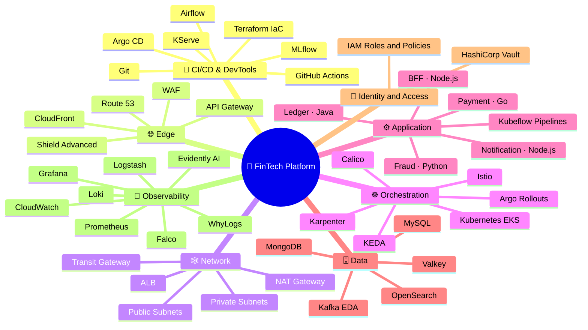

### 🏛️ Regional Architecture: 4 VPCs on AWS

<div align="center">


<sub>🎬 Animated: request, response, Transit Gateway, data, metrics, GitOps, endpoint and egress traffic.</sub>

</div>

| VPC | What runs there | How it connects |
|---|---|---|
| 🚪 **VPC A · Edge** `10.10.0.0/16` | Route 53 · CloudFront · WAF + Shield Advanced · API Gateway | Internet-facing. API Gateway forwards to the app VPC's ALB (VPC Link via Transit Gateway) |
| ⚙️ **VPC B · App** `10.20.0.0/16` | ALB → Amazon EKS: BFF, Payment, Ledger, Fraud, Notification services · KServe · Airflow · Kubeflow · Istio · Calico · KEDA · Karpenter | Transit Gateway to data and ops · VPC endpoints to ECR and S3 · NAT Gateway for outbound calls |
| 🗄️ **VPC C · Data** `10.30.0.0/16` | MySQL · Valkey · Kafka · MongoDB · OpenSearch | Private only. Reached through the Transit Gateway · VPC endpoints to KMS and S3 |
| 🛠️ **VPC D · Ops** `10.40.0.0/16` | Prometheus · Grafana · Argo CD · HashiCorp Vault · Kubeflow · MLflow | Scrapes metrics and syncs GitOps through the Transit Gateway · VPC endpoint to S3 · NAT for alerting |
| 🔀 **Transit Gateway** | Hub for all 4 VPCs | `10.0.0.0/8 → TGW` in every route table |
| ☁️ **Shared AWS services** | Amazon ECR · Amazon S3 · AWS KMS | Reached privately through VPC endpoints, never over the internet |

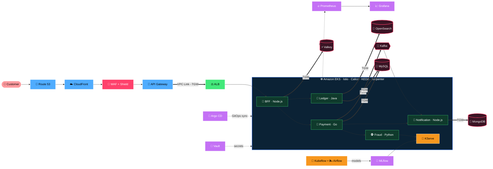

---

## 🏗️ High-Level Architecture

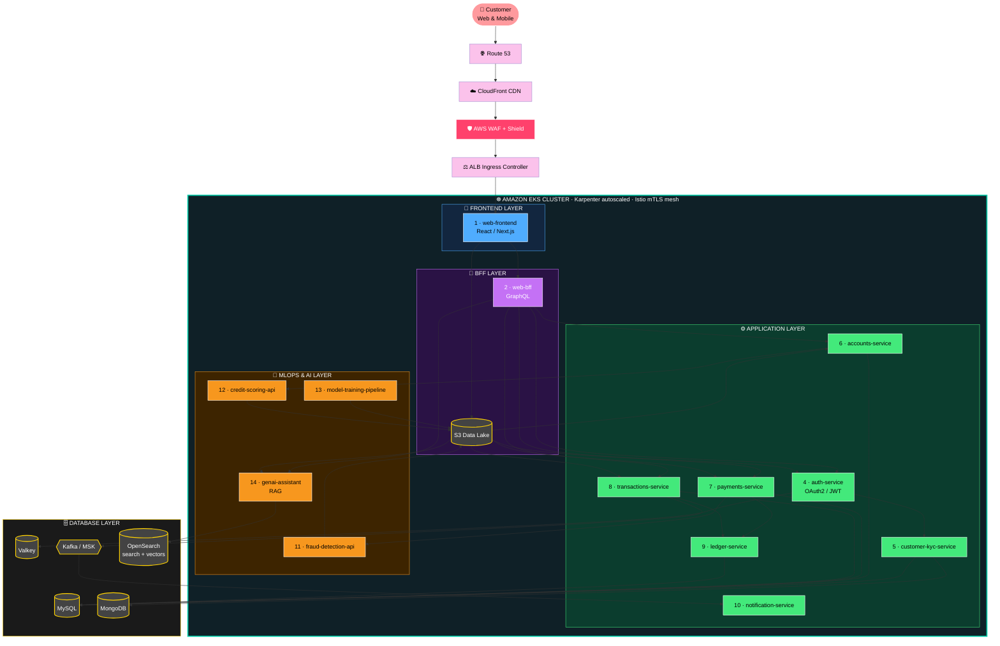

---

## 🚦 Live Traffic Flow

<div align="center">


<sub>🎬 Animated: every moving dot is a real traffic type travelling through the network.</sub>

</div>

### 🛣️ Hop by hop: one payment request through the network

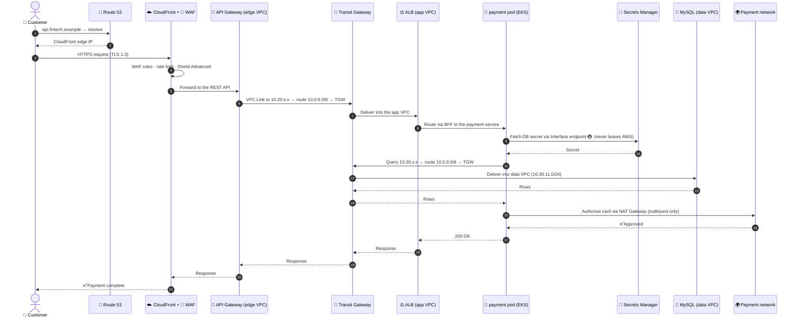

### 🧭 How a packet picks its path (route table decision)

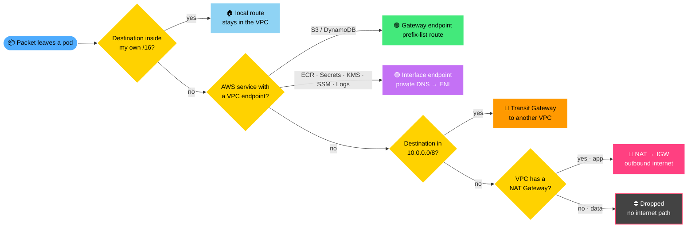

### 🛡️ Security checkpoints on the way in

```mermaid
flowchart LR
    A[👤 Internet]:::i --> B[🛡️ Shield<br/>DDoS]:::s1 --> C[🧱 WAF<br/>OWASP rules]:::s2 --> D[🔒 TLS<br/>CloudFront]:::s3 --> E[🚪 Public SG<br/>443 only]:::s4 --> F[⚖️ ALB<br/>listener rules]:::s5 --> G[🔀 TGW<br/>10.0.0.0/8]:::s6 --> H[🔐 Private SG<br/>allowed CIDRs]:::s7 --> I[🕸️ Istio mTLS<br/>AuthZ policy]:::s8 --> J[💸 Service]:::ok

    classDef i fill:#ff9a9e,color:#000
    classDef s1 fill:#ff416c,color:#fff
    classDef s2 fill:#ff6a3d,color:#fff
    classDef s3 fill:#f7971e,color:#000
    classDef s4 fill:#ffd200,color:#000
    classDef s5 fill:#84fab0,color:#000
    classDef s6 fill:#ff9900,color:#000
    classDef s7 fill:#4facfe,color:#000
    classDef s8 fill:#c471f5,color:#fff
    classDef ok fill:#43e97b,color:#000,stroke:#fff,stroke-width:3px
```

---

## 🧩 The 14 Microservices

<div align="center">

| # | Service | Layer | Responsibility | Stack | Data Store |
|:-:|---|:-:|---|---|---|
| 1 | 🎨 **web-frontend** | Frontend | Customer web UI | React, Next.js | CDN / S3 |
| 2 | 🔀 **web-bff** | BFF | Aggregates APIs for web | Node.js, GraphQL | Valkey |
| 3 | 📱 **mobile-bff** | BFF | Aggregates APIs for mobile | Node.js, REST | Valkey |
| 4 | 🔑 **auth-service** | App | Login, OAuth2, JWT, MFA | Java / Spring Boot | Valkey, MySQL |
| 5 | 🪪 **customer-kyc-service** | App | Onboarding and KYC checks | Python / FastAPI | MongoDB |
| 6 | 🏦 **accounts-service** | App | Accounts and balances | Java / Spring Boot | MySQL |
| 7 | 💸 **payments-service** | App | Payment initiation and orchestration | Go | MySQL, Kafka |
| 8 | 🔁 **transactions-service** | App | Transaction history and events | Go | MySQL, Kafka, OpenSearch |
| 9 | 📒 **ledger-service** | App | Double-entry ledger | Java / Spring Boot | MySQL |
| 10 | 🔔 **notification-service** | App | Email, SMS and push | Node.js | Kafka, MongoDB |
| 11 | 🕵️ **fraud-detection-api** | ML | Real-time fraud scoring | Python, KServe | S3 / MLflow |
| 12 | 📊 **credit-scoring-api** | ML | Credit risk prediction | Python, KServe | S3 / MLflow |
| 13 | 🏋️ **model-training-pipeline** | ML | Feature engineering, training, evaluation | Airflow, MLflow, Kubeflow | S3, Feast |
| 14 | 🧠 **genai-assistant** | AI | RAG assistant with guardrails | Python, LangChain, Bedrock | OpenSearch (vectors) |

</div>

> Languages and frameworks above are the target design and may change as the services are built.

### 🕸️ Service Dependency Map

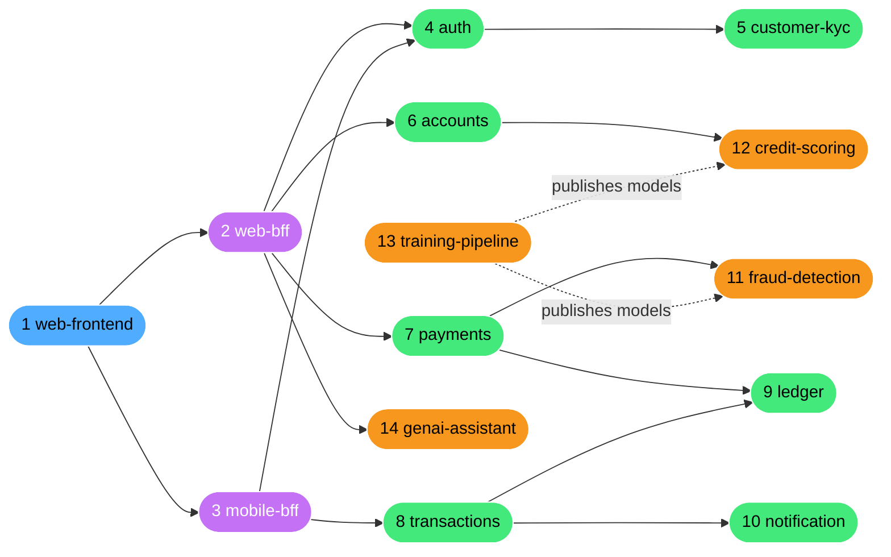

---

## ☁️ AWS Infrastructure Layout

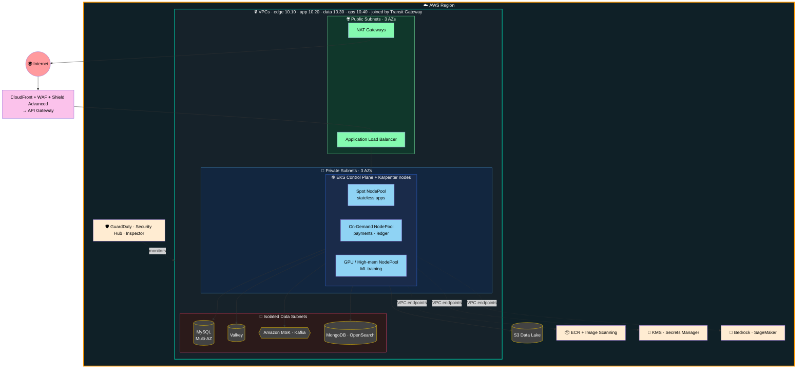

---

## 💸 Request Flow: Making a Payment

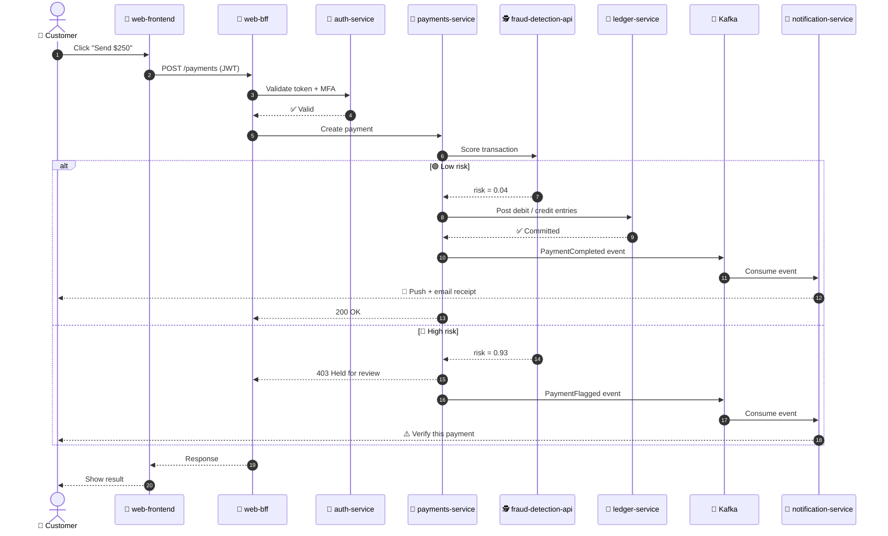

---

## 🧱 Platform Layers

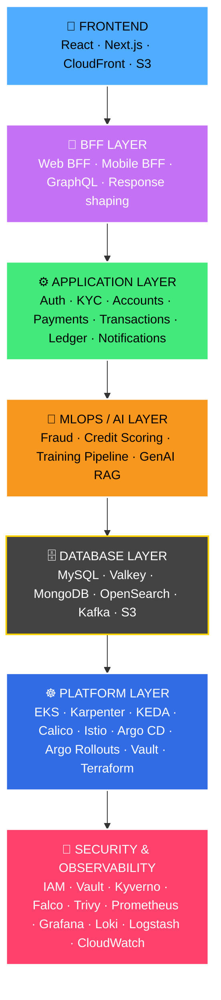

---

## 🔐 DevSecOps Pipeline

```mermaid
flowchart LR
    DEV[👨‍💻 Commit]:::s0 --> PRE[🪝 pre-commit<br/>Gitleaks]:::s1
    PRE --> SAST[🔍 SAST<br/>SonarQube · Semgrep]:::s1
    SAST --> SCA[📦 SCA<br/>Trivy · Snyk]:::s1
    SCA --> BUILD[🐳 Docker Build]:::s2
    BUILD --> SCAN[🛡️ Image Scan<br/>Trivy · Grype]:::s3
    SCAN --> SBOM[📄 SBOM + Sign<br/>Syft · Cosign]:::s4
    SBOM --> IAC[🏗️ IaC Scan<br/>Checkov · tfsec]:::s1
    IAC --> GIT[📂 GitOps Repo]:::s2
    GIT --> ARGO[🐙 ArgoCD]:::s5
    ARGO --> ADM[🚧 Admission<br/>Kyverno · OPA]:::s3
    ADM --> RUN[☸️ EKS Runtime]:::s6
    RUN --> FALCO[🦅 Falco]:::s7
    RUN --> DAST[🧪 DAST<br/>OWASP ZAP]:::s1
    FALCO --> SIEM[📊 SIEM / Alerts]:::s7

    classDef s0 fill:#4facfe,color:#000
    classDef s1 fill:#f7971e,color:#000
    classDef s2 fill:#43e97b,color:#000
    classDef s3 fill:#ff416c,color:#fff
    classDef s4 fill:#c471f5,color:#fff
    classDef s5 fill:#ef7b4d,color:#fff
    classDef s6 fill:#326ce5,color:#fff
    classDef s7 fill:#00c9a7,color:#000
```

---

## 🚀 GitOps & Delivery

```mermaid
flowchart LR
    subgraph CI["🛠️ CI · GitHub Actions"]
        A1[Lint + Test]:::ci --> A2[Build Image]:::ci --> A3[Scan + Sign]:::ci --> A4[Push to ECR]:::ci
    end
    subgraph GO["📂 GitOps Repo"]
        B1[Helm values / Kustomize]:::git
    end
    subgraph CD["🐙 CD · ArgoCD"]
        C1[App of Apps]:::cd --> C2[Argo Rollouts<br/>Canary / Blue-Green]:::cd
    end
    subgraph ENV["☸️ Environments"]
        D1[dev]:::env --> D2[staging]:::env --> D3[prod]:::env
    end

    A4 -->|update tag| B1
    B1 -->|sync| C1
    C2 --> D1
    D3 -.->|metrics gate| C2

    classDef ci fill:#4facfe,color:#000
    classDef git fill:#f7971e,color:#000
    classDef cd fill:#ef7b4d,color:#fff
    classDef env fill:#43e97b,color:#000
    style CI fill:#12263f,stroke:#4facfe,color:#fff
    style GO fill:#3d2400,stroke:#f7971e,color:#fff
    style CD fill:#3a1a10,stroke:#ef7b4d,color:#fff
    style ENV fill:#0b3d2e,stroke:#43e97b,color:#fff
```

---

## 🛡️ Defence in Depth

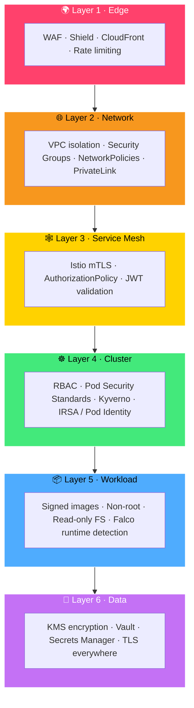

---

## 🤖 MLOps Lifecycle

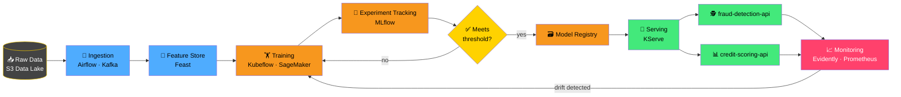

### 🔁 Model Lifecycle States

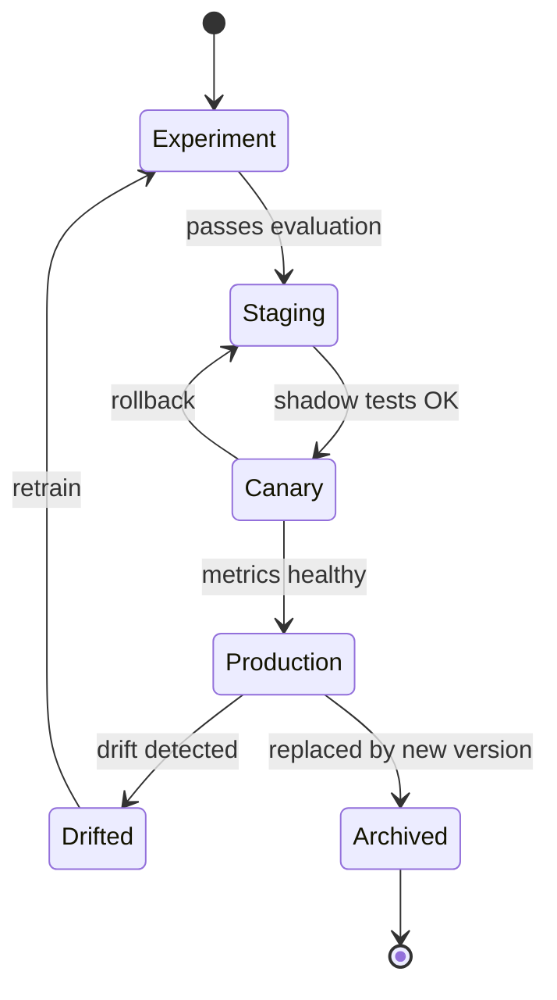

---

## 🧠 AI / GenAI Capabilities

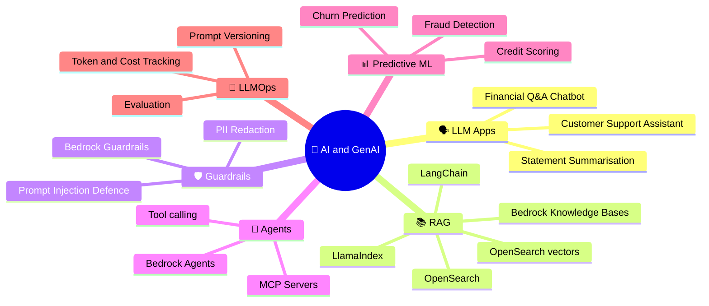

### 🧠 GenAI Assistant Flow (RAG)

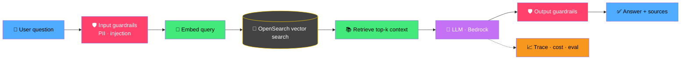

---

## 📊 Observability

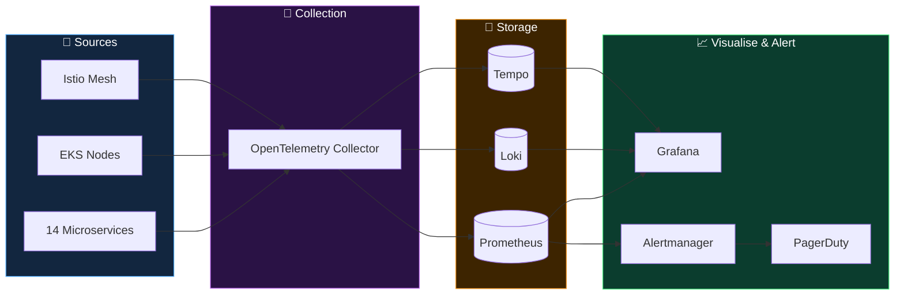

---

## 🧰 Tech Stack

### ☁️ AWS Infrastructure
| Area | Tools |
|---|---|
| **Compute / Containers** | Amazon EKS, **Karpenter**, **KEDA**, Fargate, ECR, EC2 Spot |
| **Networking** | VPC, Public/Private Subnets, NAT Gateway, Transit Gateway, VPC Endpoints / PrivateLink, Route 53, CloudFront, **API Gateway (REST)**, ALB/NLB |
| **Data** | **MySQL**, **Valkey**, **MongoDB**, **OpenSearch**, **Kafka / MSK** (event-driven), S3, DynamoDB |
| **Security** | IAM (roles, policies), IRSA / Pod Identity, KMS, Secrets Manager, GuardDuty, Security Hub, WAF, **Shield Advanced**, Inspector, Config |
| **Observability** | **CloudWatch**, X-Ray, Managed Prometheus, Managed Grafana |
| **AI / ML** | Bedrock, SageMaker, Comprehend, Textract |

### ☸️ Orchestration
| Area | Tools |
|---|---|
| **Kubernetes** | Amazon EKS, Karpenter (node autoscaling), KEDA (event-driven pod autoscaling) |
| **Networking & mesh** | **Calico** (network policy), **Istio** (mTLS, traffic management) |
| **Progressive delivery** | **Argo Rollouts** (canary, blue-green) |

### 🧑‍💻 Application Languages
| Service | Language |
|---|---|
| BFF · Notification | **Node.js** |
| Payment · Transactions | **Go** |
| Ledger · Auth · Accounts | **Java** (Spring Boot) |
| Fraud · KYC · ML · GenAI | **Python** |

### 🏗️ Infrastructure as Code & GitOps
| Area | Tools |
|---|---|
| **Source & IaC** | **Git**, **Terraform**, Terragrunt, Crossplane |
| **GitOps** | ArgoCD, Argo Rollouts, Argo Workflows, Helm, Kustomize |
| **CI/CD** | GitHub Actions, Jenkins, Tekton |

### 🛡️ DevSecOps
| Area | Tools |
|---|---|
| **Identity & Secrets** | AWS IAM, **HashiCorp Vault**, External Secrets Operator, Gitleaks |
| **SAST / DAST** | SonarQube, Semgrep, OWASP ZAP |
| **Container / Supply chain** | Trivy, Grype, Syft (SBOM), **Cosign**, SLSA |
| **IaC scanning** | Checkov, tfsec, KICS |
| **Policy** | **Kyverno**, OPA Gatekeeper, Pod Security Standards |
| **Runtime** | Falco, Tetragon, Istio mTLS, Network Policies, Cilium |
| **Compliance** | PCI-DSS, SOC 2, CIS Benchmarks (kube-bench) |

### 📊 Observability & Reliability
Prometheus · Grafana · Loki · **Logstash** · **Falco** · **CloudWatch** · Tempo · OpenTelemetry · Alertmanager · PagerDuty · SLO/SLI · Chaos Mesh · Velero · k6

### 🤖 MLOps & AI
MLflow · Kubeflow (ML Pipelines) · KServe · Airflow · Feast · **Evidently AI** · **WhyLogs** · SageMaker · Bedrock · LangChain · LlamaIndex · OpenSearch (vectors) · Ray

---

## 📈 Skill Coverage

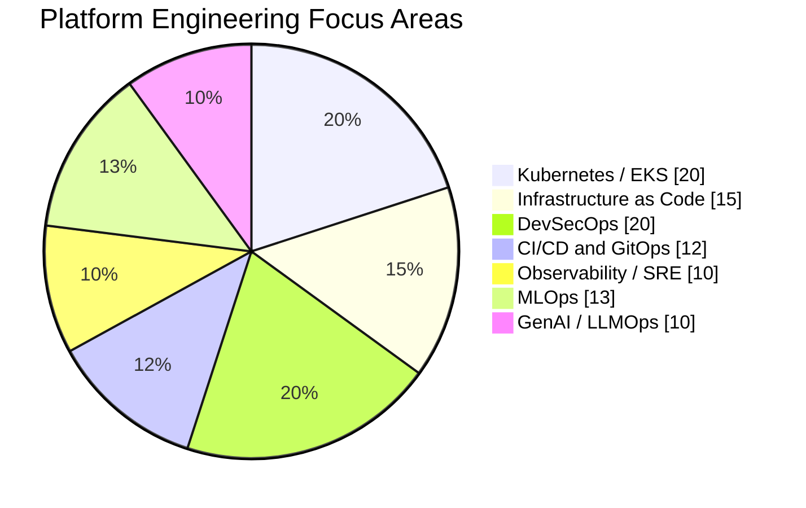

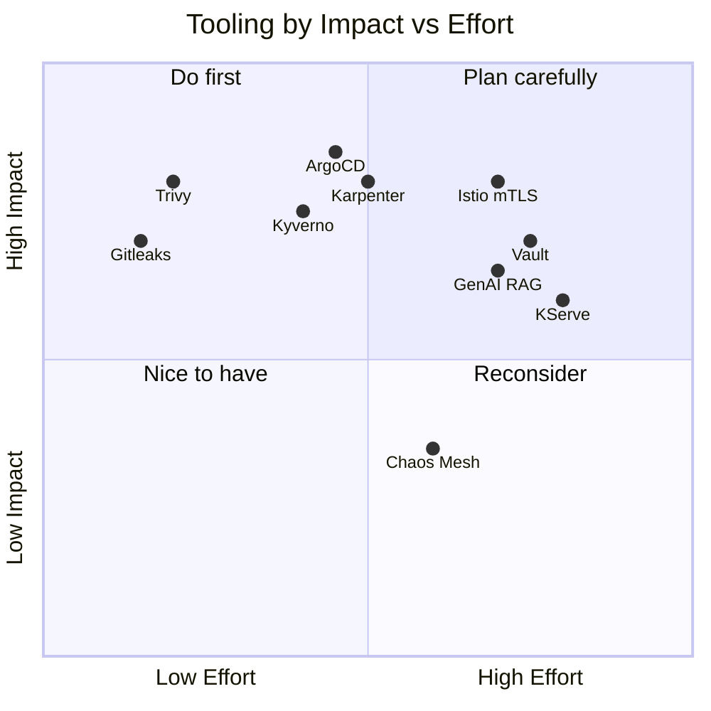

---

## 🏗️ Infrastructure Build: Networking & IAM

<div align="center">

[](https://git.io/typing-svg)


</div>

This section documents what has been **built so far** in `infra-modules/`.

### 🧭 Build Journey

```mermaid
timeline
    title Infrastructure work completed
    State backend : S3 state bucket : Encrypted state : Native S3 lock file (no DynamoDB)
    IAM : Reusable child module : Platform, App team and CI/CD roles : One root stack per environment (ops, qa, uat, prod)
    Networking : Reusable network module : 4 VPCs from one for_each : Gateway + Interface VPC endpoints
    Connectivity : Transit Gateway hub : Subnets round-robin across 3 AZs : Corrected CIDRs 10.10 to 10.40
    Hardening : Fixed SG and AZ bugs : Private SG limited to VPC CIDR : Pinned latest Terraform, provider and module versions
```

---

### 🌐 Networking: 4 VPCs + Transit Gateway

One reusable module (`prod/Networking/network/`) is called **once per VPC** from the root module with `for_each`. Each VPC gets its own subnets, route tables, security groups and VPC endpoints. A **Transit Gateway** (`transit_gateway.tf`) joins them all.

<div align="center">


</div>

```mermaid
flowchart TB
    INET((🌍 Internet)):::net

    subgraph REGION["☁️ AWS us-east-1 · AZs 1a · 1b · 1c"]
        direction TB

        subgraph EDGE["🚪 EDGE · 10.10.0.0/16"]
            EIGW[🌐 IGW]:::gw
            EPUB[public 10.10.1-3.0/24<br/>🔌 API Gateway · WAF]:::pub
            EPRIV[private 10.10.11-13.0/24]:::priv
        end

        subgraph APP["⚙️ APP · 10.20.0.0/16"]
            AIGW[🌐 IGW]:::gw
            ANAT[🔁 NAT Gateway]:::gw
            APUB[public 10.20.1-3.0/24<br/>⚖️ ALB]:::pub
            ACP[EKS control plane<br/>10.20.11-13.0/24]:::priv
            ADP[EKS data plane<br/>10.20.21-23.0/24]:::priv
        end

        subgraph DATA["🗄️ DATA · 10.30.0.0/16 · no internet"]
            DDB[MySQL · MongoDB · OpenSearch<br/>10.30.11-13.0/24]:::priv
            DKF[Kafka + Valkey<br/>10.30.21-23.0/24]:::priv
        end

        subgraph OPS["🛠️ OPS · 10.40.0.0/16"]
            OIGW[🌐 IGW]:::gw
            OPUB[public 10.40.1-3.0/24]:::pub
            OPRIV[Prometheus · Grafana · Argo<br/>Vault · Kubeflow · MLflow<br/>10.40.11-13.0/24]:::priv
        end

        TGW{{"🔀 TRANSIT GATEWAY<br/>10.0.0.0/8"}}:::tgw

        subgraph AWS["🔒 AWS services via VPC endpoints"]
            S3[(🪣 S3)]:::gwep
            DYN[(⚡ DynamoDB)]:::gwep
            ECR[📦 ECR]:::ifep
            SEC[🔑 Secrets · 📜 Logs]:::ifep
            KMS[🔐 KMS]:::ifep
            SSM[🖥️ SSM]:::ifep
        end
    end

    INET <--> EIGW --- EPUB
    INET <--> AIGW
    INET <--> OIGW --- OPUB
    ADP -->|outbound| ANAT --> AIGW

    EPRIV <==> TGW
    ACP <==> TGW
    ADP <==> TGW
    DDB <==> TGW
    DKF <==> TGW
    OPRIV <==> TGW

    ADP -.-> S3 & ECR & SEC
    DDB -.-> S3 & DYN & KMS
    OPRIV -.-> S3 & SSM

    classDef net fill:#ff9a9e,stroke:#fff,color:#000,stroke-width:2px
    classDef gw fill:#ff9900,stroke:#fff,color:#000
    classDef pub fill:#84fab0,stroke:#0b3d2e,color:#000
    classDef priv fill:#8fd3f4,stroke:#12263f,color:#000
    classDef tgw fill:#ff7a00,stroke:#ffd200,color:#000,stroke-width:3px
    classDef gwep fill:#43e97b,stroke:#fff,color:#000,stroke-width:2px
    classDef ifep fill:#c471f5,stroke:#fff,color:#fff,stroke-width:2px

    style REGION fill:#0f2027,stroke:#ff9900,color:#fff,stroke-width:3px
    style EDGE fill:#10372b,stroke:#84fab0,color:#fff,stroke-width:2px
    style APP fill:#12263f,stroke:#4facfe,color:#fff,stroke-width:2px
    style DATA fill:#2b1a1a,stroke:#ff416c,color:#fff,stroke-width:2px
    style OPS fill:#2a1245,stroke:#c471f5,color:#fff,stroke-width:2px
    style AWS fill:#1a1a1a,stroke:#ffd200,color:#fff,stroke-width:2px
```

> 🟠 thick arrows = **Transit Gateway** · 🟢/🟣 dotted arrows = **VPC endpoints** · 🌐 = Internet Gateway

| VPC | CIDR | Public subnets | Private subnets | NAT | Gateway endpoints | Interface endpoints |
|---|---|:-:|:-:|:-:|---|---|
| 🚪 **edge** | `10.10.0.0/16` | 3 | 3 | – | s3 | – |
| ⚙️ **app** | `10.20.0.0/16` | 3 | 6 (EKS control + data plane) | ✅ | s3 | ecr.api, ecr.dkr, logs, secretsmanager |
| 🗄️ **data** | `10.30.0.0/16` | – | 6 (DBs + Kafka/Valkey) | – | s3, dynamodb | kms |
| 🛠️ **ops** | `10.40.0.0/16` | 3 | 3 | – | s3 | ssm, ssmmessages, ec2messages |

**In simple words:**
- 🏢 Each **VPC is a separate building** with its own address range. The `10.10 / 10.20 / 10.30 / 10.40` CIDRs never overlap, so they can all be joined.
- 🔀 The **Transit Gateway is the central hub** that connects the buildings. Every private route table has one route, `10.0.0.0/8 → TGW`, and traffic inside a VPC stays local because its own `/16` is more specific.
- 🌐 **Public subnets** face the internet through an **Internet Gateway**.
- 🔐 **Private subnets** can't be reached from outside. Apps, databases and monitoring live here.
- 🔁 **NAT Gateway** (app): pods can call out, for example to a payment network, but nothing can come in.
- 🚇 **VPC endpoints** are private tunnels to AWS services, so ECR, S3, Secrets Manager and KMS are reached **without the internet**.
- 🗄️ The **data VPC has no internet path at all**. It's reachable only through the TGW.
- 🏗️ Subnets go **round-robin across 3 AZs** (1a → 1b → 1c → 1a …), so 6 subnets give 2 per AZ, and the first 3 (one per AZ) host the TGW attachment and endpoint ENIs.

#### 🔀 How the root module creates all 4 VPCs

```mermaid
flowchart LR
    L["📄 locals.tf<br/>vpcs = { edge, app, data, ops }"]:::loc --> M{"🔁 module network<br/>for_each = local.vpcs"}:::mod
    M --> E["🚪 module.network[edge]"]:::edge
    M --> A["⚙️ module.network[app]"]:::app
    M --> D["🗄️ module.network[data]"]:::data
    M --> O["🛠️ module.network[ops]"]:::ops
    E & A & D & O --> R["📦 Each instance creates:<br/>VPC · subnets · route tables<br/>SGs · NAT/IGW if public<br/>Gateway + Interface endpoints"]:::res
    R --> T["🔀 transit_gateway.tf<br/>attach + route every VPC<br/>(for_each = local.vpcs)"]:::tgw

    classDef loc fill:#ffd200,stroke:#fff,color:#000,stroke-width:2px
    classDef mod fill:#7B42BC,stroke:#fff,color:#fff,stroke-width:2px
    classDef edge fill:#84fab0,stroke:#fff,color:#000
    classDef app fill:#4facfe,stroke:#fff,color:#000
    classDef data fill:#ff416c,stroke:#fff,color:#fff
    classDef ops fill:#c471f5,stroke:#fff,color:#fff
    classDef res fill:#0f2027,stroke:#00c9a7,color:#fff,stroke-width:2px
    classDef tgw fill:#ff7a00,stroke:#ffd200,color:#000,stroke-width:2px
```

#### 🚇 VPC endpoints: Gateway vs Interface

```mermaid
flowchart LR
    subgraph GW["🟢 Gateway endpoint · S3 / DynamoDB · FREE"]
        direction LR
        P1[🖥️ Private workload]:::wl --> RT[🗺️ Private route table<br/>prefix list → vpce]:::rt --> G[(🪣 S3 / DynamoDB)]:::svc
    end
    subgraph IF["🟣 Interface endpoint · ECR, Secrets, KMS, SSM, Logs"]
        direction LR
        P2[🖥️ Private workload]:::wl -->|DNS: service.us-east-1.amazonaws.com| DNS[🔎 Private DNS<br/>→ endpoint private IP]:::dns
        DNS --> SG[🛡️ Endpoint SG<br/>443 from VPC CIDR]:::sg --> ENI[🔌 ENI in each AZ<br/>1a · 1b · 1c]:::eni --> I[☁️ AWS service]:::svc
    end

    classDef wl fill:#4facfe,stroke:#fff,color:#000
    classDef rt fill:#43e97b,stroke:#fff,color:#000
    classDef dns fill:#ffd200,stroke:#fff,color:#000
    classDef sg fill:#ff416c,stroke:#fff,color:#fff
    classDef eni fill:#c471f5,stroke:#fff,color:#fff
    classDef svc fill:#ff9900,stroke:#fff,color:#000,stroke-width:2px
    style GW fill:#0b3d2e,stroke:#43e97b,color:#fff,stroke-width:2px
    style IF fill:#2a1245,stroke:#c471f5,color:#fff,stroke-width:2px
```

**How the endpoint code works** (`network/main.tf`):

| Resource | What it does |
|---|---|
| `data.aws_region.current` | Reads the provider's region, so endpoint names are never hardcoded |
| `aws_vpc_endpoint.gateway` | `for_each = toset(var.gateway_endpoints)` creates one free Gateway endpoint per service and attaches it to the private route tables |
| `aws_security_group.endpoint_sg` | Created only if `interface_endpoints` isn't empty. Allows HTTPS 443 from the VPC CIDR |
| `aws_vpc_endpoint.interface` | `for_each = toset(var.interface_endpoints)` places an ENI in the first private subnet of each AZ (`private_subnet_ids_per_az`). `private_dns_enabled = true` means application code needs **no changes** |

```hcl
# Per-VPC input: just two simple lists
gateway_endpoints   = ["s3", "dynamodb"]
interface_endpoints = ["secretsmanager", "kms"]
```

#### 🔀 Transit Gateway: how VPCs talk to each other

```mermaid
sequenceDiagram
    autonumber
    participant POD as ⚙️ app pod 10.20.21.15
    participant ART as 🗺️ app private route table
    participant TGW as 🔀 Transit Gateway
    participant TRT as 📋 TGW route table
    participant DB as 🐬 MySQL 10.30.11.20

    POD->>ART: Send to 10.30.11.20
    ART->>ART: 10.20.0.0/16 local? ✖ · 10.0.0.0/8 → TGW ✅
    ART->>TGW: Forward via app attachment
    TGW->>TRT: Look up 10.30.11.20
    TRT-->>TGW: 10.30.0.0/16 → data attachment (propagated)
    TGW->>DB: Deliver into data VPC
    DB-->>TGW: Reply to 10.20.21.15
    TGW-->>POD: 10.20.0.0/16 → app attachment
    Note over POD,DB: Routing opens the path · security groups still decide what is allowed
```

| Block (`transit_gateway.tf`) | What it does |
|---|---|
| `aws_ec2_transit_gateway.main` | The hub router. Every attachment auto-associates and auto-propagates its CIDR |
| `aws_ec2_transit_gateway_vpc_attachment.vpc` | `for_each = local.vpcs` plugs every VPC in using one private subnet per AZ |
| `aws_route.private_to_tgw` | `10.0.0.0/8 → TGW` in every private route table |
| `aws_route.public_to_tgw` | The same route in public route tables (edge, app, ops) |

> ➕ **Reusable:** add a VPC to `locals.tf` and it's created, attached to the TGW and routed automatically.

#### 📦 What one `terraform apply` creates

| Resource | Count |
|---|:-:|
| VPCs | 4 |
| Subnets (9 public + 18 private) | 27 |
| Route tables (3 public + 4 private) | 7 |
| Internet Gateways / NAT Gateway / Elastic IP | 3 / 1 / 1 |
| Security groups (public, private, endpoint) | 10 |
| Gateway endpoints | 5 |
| Interface endpoints | 8 |
| Transit Gateway / attachments / TGW routes | 1 / 4 / 7 |

> 💰 **Cost note:** Gateway endpoints are free. Interface endpoints cost about $7.30 per AZ per month each (8 × 3 AZs ≈ $175 per month), the NAT Gateway about $33 per month, and TGW attachments about $36 per month each (≈ $146 per month), all before data charges.

---

### 🔐 IAM: Least-Privilege Roles per Environment

A **child module** (`iam/child-module/`) wraps `terraform-aws-modules/iam/aws//modules/iam-role` **v6.8.2** and defines three roles. Each **environment stack** (`iam/environments/*`) turns on only the roles it needs, using feature flags.

```mermaid
flowchart TB
    CM{{"🧩 iam/child-module<br/>terraform-aws-modules/iam 6.8.2"}}:::mod

    subgraph ROLES["🎭 Roles defined in the child module"]
        direction LR
        R1["👑 FinTech-Platform-Admin<br/>VPC + RDS full · eks:* · KMS manage<br/>⛔ DENY s3:GetObject, dynamodb:GetItem,<br/>rds-db:connect, kms:Decrypt (PII guard)"]:::plat
        R2["👩‍💻 AppTeam-env-Role<br/>qa: eks/rds/ecr full<br/>uat/prod: read-only + rds-db:connect env_user<br/>⛔ DENY delete VPC/Subnet/TGW, terminate EC2"]:::prod
        R3["🤖 FinTech-CI-CD-Deployer-env<br/>GitHub OIDC trust (this repo only)<br/>ECR push · EKS update · Secrets read"]:::cicd
    end

    CM --> R1 & R2 & R3

    subgraph ENVS["🌍 Environment stacks"]
        direction LR
        OPS["🛠️ product-ops-role<br/>enable_platform_role"]:::env
        QA["🧪 product-qa-role<br/>enable_product_role<br/>enable_cicd_role"]:::env
        UAT["🧷 product-uat-role<br/>enable_product_role<br/>enable_cicd_role"]:::env
        PRD["🏦 product-prod-role<br/>enable_product_role<br/>enable_cicd_role"]:::env
    end

    OPS -.-> R1
    QA -.-> R2 & R3
    UAT -.-> R2 & R3
    PRD -.-> R2 & R3

    classDef mod fill:#7B42BC,stroke:#fff,color:#fff,stroke-width:2px
    classDef plat fill:#ff9900,stroke:#fff,color:#000
    classDef prod fill:#4facfe,stroke:#fff,color:#000
    classDef cicd fill:#43e97b,stroke:#fff,color:#000
    classDef env fill:#0f2027,stroke:#00c9a7,color:#fff,stroke-width:2px
    classDef warn fill:#3a1a10,stroke:#ff416c,color:#fff,stroke-width:2px,stroke-dasharray: 5 5
    style ROLES fill:#16222a,stroke:#ffd200,color:#fff,stroke-width:2px
    style ENVS fill:#12263f,stroke:#4facfe,color:#fff,stroke-width:2px
```

#### 🤖 How GitHub Actions gets AWS access (no stored keys)

```mermaid
sequenceDiagram
    autonumber
    participant GH as 🐙 GitHub Actions
    participant OIDC as 🎫 GitHub OIDC
    participant STS as 🔐 AWS STS
    participant ROLE as 🤖 CI-CD-Deployer role
    participant AWS as ☁️ ECR / EKS

    GH->>OIDC: Request ID token for this job
    OIDC-->>GH: JWT (sub = repo:muntaha747/FinTech-Enterprise-Project:*)
    GH->>STS: AssumeRoleWithWebIdentity(JWT)
    STS->>ROLE: Check trust policy condition on sub
    alt ✅ Repo matches
        STS-->>GH: Short-lived credentials
        GH->>AWS: Push image / update cluster
    else ⛔ Any other repo
        STS-->>GH: AccessDenied
    end
```

---

### 🗃️ Multi State Files in One Remote Backend

Every stack keeps its **own state file** inside a single encrypted S3 bucket, **`fintech-project-statefile-bucket`**. Locking uses Terraform's **native S3 lock file** (`use_lockfile = true`), so no DynamoDB table is needed.

<div align="center">


</div>

**Why split the state?**
- 💥 **Smaller blast radius:** a bad apply on QA IAM can't touch prod networking.
- ⚡ **Faster plans:** each stack only refreshes its own resources.
- 🔒 **Parallel work:** different teams or pipelines lock different files.
- 🧑‍⚖️ **Access control:** bucket policies can restrict who reads which prefix.

```mermaid
flowchart LR
    subgraph STACKS["📂 Terraform root stacks"]
        direction TB
        N["🌐 prod/Networking"]:::net
        I1["🛠️ iam/product-ops-role"]:::iam
        I2["🧪 iam/product-qa-role"]:::iam
        I3["🧷 iam/product-uat-role"]:::iam
        I4["🏦 iam/product-prod-role"]:::iam
        S1["🪣 qa/s3"]:::s3
        S2["🪣 stage/s3"]:::s3
        S3["🪣 prod/s3"]:::s3
    end

    subgraph BUCKET["🔐 s3://fintech-project-statefile-bucket · encrypted · native lock"]
        direction TB
        K1["product-networking/envs/prod/networking.tfstate"]:::kn
        K2["product-iam/envs/iam-ops-role.tfstate"]:::ki
        K3["product-iam/envs/iam-qa-role.tfstate"]:::ki
        K4["product-iam/envs/iam-uat-role.tfstate"]:::ki
        K5["product-iam/envs/iam-prod-role.tfstate"]:::ki
        K6["product-name/envs/qa/s3.tfstate"]:::ks
        K7["product-name/envs/stage/s3.tfstate"]:::ks
        K8["product-name/envs/prod/s3.tfstate"]:::ks
    end

    N --> K1
    I1 --> K2
    I2 --> K3
    I3 --> K4
    I4 --> K5
    S1 --> K6
    S2 --> K7
    S3 --> K8

    classDef net fill:#4facfe,stroke:#fff,color:#000
    classDef iam fill:#ff9900,stroke:#fff,color:#000
    classDef s3 fill:#43e97b,stroke:#fff,color:#000
    classDef kn fill:#12263f,stroke:#4facfe,color:#fff
    classDef ki fill:#3d2400,stroke:#ff9900,color:#fff
    classDef ks fill:#0b3d2e,stroke:#43e97b,color:#fff
    style STACKS fill:#0f2027,stroke:#00c9a7,color:#fff,stroke-width:2px
    style BUCKET fill:#1a1a1a,stroke:#ffd200,color:#fff,stroke-width:3px
```

| Stack | State key |
|---|---|
| 🌐 prod/Networking | `product-networking/envs/prod/networking.tfstate` |
| 🛠️ iam/product-ops-role | `product-iam/envs/iam-ops-role.tfstate` |
| 🧪 iam/product-qa-role | `product-iam/envs/iam-qa-role.tfstate` |
| 🧷 iam/product-uat-role | `product-iam/envs/iam-uat-role.tfstate` |
| 🏦 iam/product-prod-role | `product-iam/envs/iam-prod-role.tfstate` |
| 🪣 qa/s3 | `product-name/envs/qa/s3.tfstate` |
| 🪣 stage/s3 | `product-name/envs/stage/s3.tfstate` |
| 🪣 prod/s3 | `product-name/envs/prod/s3.tfstate` |

#### 🔒 How native S3 locking protects state

```mermaid
sequenceDiagram
    autonumber
    actor A as 👩‍💻 Engineer A
    actor B as 👨‍💻 Engineer B
    participant S3 as 🪣 S3 state bucket

    A->>S3: terraform apply → create networking.tfstate.tflock
    S3-->>A: 🔒 Lock acquired
    B->>S3: terraform apply (same stack)
    S3-->>B: ⛔ Error acquiring the state lock
    A->>S3: Write new networking.tfstate (encrypted)
    A->>S3: Delete .tflock
    S3-->>A: 🔓 Lock released
    B->>S3: Retry → lock acquired ✅
```

---

### 📌 Pinned Versions

| Component | Version | Where |
|---|---|---|
| Terraform | `>= 1.17.1` | every `versions.tf` + CI (`terraform_version: "1.17.1"`) |
| AWS provider | `~> 6.72` (locked at 6.72.0) | every `versions.tf` + `.terraform.lock.hcl` |
| terraform-aws-modules/iam | `6.8.2` | `iam/child-module/main.tf` (all 3 roles) |

### ✅ Fixes Applied During the Build

- 🐞 `availability_zones.all.name` → `.names` (public subnets)
- 🐞 Restored the missing `resource "aws_security_group" "public"` header around dangling `dynamic` blocks
- 🐞 Variable typos: `sting` → `string`, `cidr_block` → `cidr_blocks`, `Environment` default `{}` → `"prod"`
- 🛡️ Private SG no longer hardcodes `0.0.0.0/0` ingress. Rules now come from the root module (VPC CIDR only)
- 🔁 VPC endpoint code rewritten: no hardcoded region, no fragile `slice()`, no `[0]` index crash, descriptions + tags added (clears the KICS findings)
- 📌 Pinned latest Terraform, AWS provider and IAM module versions everywhere
- 🗺️ CIDRs re-planned to `10.10 / 10.20 / 10.30 / 10.40` with edge subnets fixed to sit inside `10.10.0.0/16`
- 🏗️ Subnets now round-robin across 3 AZs, and TGW and endpoints use one subnet per AZ
- 🐞 `outputs.tf`: `aws.subnet` → `aws_subnet`, added CIDR, public subnet and route table outputs
- 🔐 `product-prod-role` now uses real module inputs (`enable_product_role`, `enable_cicd_role`)
- 🪣 `stage/s3` has its own state key, no longer sharing prod's

### 🚀 How to Deploy the Networking Stack

```bash
cd infra-modules/prod/Networking
terraform init -reconfigure          # connect to the S3 backend
terraform plan -out=network.tfplan   # review: 4 VPCs, 27 subnets, 13 endpoints, 1 TGW
terraform apply network.tfplan
```

### 🔜 Next Up

- [x] Transit Gateway connecting edge ↔ app ↔ data ↔ ops
- [x] Separate state key for `stage/s3`
- [x] Fix `product-prod-role` role flags
- [ ] VPC Flow Logs (PCI-DSS / SOC 2)
- [ ] Lock down the default security group (CIS 5.4)
- [ ] EKS subnet tags (`kubernetes.io/role/elb`, `internal-elb`)
- [ ] `default_tags` in the provider + unique route table names
- [ ] TGW segmentation (separate route tables so edge can't reach data directly)
- [ ] EKS + Karpenter in the app VPC

---

## 🗺️ Roadmap

```mermaid
gantt
    title Project Roadmap
    dateFormat  YYYY-MM-DD
    axisFormat  %b %Y
    section Foundation
    Repo, README, .gitignore          :done,    f1, 2026-11-01, 3d
    Terraform VPC + EKS + Karpenter   :active,  f2, 2026-11-04, 14d
    section Application
    Frontend + 2 BFFs                 :         a1, after f2, 21d
    7 core app microservices + MySQL  :         a2, after a1, 35d
    section DevSecOps
    CI/CD, scanning, signing          :         d1, after f2, 21d
    Kyverno, Falco, Vault, Istio      :         d2, after d1, 28d
    section GitOps and Observability
    ArgoCD + Rollouts                 :         g1, after d1, 14d
    Prometheus, Grafana, Loki, Tempo  :         g2, after g1, 21d
    section MLOps and AI
    Fraud and credit models + MLflow  :         m1, after a2, 28d
    Training pipeline + KServe        :         m2, after m1, 21d
    GenAI RAG assistant + guardrails  :         m3, after m2, 28d
```

```mermaid
timeline
    title Evolution of the Platform
    Phase 1 - Foundation : Repository and docs : Terraform VPC, EKS, Karpenter
    Phase 2 - Services : Frontend and BFFs : 7 application microservices : MySQL, Valkey, MongoDB, OpenSearch, Kafka
    Phase 3 - Security : CI/CD scanning and signing : Kyverno, Falco, Vault : Istio mTLS
    Phase 4 - Delivery : ArgoCD GitOps : Canary rollouts : Observability stack
    Phase 5 - Intelligence : MLOps pipeline : Fraud and credit scoring : GenAI RAG assistant
```

| Status | Item |
|:--:|---|
| ✅ | Repository scaffold, README, `.gitignore` |
| ✅ | Terraform remote backend: multi state files in S3 with native locking |
| ✅ | IAM: reusable child module + ops / qa / uat environment roles (GitHub OIDC for CI/CD) |
| ✅ | Networking: 4 VPCs (edge, app, data, ops) with Gateway + Interface VPC endpoints |
| ✅ | Transit Gateway hub · round-robin subnets across 3 AZs · module outputs |
| 🚧 | Flow Logs · default SG lockdown · EKS subnet tags · default tags |
| 🔜 | Terraform: EKS cluster, Karpenter |
| 🔜 | Frontend, 2 BFFs and 7 application microservices |
| 🔜 | CI/CD with scanning, SBOM and image signing |
| 🔜 | ArgoCD GitOps, Kyverno policies, Falco, Istio |
| 🔜 | Observability stack (Prometheus, Grafana, Loki, Tempo) |
| 🔜 | MLOps pipeline and 2 prediction APIs |
| 🔜 | GenAI assistant with RAG and guardrails |

---

## 📁 Repository Structure

```text
FinTech-Enterprise-Project/
├── .github/workflows/            # Terraform CI pipelines (GitHub OIDC → AWS)
├── docs/diagrams/                # animated SVG diagrams used in this README
├── infra-modules/
│   ├── iam/
│   │   ├── child-module/         # 3 roles via terraform-aws-modules/iam 6.8.2
│   │   └── environments/
│   │       ├── product-ops-role/ # platform admin role
│   │       ├── product-qa-role/  # app team + CI/CD roles
│   │       ├── product-uat-role/ # app team + CI/CD roles
│   │       └── product-prod-role/
│   ├── prod/
│   │   ├── Networking/           # root: backend, provider, locals (4 VPCs), module call, transit_gateway.tf
│   │   │   └── network/          # child: VPC, subnets, NAT, SGs, VPC endpoints
│   │   └── s3/
│   ├── qa/   (s3, EKS)
│   └── stage/ (s3)
├── .gitignore
└── README.md
```

---

<div align="center">

### 👩‍💻 Built by a DevOps engineer, for DevOps engineers

⭐ Star this repo to follow along as it grows.


</div>
