<div align="center">


[](https://git.io/typing-svg)


</div>

---

## 📑 Table of Contents

- [About](#-about-this-project)
- [Project Overview & Architecture](#%EF%B8%8F-project-overview--architecture)
- [Tech Stack](#-tech-stack)
- [Live Traffic Flow](#-live-traffic-flow)
- [Microservices](#-microservices)
- [Request Flow](#-request-flow-making-a-payment)
- [Security by Layer](#%EF%B8%8F-security-by-layer)
- [CI/CD & GitOps](#-cicd--gitops)
- [MLOps](#-mlops-lifecycle)
- [Observability](#-observability)
- [Infrastructure Build: Networking & IAM](#%EF%B8%8F-infrastructure-build-networking--iam)
- [Roadmap](#%EF%B8%8F-roadmap)

---

## 🌟 About This Project

> **This repository is a replica of the FinTech platform from my past projects and professional work experience.**

It is an **AWS FinTech platform on Amazon EKS** built from **6 infrastructure layers** (CI/CD & DevTools → Edge → Network → Orchestration → Application → Data) plus two cross-cutting pillars (**Identity & Access** and **Observability**). It runs across **4 VPCs** (edge, app, data, ops) joined by a **Transit Gateway**.

- 🌐 **Edge:** Route 53, CloudFront, WAF, Shield Advanced and API Gateway
- ⚙️ **Microservices:** **5** services on EKS: BFF (Node.js), Payment (Go), Ledger (Java), Fraud (Python) and Notification (Node.js)
- 🗄️ **Data:** MySQL, Valkey, MongoDB, OpenSearch and Kafka
- 🛠️ **Ops:** Prometheus, Grafana, Argo CD, Vault, Kubeflow and MLflow
- 🤖 **MLOps:** Airflow, Kubeflow, MLflow and KServe for fraud scoring, monitored by Evidently AI and WhyLogs

The project grows in stages. Each stage adds a layer of the architecture below, with security built in at every layer.

<div align="center">

| ⚙️ Microservices | 🧱 Layers | 🏢 VPCs | 🧰 Tools | ☁️ Region |
|:---:|:---:|:---:|:---:|:---:|
| **5** | **6 + 2 pillars** | **4** | **48** | **us-east-1** |

</div>

---

## 🗺️ Project Overview & Architecture

<div align="center">

[](https://git.io/typing-svg)

</div>

### 🧱 FinTech Infrastructure Layers (AWS)

<div align="center">

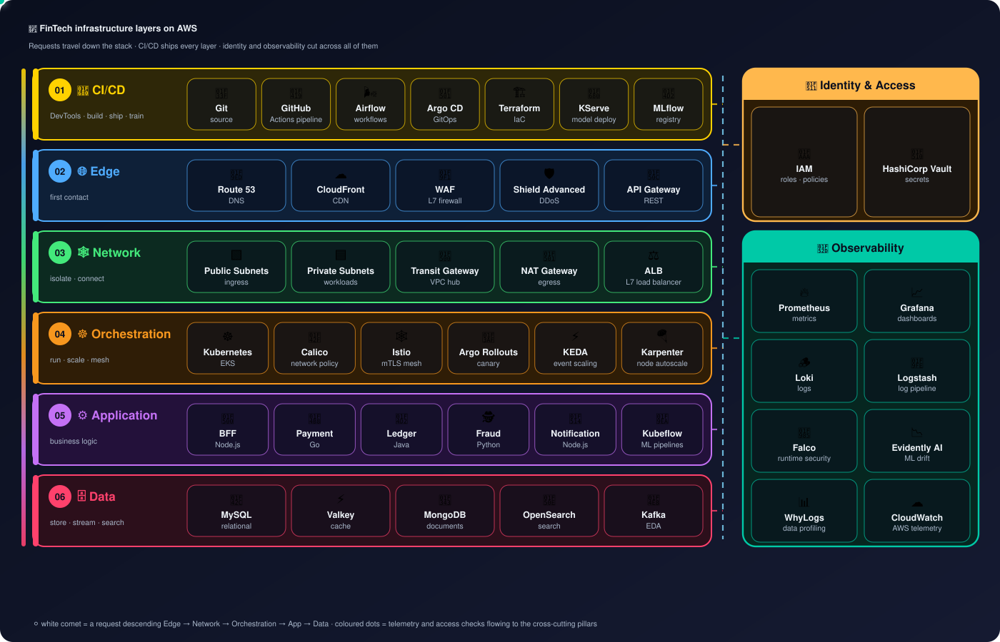

</div>

### 🏛️ Regional Architecture: 4 VPCs on AWS

<div align="center">


<sub>🎬 Animated: request, response, Transit Gateway, data, metrics, GitOps, endpoint and egress traffic.</sub>

</div>

### 🧰 Tech Stack

**48 tools**, every one of them shown in the two diagrams above, grouped exactly like the layers.

#### 🚀 01 · CI/CD & DevTools

<sub>Build, test and ship apps, infrastructure and ML models</sub>


#### 🌐 02 · Edge

<sub>First contact for every request</sub>


#### 🕸️ 03 · Network

<sub>Isolate, connect and load-balance traffic</sub>


#### ☸️ 04 · Orchestration

<sub>Run, scale, secure and roll out workloads</sub>


#### ⚙️ 05 · Application

<sub>Business logic and ML pipelines</sub>


#### 🗄️ 06 · Data

<sub>Store, cache, search and stream</sub>


#### 🔑 · Identity & Access

<sub>Least privilege and secrets across every layer</sub>


#### 🔭 · Observability

<sub>Metrics, logs, runtime security and ML drift across every layer</sub>


#### ☁️ · Shared AWS Services

<sub>Reached privately through VPC endpoints</sub>


<details>
<summary><b>📋 Every tool and what it does (table)</b></summary>

| Layer | Tool | Role in this project |
|---|---|---|
| CI/CD & DevTools | **Git** | source control |
| CI/CD & DevTools | **GitHub Actions** | CI pipelines |
| CI/CD & DevTools | **Apache Airflow** | ML & data workflows |
| CI/CD & DevTools | **Argo CD** | GitOps delivery |
| CI/CD & DevTools | **Terraform** | infrastructure as code |
| CI/CD & DevTools | **KServe** | model serving |
| CI/CD & DevTools | **MLflow** | experiments & registry |
| Edge | **Route 53** | DNS |
| Edge | **CloudFront** | CDN · TLS |
| Edge | **AWS WAF** | L7 firewall |
| Edge | **Shield Advanced** | DDoS protection |
| Edge | **API Gateway** | REST API front door |
| Network | **Amazon VPC** | 4 VPCs |
| Network | **Public Subnets** | internet-facing |
| Network | **Private Subnets** | workloads & data |
| Network | **Transit Gateway** | VPC hub |
| Network | **NAT Gateway** | outbound only |
| Network | **ALB** | L7 load balancer |
| Network | **VPC Endpoints** | private AWS access |
| Orchestration | **Amazon EKS** | Kubernetes |
| Orchestration | **Calico** | network policy |
| Orchestration | **Istio** | mTLS service mesh |
| Orchestration | **Argo Rollouts** | canary · blue-green |
| Orchestration | **KEDA** | event-driven pod scaling |
| Orchestration | **Karpenter** | node autoscaling |
| Application | **Node.js** | BFF · Notification |
| Application | **Go** | Payment |
| Application | **Java** | Ledger |
| Application | **Python** | Fraud |
| Application | **Kubeflow** | ML pipelines |
| Data | **MySQL** | transactions · ledger |
| Data | **Valkey** | cache · sessions |
| Data | **MongoDB** | documents |
| Data | **OpenSearch** | search · logs |
| Data | **Apache Kafka** | event-driven (EDA) |
| Identity & Access | **AWS IAM** | roles · policies |
| Identity & Access | **HashiCorp Vault** | secrets |
| Identity & Access | **AWS KMS** | encryption keys |
| Observability | **Prometheus** | metrics |
| Observability | **Grafana** | dashboards · alerts |
| Observability | **Loki** | logs |
| Observability | **Logstash** | log pipeline |
| Observability | **Falco** | runtime security |
| Observability | **Evidently AI** | model drift |
| Observability | **WhyLogs** | data profiling |
| Observability | **CloudWatch** | AWS telemetry |
| Shared AWS Services | **Amazon ECR** | container images |
| Shared AWS Services | **Amazon S3** | artifacts · data · state |

**Total: 48 tools**

</details>

### 📋 Layers at a glance

| # | Layer | Tools | Purpose |
|:-:|---|---|---|
| 01 | 🚀 **CI/CD & DevTools** | Git · GitHub Actions · Airflow · Argo CD · Terraform (IaC) · KServe · MLflow | Build, test, ship apps, infrastructure and ML models |
| 02 | 🌐 **Edge** | Route 53 (DNS) · CloudFront (CDN) · AWS WAF · AWS Shield Advanced · API Gateway (REST) | First contact: DNS, caching, L7 filtering, DDoS protection, API front door |
| 03 | 🕸️ **Network** | Public subnets · Private subnets · AWS Transit Gateway · NAT Gateway · ALB · VPC endpoints | Isolate, connect and load-balance traffic |
| 04 | ☸️ **Orchestration** | Kubernetes (EKS) · Calico · Istio · Argo Rollouts · KEDA · Karpenter | Run, scale, secure and progressively deliver workloads |
| 05 | ⚙️ **Application** | BFF (Node.js) · Payment (Go) · Ledger (Java) · Fraud (Python) · Notification (Node.js) · Kubeflow ML Pipelines | Business logic and ML pipelines |
| 06 | 🗄️ **Data** | MySQL · Valkey · MongoDB · OpenSearch · Kafka (event-driven architecture) | Store, cache, search and stream data |
| 🔑 | **Identity & Access** | AWS IAM (roles, policies) · HashiCorp Vault | Least privilege and secrets, across every layer |
| 🔭 | **Observability** | Prometheus · Grafana · Loki · Logstash · Falco · Evidently AI · WhyLogs · CloudWatch | Metrics, logs, runtime security and ML/data drift, across every layer |

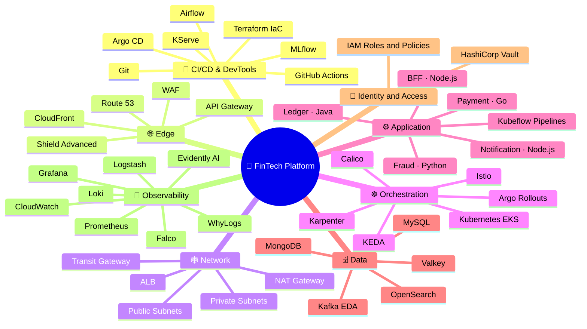

### 🗺️ VPC breakdown & service flow

| VPC | What runs there | How it connects |
|---|---|---|
| 🚪 **VPC A · Edge** `10.10.0.0/16` | Route 53 · CloudFront · WAF + Shield Advanced · API Gateway | Internet-facing. API Gateway forwards to the app VPC's ALB (VPC Link via Transit Gateway) |
| ⚙️ **VPC B · App** `10.20.0.0/16` | ALB → Amazon EKS: BFF, Payment, Ledger, Fraud, Notification services · KServe · Airflow · Kubeflow · Istio · Calico · KEDA · Karpenter | Transit Gateway to data and ops · VPC endpoints to ECR and S3 · NAT Gateway for outbound calls |
| 🗄️ **VPC C · Data** `10.30.0.0/16` | MySQL · Valkey · Kafka · MongoDB · OpenSearch | Private only. Reached through the Transit Gateway · VPC endpoints to KMS and S3 |
| 🛠️ **VPC D · Ops** `10.40.0.0/16` | Prometheus · Grafana · Argo CD · HashiCorp Vault · Kubeflow · MLflow | Scrapes metrics and syncs GitOps through the Transit Gateway · VPC endpoint to S3 · NAT for alerting |
| 🔀 **Transit Gateway** | Hub for all 4 VPCs | `10.0.0.0/8 → TGW` in every route table |
| ☁️ **Shared AWS services** | Amazon ECR · Amazon S3 · AWS KMS | Reached privately through VPC endpoints, never over the internet |


---

## 🚦 Live Traffic Flow

<div align="center">

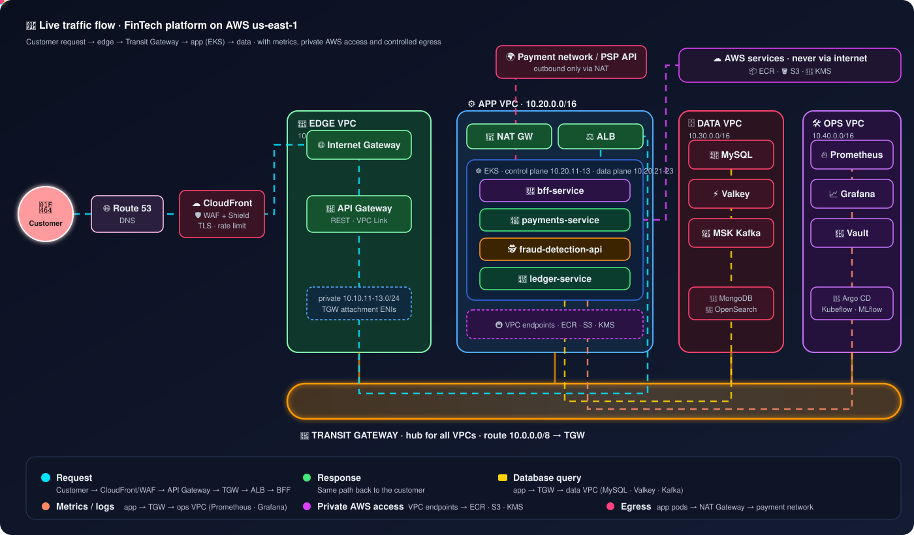

<sub>🎬 Animated: every moving dot is a real traffic type travelling through the network.</sub>

</div>

### 🛣️ Hop by hop: one payment request through the network

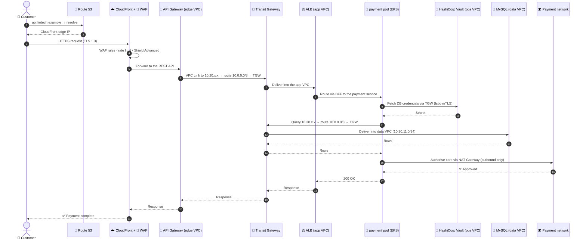

### 🧭 How a packet picks its path (route table decision)

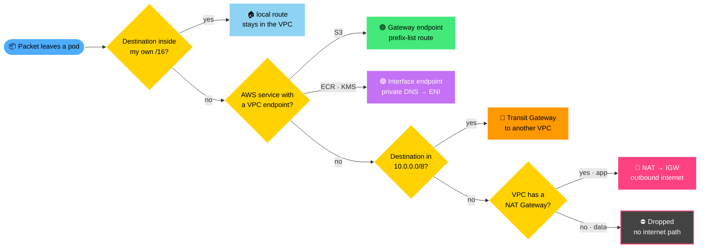

### 🛡️ Security checkpoints on the way in

```mermaid
flowchart LR
    A[👤 Internet]:::i --> B[🛡️ Shield Advanced<br/>DDoS]:::s1 --> C[🧱 WAF<br/>L7 rules]:::s2 --> D[☁️ CloudFront<br/>TLS]:::s3 --> E[🔌 API Gateway<br/>throttling]:::s4 --> F[🔀 Transit Gateway<br/>10.0.0.0/8]:::s5 --> G[⚖️ ALB<br/>listener rules]:::s6 --> H[🐯 Calico<br/>network policy]:::s7 --> I[🕸️ Istio<br/>mTLS]:::s8 --> J[⚙️ Service]:::ok

    classDef i fill:#ff9a9e,color:#000
    classDef s1 fill:#ff416c,color:#fff
    classDef s2 fill:#ff6a3d,color:#fff
    classDef s3 fill:#f7971e,color:#000
    classDef s4 fill:#ffd200,color:#000
    classDef s5 fill:#ff9900,color:#000
    classDef s6 fill:#84fab0,color:#000
    classDef s7 fill:#4facfe,color:#000
    classDef s8 fill:#c471f5,color:#fff
    classDef ok fill:#43e97b,color:#000,stroke:#fff,stroke-width:3px
```

---

## 🧩 Microservices

All five services run on **Amazon EKS in the app VPC**, behind the **ALB**, inside the **Istio** mesh with **Calico** network policies. **KEDA** scales pods on load and Kafka lag, and **Karpenter** adds nodes.

<div align="center">

| # | Service | Language | Responsibility | Calls | Data (data VPC) |
|:-:|---|:-:|---|---|---|
| 1 | 🔀 **BFF Service** | Node.js | Single API for web and mobile; aggregates and shapes responses | Payment, Ledger | Valkey (sessions, cache) |
| 2 | 💸 **Payment Service** | Go | Payment initiation and orchestration | Fraud, Ledger, Kafka | MySQL |
| 3 | 📒 **Ledger Service** | Java | Double-entry ledger and balances | – | MySQL, OpenSearch (search, audit) |
| 4 | 🕵️ **Fraud Service** | Python | Real-time fraud scoring | KServe model | MongoDB (fraud cases) |
| 5 | 🔔 **Notification Service** | Node.js | Email, SMS and push from payment events | – | Kafka (consumer), MongoDB |

</div>

| ML component | Where | Role |
|---|---|---|
| 🚀 **KServe** | app VPC (EKS) | Serves the fraud model to the Fraud Service |
| 🌬️ **Airflow** | app VPC (EKS) | Orchestrates data and training workflows |
| 🧪 **Kubeflow** | app + ops VPCs | ML pipelines: train and evaluate |
| 📒 **MLflow** | ops VPC | Experiment tracking and model registry |

### 🕸️ Service Dependency Map

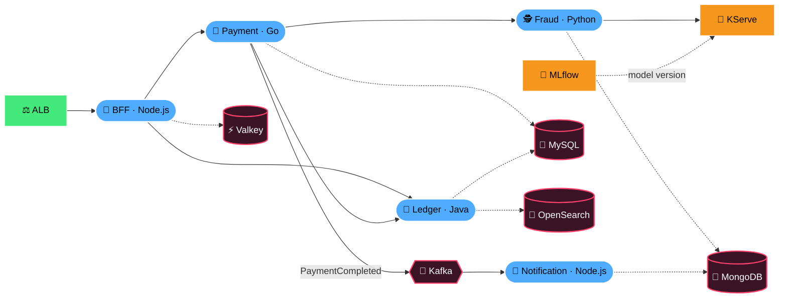

---

## 💸 Request Flow: Making a Payment

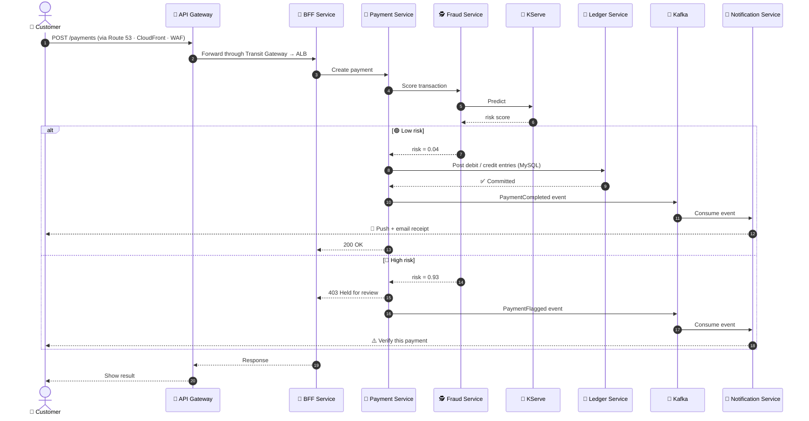

---

## 🛡️ Security by Layer

Every layer in the architecture adds its own control, and nothing depends on a single defence.

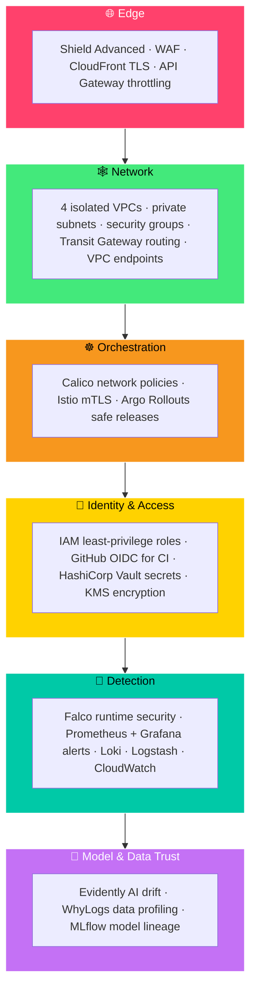

---

## 🔁 CI/CD & GitOps

**GitHub Actions** builds, **Terraform** provisions, **Argo CD** (ops VPC) syncs and **Argo Rollouts** releases progressively onto **EKS** (app VPC). Models follow the same path through **Airflow → Kubeflow → MLflow → KServe**.

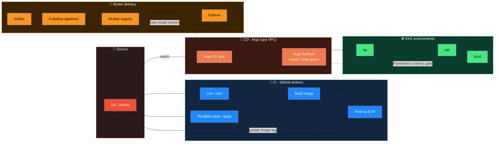

> 🔐 CI never stores AWS keys: GitHub Actions assumes the `FinTech-CI-CD-Deployer-<env>` IAM role through **GitHub OIDC**, as defined in the IAM module below.

---

## 🤖 MLOps Lifecycle

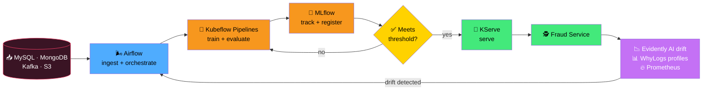

### 🔁 Model Lifecycle States

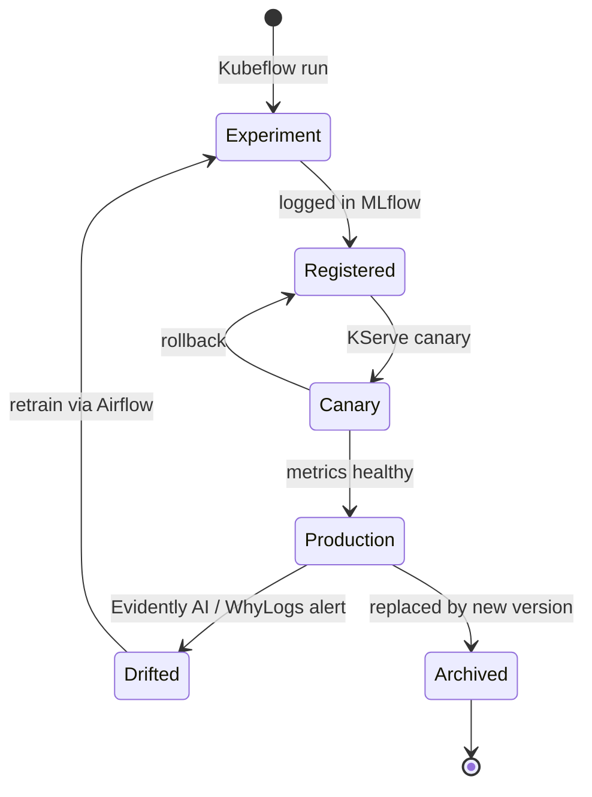

---

## 📊 Observability

The **ops VPC** collects telemetry from every layer over the **Transit Gateway**.

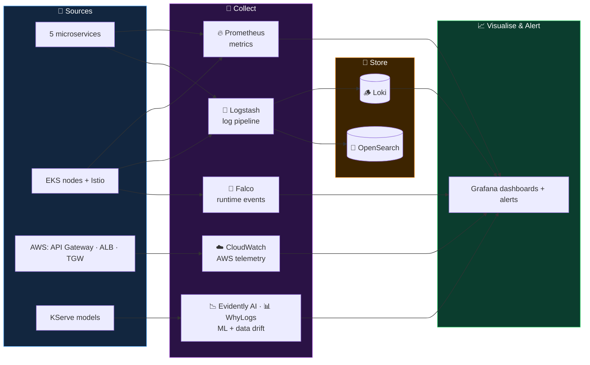

---

## 📈 Skill Coverage

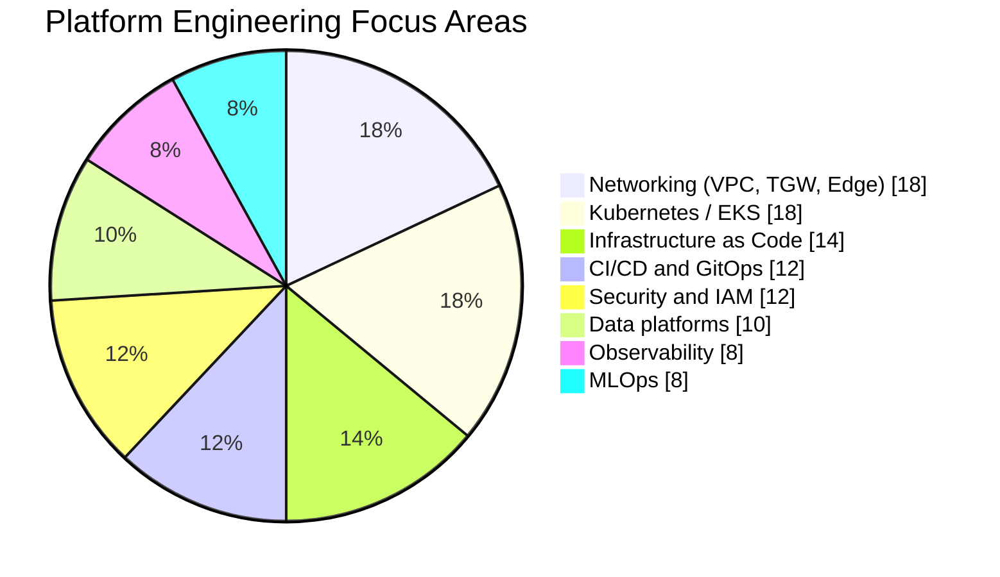

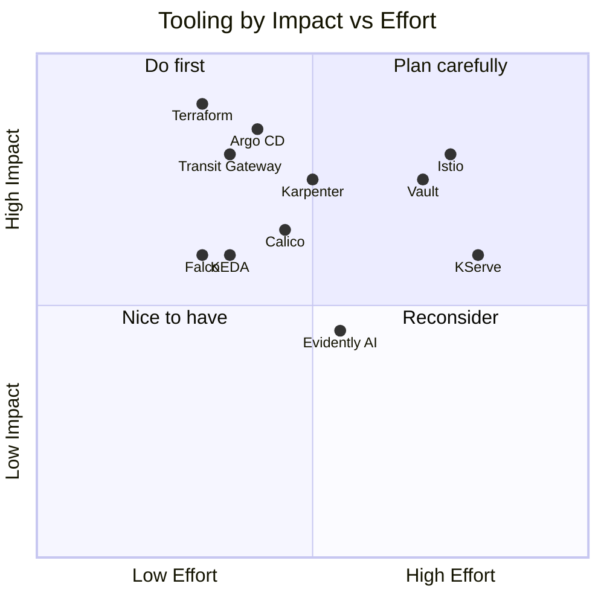

---

## 🏗️ Infrastructure Build: Networking & IAM

<div align="center">

[](https://git.io/typing-svg)


</div>

This section documents what has been **built so far** in `infra-modules/`.

### 🧭 Build Journey

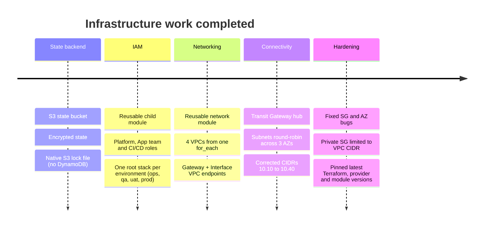

---

### 🌐 Networking: 4 VPCs + Transit Gateway

One reusable module (`prod/Networking/network/`) is called **once per VPC** from the root module with `for_each`. Each VPC gets its own subnets, route tables, security groups and VPC endpoints. A **Transit Gateway** (`transit_gateway.tf`) joins them all.

<div align="center">


</div>

```mermaid
flowchart TB
    INET((🌍 Internet)):::net

    subgraph REGION["☁️ AWS us-east-1 · AZs 1a · 1b · 1c"]
        direction TB

        subgraph EDGE["🚪 EDGE · 10.10.0.0/16"]
            EIGW[🌐 IGW]:::gw
            EPUB[public 10.10.1-3.0/24<br/>🔌 API Gateway · WAF]:::pub
            EPRIV[private 10.10.11-13.0/24]:::priv
        end

        subgraph APP["⚙️ APP · 10.20.0.0/16"]
            AIGW[🌐 IGW]:::gw
            ANAT[🔁 NAT Gateway]:::gw
            APUB[public 10.20.1-3.0/24<br/>⚖️ ALB]:::pub
            ACP[EKS control plane<br/>10.20.11-13.0/24]:::priv
            ADP[EKS data plane<br/>10.20.21-23.0/24]:::priv
        end

        subgraph DATA["🗄️ DATA · 10.30.0.0/16 · no internet"]
            DDB[MySQL · MongoDB · OpenSearch<br/>10.30.11-13.0/24]:::priv
            DKF[Kafka + Valkey<br/>10.30.21-23.0/24]:::priv
        end

        subgraph OPS["🛠️ OPS · 10.40.0.0/16"]
            OIGW[🌐 IGW]:::gw
            OPUB[public 10.40.1-3.0/24]:::pub
            OPRIV[Prometheus · Grafana · Argo<br/>Vault · Kubeflow · MLflow<br/>10.40.11-13.0/24]:::priv
        end

        TGW{{"🔀 TRANSIT GATEWAY<br/>10.0.0.0/8"}}:::tgw

        subgraph AWS["🔒 AWS services via VPC endpoints"]
            S3[(🪣 S3)]:::gwep
            DYN[(⚡ DynamoDB)]:::gwep
            ECR[📦 ECR]:::ifep
            SEC[🔑 Secrets · 📜 Logs]:::ifep
            KMS[🔐 KMS]:::ifep
            SSM[🖥️ SSM]:::ifep
        end
    end

    INET <--> EIGW --- EPUB
    INET <--> AIGW
    INET <--> OIGW --- OPUB
    ADP -->|outbound| ANAT --> AIGW

    EPRIV <==> TGW
    ACP <==> TGW
    ADP <==> TGW
    DDB <==> TGW
    DKF <==> TGW
    OPRIV <==> TGW

    ADP -.-> S3 & ECR & SEC
    DDB -.-> S3 & DYN & KMS
    OPRIV -.-> S3 & SSM

    classDef net fill:#ff9a9e,stroke:#fff,color:#000,stroke-width:2px
    classDef gw fill:#ff9900,stroke:#fff,color:#000
    classDef pub fill:#84fab0,stroke:#0b3d2e,color:#000
    classDef priv fill:#8fd3f4,stroke:#12263f,color:#000
    classDef tgw fill:#ff7a00,stroke:#ffd200,color:#000,stroke-width:3px
    classDef gwep fill:#43e97b,stroke:#fff,color:#000,stroke-width:2px
    classDef ifep fill:#c471f5,stroke:#fff,color:#fff,stroke-width:2px

    style REGION fill:#0f2027,stroke:#ff9900,color:#fff,stroke-width:3px
    style EDGE fill:#10372b,stroke:#84fab0,color:#fff,stroke-width:2px
    style APP fill:#12263f,stroke:#4facfe,color:#fff,stroke-width:2px
    style DATA fill:#2b1a1a,stroke:#ff416c,color:#fff,stroke-width:2px
    style OPS fill:#2a1245,stroke:#c471f5,color:#fff,stroke-width:2px
    style AWS fill:#1a1a1a,stroke:#ffd200,color:#fff,stroke-width:2px
```

> 🟠 thick arrows = **Transit Gateway** · 🟢/🟣 dotted arrows = **VPC endpoints** · 🌐 = Internet Gateway

| VPC | CIDR | Public subnets | Private subnets | NAT | Gateway endpoints | Interface endpoints |
|---|---|:-:|:-:|:-:|---|---|
| 🚪 **edge** | `10.10.0.0/16` | 3 | 3 | – | s3 | – |
| ⚙️ **app** | `10.20.0.0/16` | 3 | 6 (EKS control + data plane) | ✅ | s3 | ecr.api, ecr.dkr, logs, secretsmanager |
| 🗄️ **data** | `10.30.0.0/16` | – | 6 (DBs + Kafka/Valkey) | – | s3, dynamodb | kms |
| 🛠️ **ops** | `10.40.0.0/16` | 3 | 3 | – | s3 | ssm, ssmmessages, ec2messages |

**In simple words:**
- 🏢 Each **VPC is a separate building** with its own address range. The `10.10 / 10.20 / 10.30 / 10.40` CIDRs never overlap, so they can all be joined.
- 🔀 The **Transit Gateway is the central hub** that connects the buildings. Every private route table has one route, `10.0.0.0/8 → TGW`, and traffic inside a VPC stays local because its own `/16` is more specific.
- 🌐 **Public subnets** face the internet through an **Internet Gateway**.
- 🔐 **Private subnets** can't be reached from outside. Apps, databases and monitoring live here.
- 🔁 **NAT Gateway** (app): pods can call out, for example to a payment network, but nothing can come in.
- 🚇 **VPC endpoints** are private tunnels to AWS services, so ECR, S3, Secrets Manager and KMS are reached **without the internet**.
- 🗄️ The **data VPC has no internet path at all**. It's reachable only through the TGW.
- 🏗️ Subnets go **round-robin across 3 AZs** (1a → 1b → 1c → 1a …), so 6 subnets give 2 per AZ, and the first 3 (one per AZ) host the TGW attachment and endpoint ENIs.

#### 🔀 How the root module creates all 4 VPCs

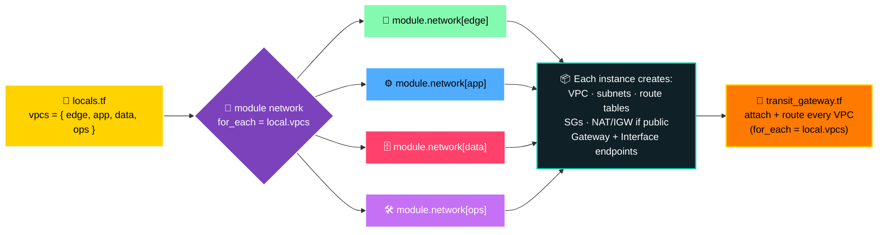

#### 🚇 VPC endpoints: Gateway vs Interface

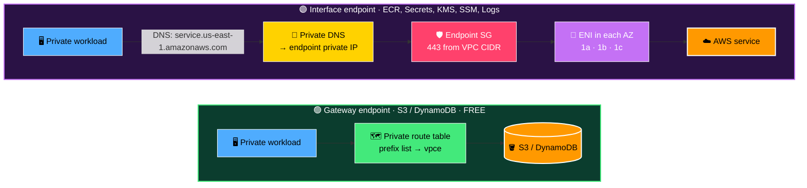

**How the endpoint code works** (`network/main.tf`):

| Resource | What it does |
|---|---|
| `data.aws_region.current` | Reads the provider's region, so endpoint names are never hardcoded |
| `aws_vpc_endpoint.gateway` | `for_each = toset(var.gateway_endpoints)` creates one free Gateway endpoint per service and attaches it to the private route tables |
| `aws_security_group.endpoint_sg` | Created only if `interface_endpoints` isn't empty. Allows HTTPS 443 from the VPC CIDR |
| `aws_vpc_endpoint.interface` | `for_each = toset(var.interface_endpoints)` places an ENI in the first private subnet of each AZ (`private_subnet_ids_per_az`). `private_dns_enabled = true` means application code needs **no changes** |

```hcl
# Per-VPC input: just two simple lists
gateway_endpoints   = ["s3", "dynamodb"]
interface_endpoints = ["secretsmanager", "kms"]
```

#### 🔀 Transit Gateway: how VPCs talk to each other

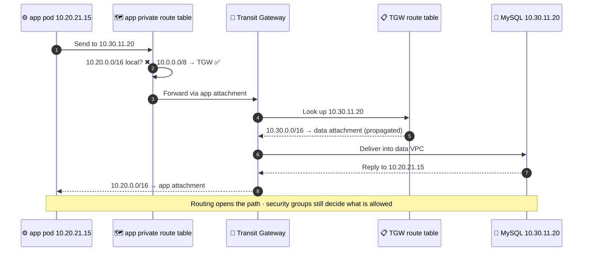

| Block (`transit_gateway.tf`) | What it does |
|---|---|
| `aws_ec2_transit_gateway.main` | The hub router. Every attachment auto-associates and auto-propagates its CIDR |
| `aws_ec2_transit_gateway_vpc_attachment.vpc` | `for_each = local.vpcs` plugs every VPC in using one private subnet per AZ |
| `aws_route.private_to_tgw` | `10.0.0.0/8 → TGW` in every private route table |
| `aws_route.public_to_tgw` | The same route in public route tables (edge, app, ops) |

> ➕ **Reusable:** add a VPC to `locals.tf` and it's created, attached to the TGW and routed automatically.

#### 📦 What one `terraform apply` creates

| Resource | Count |
|---|:-:|
| VPCs | 4 |
| Subnets (9 public + 18 private) | 27 |
| Route tables (3 public + 4 private) | 7 |
| Internet Gateways / NAT Gateway / Elastic IP | 3 / 1 / 1 |
| Security groups (public, private, endpoint) | 10 |
| Gateway endpoints | 5 |
| Interface endpoints | 8 |
| Transit Gateway / attachments / TGW routes | 1 / 4 / 7 |

> 💰 **Cost note:** Gateway endpoints are free. Interface endpoints cost about $7.30 per AZ per month each (8 × 3 AZs ≈ $175 per month), the NAT Gateway about $33 per month, and TGW attachments about $36 per month each (≈ $146 per month), all before data charges.

---

### 🔐 IAM: Least-Privilege Roles per Environment

A **child module** (`iam/child-module/`) wraps `terraform-aws-modules/iam/aws//modules/iam-role` **v6.8.2** and defines three roles. Each **environment stack** (`iam/environments/*`) turns on only the roles it needs, using feature flags.

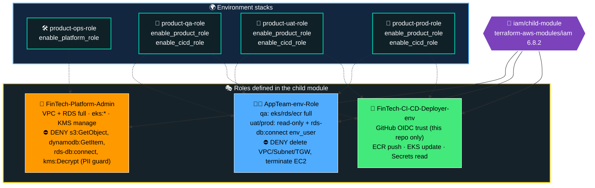

#### 🤖 How GitHub Actions gets AWS access (no stored keys)

```mermaid
sequenceDiagram
    autonumber
    participant GH as 🐙 GitHub Actions
    participant OIDC as 🎫 GitHub OIDC
    participant STS as 🔐 AWS STS
    participant ROLE as 🤖 CI-CD-Deployer role
    participant AWS as ☁️ ECR / EKS

    GH->>OIDC: Request ID token for this job
    OIDC-->>GH: JWT (sub = repo:muntaha747/FinTech-Enterprise-Project:*)
    GH->>STS: AssumeRoleWithWebIdentity(JWT)
    STS->>ROLE: Check trust policy condition on sub
    alt ✅ Repo matches
        STS-->>GH: Short-lived credentials
        GH->>AWS: Push image / update cluster
    else ⛔ Any other repo
        STS-->>GH: AccessDenied
    end
```

---

### 🗃️ Multi State Files in One Remote Backend

Every stack keeps its **own state file** inside a single encrypted S3 bucket, **`fintech-project-statefile-bucket`**. Locking uses Terraform's **native S3 lock file** (`use_lockfile = true`), so no DynamoDB table is needed.

<div align="center">


</div>

**Why split the state?**
- 💥 **Smaller blast radius:** a bad apply on QA IAM can't touch prod networking.
- ⚡ **Faster plans:** each stack only refreshes its own resources.
- 🔒 **Parallel work:** different teams or pipelines lock different files.
- 🧑‍⚖️ **Access control:** bucket policies can restrict who reads which prefix.

```mermaid
flowchart LR
    subgraph STACKS["📂 Terraform root stacks"]
        direction TB
        N["🌐 prod/Networking"]:::net
        I1["🛠️ iam/product-ops-role"]:::iam
        I2["🧪 iam/product-qa-role"]:::iam
        I3["🧷 iam/product-uat-role"]:::iam
        I4["🏦 iam/product-prod-role"]:::iam
        S1["🪣 qa/s3"]:::s3
        S2["🪣 stage/s3"]:::s3
        S3["🪣 prod/s3"]:::s3
    end

    subgraph BUCKET["🔐 s3://fintech-project-statefile-bucket · encrypted · native lock"]
        direction TB
        K1["product-networking/envs/prod/networking.tfstate"]:::kn
        K2["product-iam/envs/iam-ops-role.tfstate"]:::ki
        K3["product-iam/envs/iam-qa-role.tfstate"]:::ki
        K4["product-iam/envs/iam-uat-role.tfstate"]:::ki
        K5["product-iam/envs/iam-prod-role.tfstate"]:::ki
        K6["product-name/envs/qa/s3.tfstate"]:::ks
        K7["product-name/envs/stage/s3.tfstate"]:::ks
        K8["product-name/envs/prod/s3.tfstate"]:::ks
    end

    N --> K1
    I1 --> K2
    I2 --> K3
    I3 --> K4
    I4 --> K5
    S1 --> K6
    S2 --> K7
    S3 --> K8

    classDef net fill:#4facfe,stroke:#fff,color:#000
    classDef iam fill:#ff9900,stroke:#fff,color:#000
    classDef s3 fill:#43e97b,stroke:#fff,color:#000
    classDef kn fill:#12263f,stroke:#4facfe,color:#fff
    classDef ki fill:#3d2400,stroke:#ff9900,color:#fff
    classDef ks fill:#0b3d2e,stroke:#43e97b,color:#fff
    style STACKS fill:#0f2027,stroke:#00c9a7,color:#fff,stroke-width:2px
    style BUCKET fill:#1a1a1a,stroke:#ffd200,color:#fff,stroke-width:3px
```

| Stack | State key |
|---|---|
| 🌐 prod/Networking | `product-networking/envs/prod/networking.tfstate` |
| 🛠️ iam/product-ops-role | `product-iam/envs/iam-ops-role.tfstate` |
| 🧪 iam/product-qa-role | `product-iam/envs/iam-qa-role.tfstate` |
| 🧷 iam/product-uat-role | `product-iam/envs/iam-uat-role.tfstate` |
| 🏦 iam/product-prod-role | `product-iam/envs/iam-prod-role.tfstate` |
| 🪣 qa/s3 | `product-name/envs/qa/s3.tfstate` |
| 🪣 stage/s3 | `product-name/envs/stage/s3.tfstate` |
| 🪣 prod/s3 | `product-name/envs/prod/s3.tfstate` |

#### 🔒 How native S3 locking protects state

```mermaid
sequenceDiagram
    autonumber
    actor A as 👩‍💻 Engineer A
    actor B as 👨‍💻 Engineer B
    participant S3 as 🪣 S3 state bucket

    A->>S3: terraform apply → create networking.tfstate.tflock
    S3-->>A: 🔒 Lock acquired
    B->>S3: terraform apply (same stack)
    S3-->>B: ⛔ Error acquiring the state lock
    A->>S3: Write new networking.tfstate (encrypted)
    A->>S3: Delete .tflock
    S3-->>A: 🔓 Lock released
    B->>S3: Retry → lock acquired ✅
```

---

### 📌 Pinned Versions

| Component | Version | Where |
|---|---|---|
| Terraform | `>= 1.17.1` | every `versions.tf` + CI (`terraform_version: "1.17.1"`) |
| AWS provider | `~> 6.72` (locked at 6.72.0) | every `versions.tf` + `.terraform.lock.hcl` |
| terraform-aws-modules/iam | `6.8.2` | `iam/child-module/main.tf` (all 3 roles) |

### ✅ Fixes Applied During the Build

- 🐞 `availability_zones.all.name` → `.names` (public subnets)
- 🐞 Restored the missing `resource "aws_security_group" "public"` header around dangling `dynamic` blocks
- 🐞 Variable typos: `sting` → `string`, `cidr_block` → `cidr_blocks`, `Environment` default `{}` → `"prod"`
- 🛡️ Private SG no longer hardcodes `0.0.0.0/0` ingress. Rules now come from the root module (VPC CIDR only)
- 🔁 VPC endpoint code rewritten: no hardcoded region, no fragile `slice()`, no `[0]` index crash, descriptions + tags added (clears the KICS findings)
- 📌 Pinned latest Terraform, AWS provider and IAM module versions everywhere
- 🗺️ CIDRs re-planned to `10.10 / 10.20 / 10.30 / 10.40` with edge subnets fixed to sit inside `10.10.0.0/16`
- 🏗️ Subnets now round-robin across 3 AZs, and TGW and endpoints use one subnet per AZ
- 🐞 `outputs.tf`: `aws.subnet` → `aws_subnet`, added CIDR, public subnet and route table outputs
- 🔐 `product-prod-role` now uses real module inputs (`enable_product_role`, `enable_cicd_role`)
- 🪣 `stage/s3` has its own state key, no longer sharing prod's

### 🚀 How to Deploy the Networking Stack

```bash
cd infra-modules/prod/Networking
terraform init -reconfigure          # connect to the S3 backend
terraform plan -out=network.tfplan   # review: 4 VPCs, 27 subnets, 13 endpoints, 1 TGW
terraform apply network.tfplan
```

### 🔜 Next Up

- [x] Transit Gateway connecting edge ↔ app ↔ data ↔ ops
- [x] Separate state key for `stage/s3`
- [x] Fix `product-prod-role` role flags
- [ ] VPC Flow Logs (PCI-DSS / SOC 2)
- [ ] Lock down the default security group (CIS 5.4)
- [ ] EKS subnet tags (`kubernetes.io/role/elb`, `internal-elb`)
- [ ] `default_tags` in the provider + unique route table names
- [ ] TGW segmentation (separate route tables so edge can't reach data directly)
- [ ] EKS + Karpenter in the app VPC

---

## 🗺️ Roadmap

```mermaid
gantt
    title Project Roadmap
    dateFormat  YYYY-MM-DD
    axisFormat  %b %Y
    section Foundation
    Repo, README, state backend, IAM     :done,    f1, 2026-11-01, 8d
    Network: 4 VPCs + Transit Gateway    :done,    f2, 2026-11-07, 5d
    section Edge
    Route 53, CloudFront, WAF, Shield, API Gateway :active, e1, 2026-11-12, 10d
    section Orchestration
    EKS + Karpenter + KEDA               :         o1, after e1, 14d
    Calico + Istio                       :         o2, after o1, 10d
    section Data
    MySQL, Valkey, MongoDB, OpenSearch, Kafka :    d1, after o1, 14d
    section Application
    BFF, Payment, Ledger, Fraud, Notification :    a1, after d1, 28d
    section Delivery
    GitHub Actions + Argo CD + Argo Rollouts  :    g1, after o2, 14d
    section Observability and Security
    Prometheus, Grafana, Loki, Logstash, CloudWatch : s1, after g1, 14d
    Vault + Falco                        :         s2, after s1, 10d
    section MLOps
    Airflow, Kubeflow, MLflow, KServe    :         m1, after a1, 21d
    Evidently AI + WhyLogs               :         m2, after m1, 10d
```

```mermaid
timeline
    title Evolution of the Platform
    Phase 1 - Foundation : State backend and IAM : 4 VPCs and Transit Gateway
    Phase 2 - Edge and Platform : Route 53, CloudFront, WAF, Shield, API Gateway : EKS, Karpenter, KEDA, Calico, Istio
    Phase 3 - Data and Services : MySQL, Valkey, MongoDB, OpenSearch, Kafka : BFF, Payment, Ledger, Fraud, Notification
    Phase 4 - Delivery and Operations : GitHub Actions, Argo CD, Argo Rollouts : Prometheus, Grafana, Loki, Logstash, CloudWatch, Vault, Falco
    Phase 5 - Intelligence : Airflow, Kubeflow, MLflow, KServe : Evidently AI and WhyLogs
```

| Status | Item |
|:--:|---|
| ✅ | Repository, README and animated architecture diagrams |
| ✅ | Terraform remote backend: multi state files in S3 with native locking |
| ✅ | IAM: reusable child module and roles for ops, qa, uat and prod (GitHub OIDC for CI/CD) |
| ✅ | Network: 4 VPCs (edge, app, data, ops), VPC endpoints and Transit Gateway |
| 🚧 | Network hardening: Flow Logs, default SG lockdown, EKS subnet tags, default tags |
| 🔜 | Edge: Route 53, CloudFront, WAF, Shield Advanced, API Gateway |
| 🔜 | Orchestration: EKS, Karpenter, KEDA, Calico, Istio |
| 🔜 | Data: MySQL, Valkey, MongoDB, OpenSearch, Kafka |
| 🔜 | Application: BFF, Payment, Ledger, Fraud and Notification services |
| 🔜 | Delivery: GitHub Actions, Argo CD, Argo Rollouts |
| 🔜 | Identity and observability: Vault, Falco, Prometheus, Grafana, Loki, Logstash, CloudWatch |
| 🔜 | MLOps: Airflow, Kubeflow, MLflow, KServe, Evidently AI, WhyLogs |

---

## 📁 Repository Structure

```text
FinTech-Enterprise-Project/
├── .github/workflows/            # Terraform CI pipelines (GitHub OIDC → AWS)
├── docs/diagrams/                # animated SVG diagrams used in this README
├── infra-modules/
│   ├── iam/
│   │   ├── child-module/         # 3 roles via terraform-aws-modules/iam 6.8.2
│   │   └── environments/
│   │       ├── product-ops-role/ # platform admin role
│   │       ├── product-qa-role/  # app team + CI/CD roles
│   │       ├── product-uat-role/ # app team + CI/CD roles
│   │       └── product-prod-role/
│   ├── prod/
│   │   ├── Networking/           # root: backend, provider, locals (4 VPCs), module call, transit_gateway.tf
│   │   │   └── network/          # child: VPC, subnets, NAT, SGs, VPC endpoints
│   │   └── s3/
│   ├── qa/   (s3, EKS)
│   └── stage/ (s3)
├── .gitignore
└── README.md
```

---

<div align="center">

### 👩‍💻 Built by a DevOps engineer, for DevOps engineers

⭐ Star this repo to follow along as it grows.


</div>
