<div align="center">


[](https://git.io/typing-svg)


</div>

---

## 📑 Table of Contents

- [About](#-about-this-project)
- [Architecture](#%EF%B8%8F-high-level-architecture)
- [The 14 Microservices](#-the-14-microservices)
- [AWS Infrastructure](#%EF%B8%8F-aws-infrastructure-layout)
- [Request Flow](#-request-flow-making-a-payment)
- [Platform Layers](#-platform-layers)
- [DevSecOps](#-devsecops-pipeline)
- [GitOps & Delivery](#-gitops--delivery)
- [Security Layers](#%EF%B8%8F-defence-in-depth)
- [MLOps](#-mlops-lifecycle)
- [AI / GenAI](#-ai--genai-capabilities)
- [Observability](#-observability)
- [Tech Stack](#-tech-stack)
- [Roadmap](#%EF%B8%8F-roadmap)

---

## 🌟 About This Project

> **This repository is a replica of the FinTech platform from my past projects and professional work experience.**

It is an **EKS-based, multi-tier FinTech platform** made up of **14 microservices** across five layers: **Frontend → BFF → Application → Database**, plus an **MLOps / AI** layer for model training and data prediction.

The project **will be upgraded over time**. Each upgrade showcases a modern tool, skill or concept, with **DevSecOps security** as the main concern throughout. It mirrors the toolset and skillset expected of a **Platform Engineer / Senior DevOps Engineer in a FinTech organisation**.

> ⚠️ **Note:** this README describes the target architecture. The [Roadmap](#%EF%B8%8F-roadmap) shows what is done (✅), in progress (🚧) and planned (🔜).

<div align="center">

| 🧩 Microservices | 🏛️ Layers | 🔐 Security Controls | 🤖 ML / AI Services | ☁️ AWS Services |
|:---:|:---:|:---:|:---:|:---:|
| **14** | **5** | **20+** | **4** | **25+** |

</div>

---

## 🏗️ High-Level Architecture

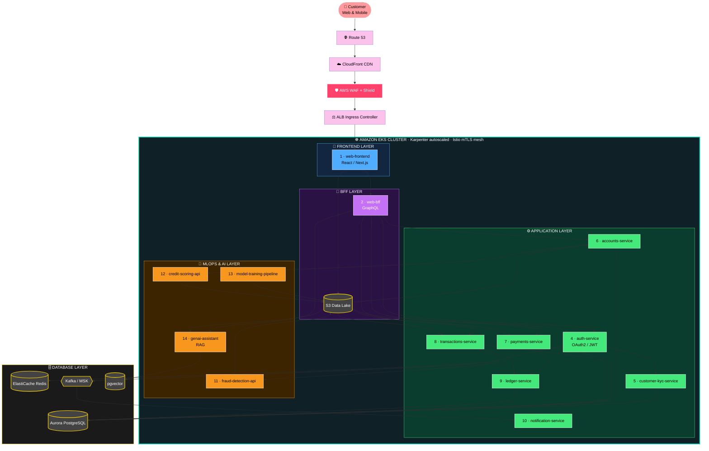

---

## 🧩 The 14 Microservices

<div align="center">

| # | Service | Layer | Responsibility | Stack | Data Store |
|:-:|---|:-:|---|---|---|
| 1 | 🎨 **web-frontend** | Frontend | Customer web UI | React, Next.js | CDN / S3 |
| 2 | 🔀 **web-bff** | BFF | Aggregates APIs for web | Node.js, GraphQL | Redis |
| 3 | 📱 **mobile-bff** | BFF | Aggregates APIs for mobile | Node.js, REST | Redis |
| 4 | 🔑 **auth-service** | App | Login, OAuth2, JWT, MFA | Java / Spring Boot | Redis, Aurora |
| 5 | 🪪 **customer-kyc-service** | App | Onboarding and KYC checks | Python / FastAPI | Aurora |
| 6 | 🏦 **accounts-service** | App | Accounts and balances | Java / Spring Boot | Aurora |
| 7 | 💸 **payments-service** | App | Payment initiation and orchestration | Go | Aurora |
| 8 | 🔁 **transactions-service** | App | Transaction history and events | Go | Aurora, Kafka |
| 9 | 📒 **ledger-service** | App | Double-entry ledger | Java / Spring Boot | Aurora |
| 10 | 🔔 **notification-service** | App | Email, SMS and push | Python | Kafka |
| 11 | 🕵️ **fraud-detection-api** | ML | Real-time fraud scoring | Python, KServe | S3 / MLflow |
| 12 | 📊 **credit-scoring-api** | ML | Credit risk prediction | Python, KServe | S3 / MLflow |
| 13 | 🏋️ **model-training-pipeline** | ML | Feature engineering, training, evaluation | Airflow, MLflow, Kubeflow | S3, Feast |
| 14 | 🧠 **genai-assistant** | AI | RAG assistant with guardrails | Python, LangChain, Bedrock | pgvector |

</div>

> Languages and frameworks above are the target design and may change as the services are built.

### 🕸️ Service Dependency Map


---

## ☁️ AWS Infrastructure Layout

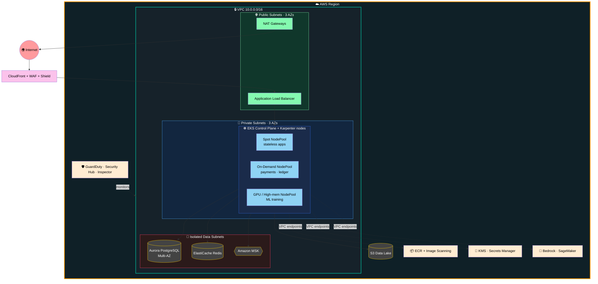

---

## 💸 Request Flow: Making a Payment

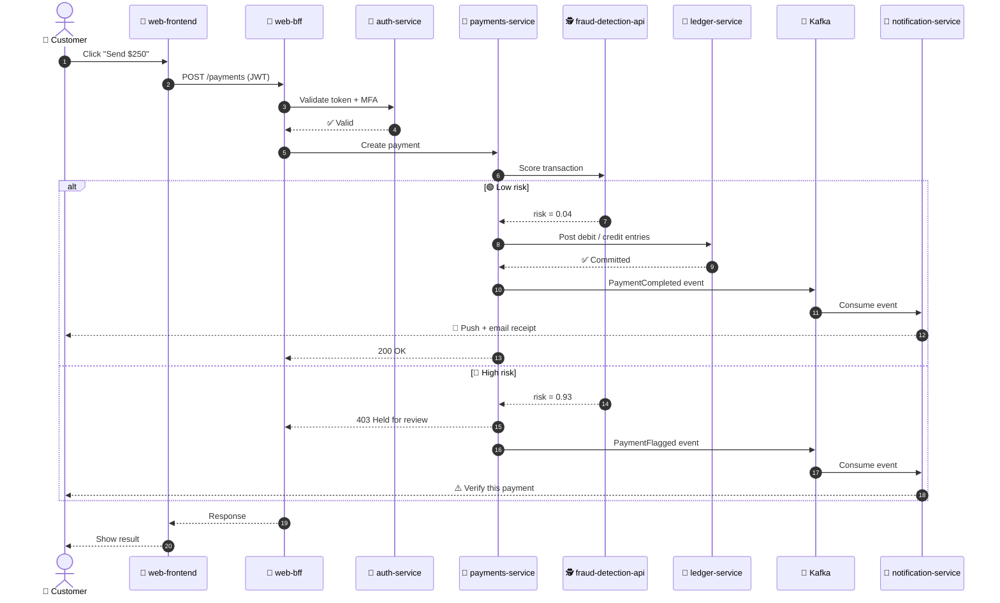

---

## 🧱 Platform Layers

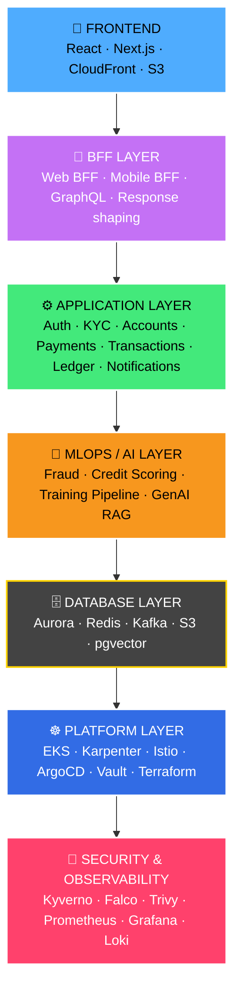

---

## 🔐 DevSecOps Pipeline

```mermaid
flowchart LR
    DEV[👨‍💻 Commit]:::s0 --> PRE[🪝 pre-commit<br/>Gitleaks]:::s1
    PRE --> SAST[🔍 SAST<br/>SonarQube · Semgrep]:::s1
    SAST --> SCA[📦 SCA<br/>Trivy · Snyk]:::s1
    SCA --> BUILD[🐳 Docker Build]:::s2
    BUILD --> SCAN[🛡️ Image Scan<br/>Trivy · Grype]:::s3
    SCAN --> SBOM[📄 SBOM + Sign<br/>Syft · Cosign]:::s4
    SBOM --> IAC[🏗️ IaC Scan<br/>Checkov · tfsec]:::s1
    IAC --> GIT[📂 GitOps Repo]:::s2
    GIT --> ARGO[🐙 ArgoCD]:::s5
    ARGO --> ADM[🚧 Admission<br/>Kyverno · OPA]:::s3
    ADM --> RUN[☸️ EKS Runtime]:::s6
    RUN --> FALCO[🦅 Falco]:::s7
    RUN --> DAST[🧪 DAST<br/>OWASP ZAP]:::s1
    FALCO --> SIEM[📊 SIEM / Alerts]:::s7

    classDef s0 fill:#4facfe,color:#000
    classDef s1 fill:#f7971e,color:#000
    classDef s2 fill:#43e97b,color:#000
    classDef s3 fill:#ff416c,color:#fff
    classDef s4 fill:#c471f5,color:#fff
    classDef s5 fill:#ef7b4d,color:#fff
    classDef s6 fill:#326ce5,color:#fff
    classDef s7 fill:#00c9a7,color:#000
```

---

## 🚀 GitOps & Delivery

```mermaid
flowchart LR
    subgraph CI["🛠️ CI · GitHub Actions"]
        A1[Lint + Test]:::ci --> A2[Build Image]:::ci --> A3[Scan + Sign]:::ci --> A4[Push to ECR]:::ci
    end
    subgraph GO["📂 GitOps Repo"]
        B1[Helm values / Kustomize]:::git
    end
    subgraph CD["🐙 CD · ArgoCD"]
        C1[App of Apps]:::cd --> C2[Argo Rollouts<br/>Canary / Blue-Green]:::cd
    end
    subgraph ENV["☸️ Environments"]
        D1[dev]:::env --> D2[staging]:::env --> D3[prod]:::env
    end

    A4 -->|update tag| B1
    B1 -->|sync| C1
    C2 --> D1
    D3 -.->|metrics gate| C2

    classDef ci fill:#4facfe,color:#000
    classDef git fill:#f7971e,color:#000
    classDef cd fill:#ef7b4d,color:#fff
    classDef env fill:#43e97b,color:#000
    style CI fill:#12263f,stroke:#4facfe,color:#fff
    style GO fill:#3d2400,stroke:#f7971e,color:#fff
    style CD fill:#3a1a10,stroke:#ef7b4d,color:#fff
    style ENV fill:#0b3d2e,stroke:#43e97b,color:#fff
```

---

## 🛡️ Defence in Depth

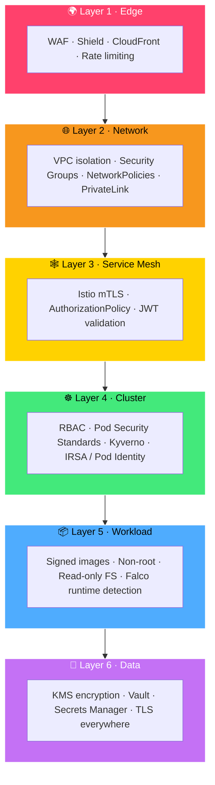

---

## 🤖 MLOps Lifecycle

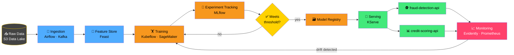

### 🔁 Model Lifecycle States

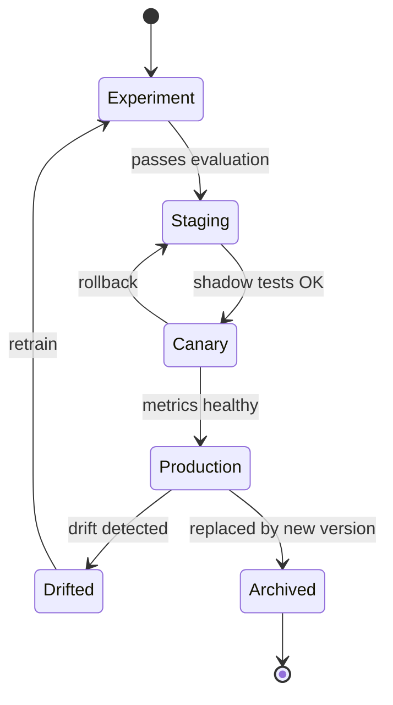

---

## 🧠 AI / GenAI Capabilities

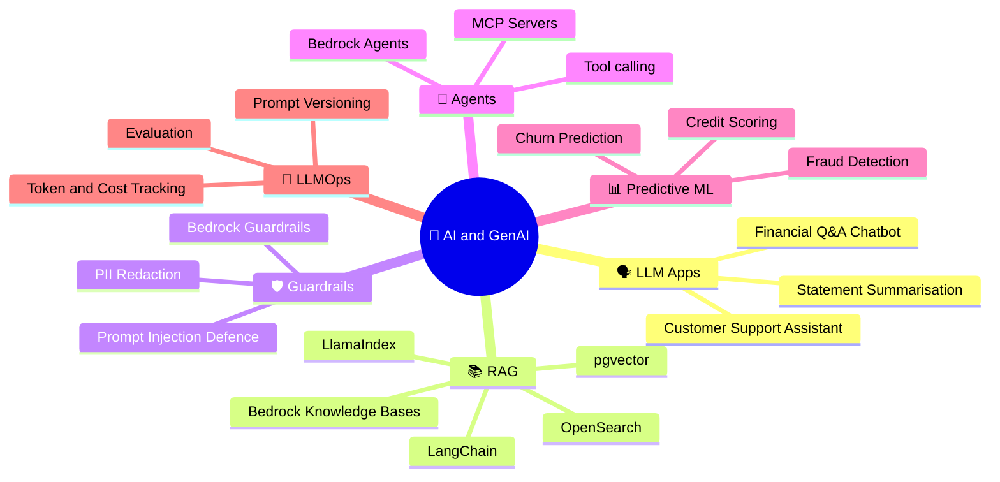

### 🧠 GenAI Assistant Flow (RAG)

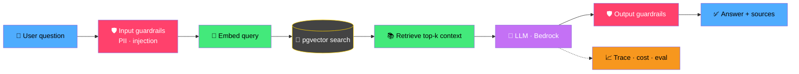

---

## 📊 Observability

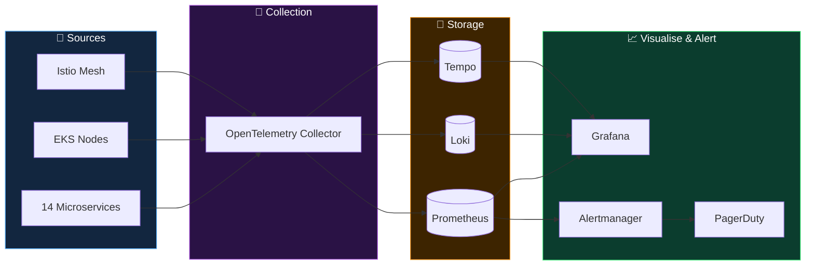

---

## 🧰 Tech Stack

### ☁️ AWS Infrastructure
| Area | Tools |
|---|---|
| **Compute / Containers** | Amazon EKS, **Karpenter**, Fargate, ECR, EC2 Spot |
| **Networking** | VPC, Subnets, NAT, Transit Gateway, PrivateLink, Route 53, CloudFront, ALB/NLB |
| **Data** | Aurora PostgreSQL, ElastiCache Redis, S3, DynamoDB, MSK (Kafka) |
| **Security** | IAM, IRSA / Pod Identity, KMS, Secrets Manager, GuardDuty, Security Hub, WAF, Shield, Inspector, Config |
| **Observability** | CloudWatch, X-Ray, Managed Prometheus, Managed Grafana |
| **AI / ML** | Bedrock, SageMaker, Comprehend, Textract |

### 🏗️ Infrastructure as Code & GitOps
| Area | Tools |
|---|---|
| **IaC** | **Terraform**, Terragrunt, Crossplane |
| **GitOps** | ArgoCD, Argo Rollouts, Argo Workflows, Helm, Kustomize |
| **CI/CD** | GitHub Actions, Jenkins, Tekton |

### 🛡️ DevSecOps
| Area | Tools |
|---|---|
| **Secrets** | Gitleaks, HashiCorp Vault, External Secrets Operator |
| **SAST / DAST** | SonarQube, Semgrep, OWASP ZAP |
| **Container / Supply chain** | Trivy, Grype, Syft (SBOM), **Cosign**, SLSA |
| **IaC scanning** | Checkov, tfsec, KICS |
| **Policy** | **Kyverno**, OPA Gatekeeper, Pod Security Standards |
| **Runtime** | Falco, Tetragon, Istio mTLS, Network Policies, Cilium |
| **Compliance** | PCI-DSS, SOC 2, CIS Benchmarks (kube-bench) |

### 📊 Observability & Reliability
Prometheus · Grafana · Loki · Tempo · OpenTelemetry · Alertmanager · PagerDuty · SLO/SLI · Chaos Mesh · Velero · k6

### 🤖 MLOps & AI
MLflow · Kubeflow · KServe · Feast · Airflow · Evidently · SageMaker · Bedrock · LangChain · LlamaIndex · pgvector · Ray

---

## 📈 Skill Coverage

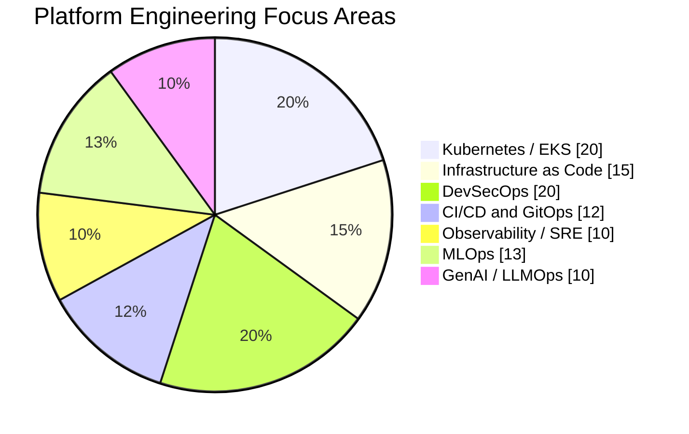

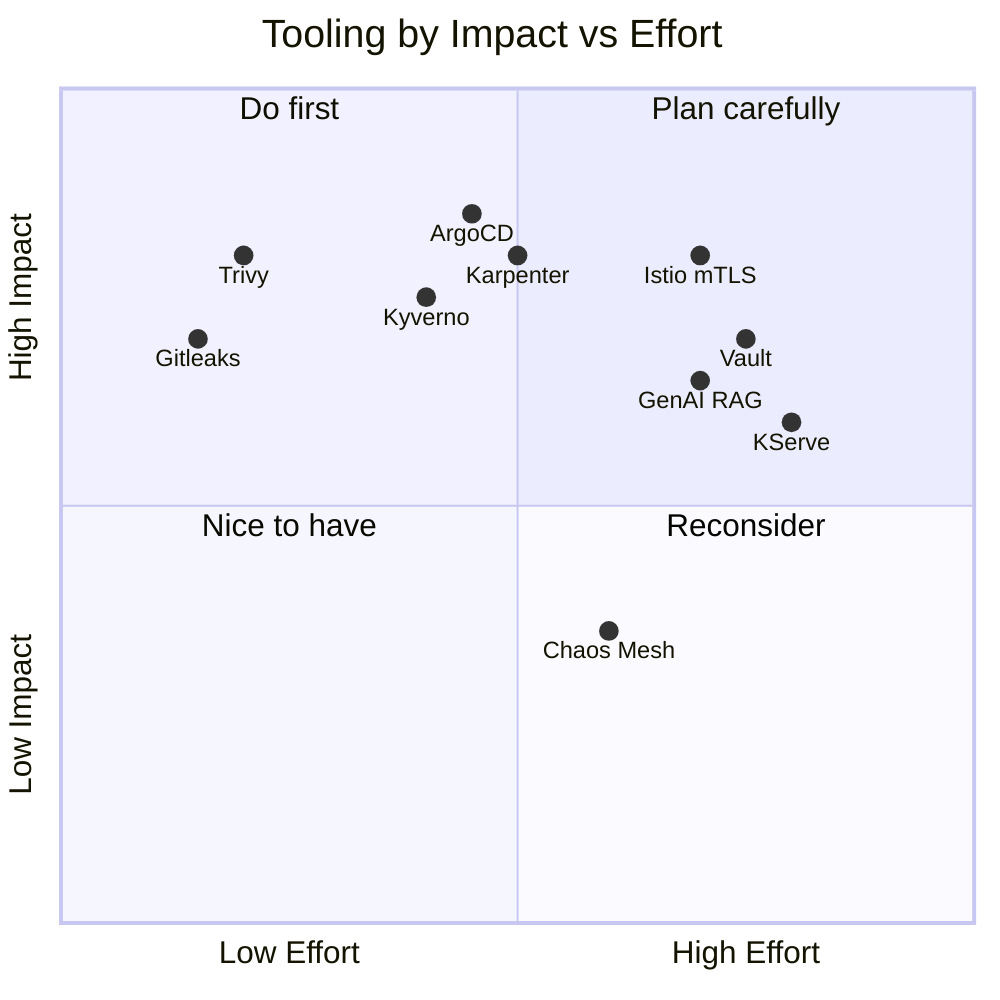

---

## 🗺️ Roadmap

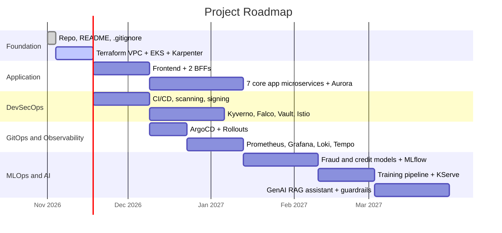

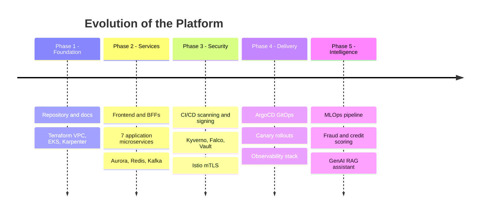

| Status | Item |
|:--:|---|
| ✅ | Repository scaffold, README, `.gitignore` |
| 🔜 | Terraform: VPC, EKS cluster, Karpenter |
| 🔜 | Frontend, 2 BFFs and 7 application microservices |
| 🔜 | CI/CD with scanning, SBOM and image signing |
| 🔜 | ArgoCD GitOps, Kyverno policies, Falco, Istio |
| 🔜 | Observability stack (Prometheus, Grafana, Loki, Tempo) |
| 🔜 | MLOps pipeline and 2 prediction APIs |
| 🔜 | GenAI assistant with RAG and guardrails |

---

## 📁 Repository Structure

```text
FinTech-Enterprise-Project/
├── .gitignore
└── README.md             # more folders are added as the project grows
```

---

<div align="center">

### 👩‍💻 Built by a DevOps engineer, for DevOps engineers

⭐ Star this repo to follow along as it grows.


</div>
