<div align="center">


</div>

> **An AWS FinTech platform, built layer by layer with Terraform.**
> Four isolated VPCs joined by a Transit Gateway, Amazon EKS with blue/green node groups, security scanned with Checkov, and deployed by a GitHub Actions pipeline that never stores an AWS key.

---

## 📑 Table of Contents

| # | Section | What you will find |
|:-:|---|---|
| 1 | [About This Project](#1-about-this-project) | What it is, and what is built today vs planned |
| 2 | [Platform Architecture](#2-platform-architecture) | The six layers, the regional picture, the tech stack |
| 3 | [Terraform Infrastructure: The 4 VPCs](#3-terraform-infrastructure-the-4-vpcs) | What Terraform builds, each VPC in plain words, routing and endpoints |
| 4 | [Traffic and Request Flows](#4-traffic-and-request-flows) | How a request and a payment travel through the platform |
| 5 | [Kubernetes Platform on EKS](#5-kubernetes-platform-on-eks) | Control plane, node groups, autoscaling, blue/green upgrades |
| 6 | [Microservices](#6-microservices) | The five services and how they talk |
| 7 | [Security](#7-security) | Defence in depth, the Checkov scan, IAM roles, keyless CI |
| 8 | [Infrastructure as Code](#8-infrastructure-as-code) | Folder layout, the four environments, remote state and locking |
| 9 | [CI/CD](#9-cicd) | The infrastructure pipeline and the application delivery path |
| 10 | [Observability](#10-observability) | Metrics, logs and alerts |
| 11 | [MLOps](#11-mlops) | The fraud model's training loop |
| 12 | [Roadmap](#12-roadmap) | Done, in progress, planned |
| 13 | [Repository Structure](#13-repository-structure) | Where everything lives |

<details>
<summary><b>Full list of the 24 diagrams</b></summary>

| Section | Diagrams |
|---|---|
| 2 | [Infrastructure layers](#21-infrastructure-layers) · [Regional architecture](#22-regional-architecture) |
| 3 | [What Terraform builds today](#31-what-terraform-builds-today) · [Hub-and-spoke network](#33-hub-and-spoke-network) · [One module, four VPCs](#34-one-module-four-vpcs) · [VPC endpoints](#35-vpc-endpoints) · [How a packet picks its path](#36-how-a-packet-picks-its-path) · [Transit Gateway route lookup](#37-transit-gateway-route-lookup) |
| 4 | [Live traffic flow](#41-live-traffic-flow) · [Payment hop by hop](#42-one-payment-hop-by-hop) · [Payment through the services](#43-one-payment-through-the-services) |
| 5 | [EKS platform](#5-kubernetes-platform-on-eks) |
| 6 | [Microservices](#6-microservices) |
| 7 | [Security checkpoints](#71-security-checkpoints) · [Checkov hardening](#72-checkov-security-scan) · [IAM roles](#73-iam-roles-per-environment) · [GitHub OIDC](#74-github-actions-to-aws-without-keys) |
| 8 | [State files](#82-remote-state-one-file-per-stack) · [State locking](#83-state-locking) |
| 9 | [Pipeline and environments](#91-infrastructure-pipeline-and-environments) · [App delivery and GitOps](#92-application-delivery-and-gitops) |
| 10–12 | [Observability](#10-observability) · [MLOps loop](#11-mlops) · [Roadmap](#12-roadmap) |

</details>

> **How to read this page:** every diagram is animated (the moving dots are traffic, events or state) and has a short explanation under it, followed by **🎤 interview talking points** you can say out loud.
> Sections are tagged 🟢 **Built** (the Terraform code is in this repository) or 🔵 **Target design** (the architecture the project is growing into).

---

## 1. About This Project

> **This repository is a replica of the FinTech platform from my past projects and professional work experience.**

It is an **AWS FinTech platform on Amazon EKS** made of **6 infrastructure layers** (CI/CD → Edge → Network → Orchestration → Application → Data) plus two pillars that cut across all of them (**Identity & Access** and **Observability**). It runs in **4 VPCs** (Edge, App, Database, Ops) joined by a **Transit Gateway**.

The project grows in stages. Each stage adds one layer, with security built in from the start.

<div align="center">

| ⚙️ Microservices | 🧱 Layers | 🏢 VPCs | 🌍 Environments | 🧰 Tools | ☁️ Region |
|:---:|:---:|:---:|:---:|:---:|:---:|
| **5** | **6 + 2 pillars** | **4 per environment** | **Prod · Stage · QA · Dev** | **48** | **us-east-1** |

</div>

### What is built today, and what is planned

| Status | Layer | What exists in this repository |
|:--:|---|---|
| 🟢 Built | **Foundation** | Remote state in S3 with native locking · IAM roles for the platform team, app teams and CI/CD |
| 🟢 Built | **Network** | 4 VPCs + Transit Gateway per environment · NAT · VPC endpoints · VPC Flow Logs · locked default security groups |
| 🟢 Built | **Storage and registry** | Versioned, KMS-encrypted S3 buckets with lifecycle rules · 4 ECR repositories with immutable tags and scan on push |
| 🟢 Built | **Kubernetes** | Amazon EKS 1.36 · 4 managed node groups (blue/green × core/ML) · Cluster Autoscaler with IRSA · encrypted secrets · audit logs |
| 🟢 Built | **Infrastructure pipeline** | GitHub Actions deploy and destroy workflows · OIDC login · Checkov gate · 4 environments |
| 🔵 Planned | **Edge** | Route 53 · CloudFront · WAF · Shield Advanced · API Gateway |
| 🔵 Planned | **Platform add-ons** | Karpenter · KEDA · Calico · Istio · Argo CD · Argo Rollouts |
| 🔵 Planned | **Data and services** | MySQL · Valkey · MongoDB · OpenSearch · Kafka · the 5 microservices |
| 🔵 Planned | **Operate and MLOps** | Prometheus · Grafana · Loki · Vault · Falco · Airflow · Kubeflow · MLflow · KServe |

---

## 2. Platform Architecture

### 2.1 Infrastructure Layers

🔵 **Target design** (layers 03 and 04 are partly 🟢 built)

<div align="center">
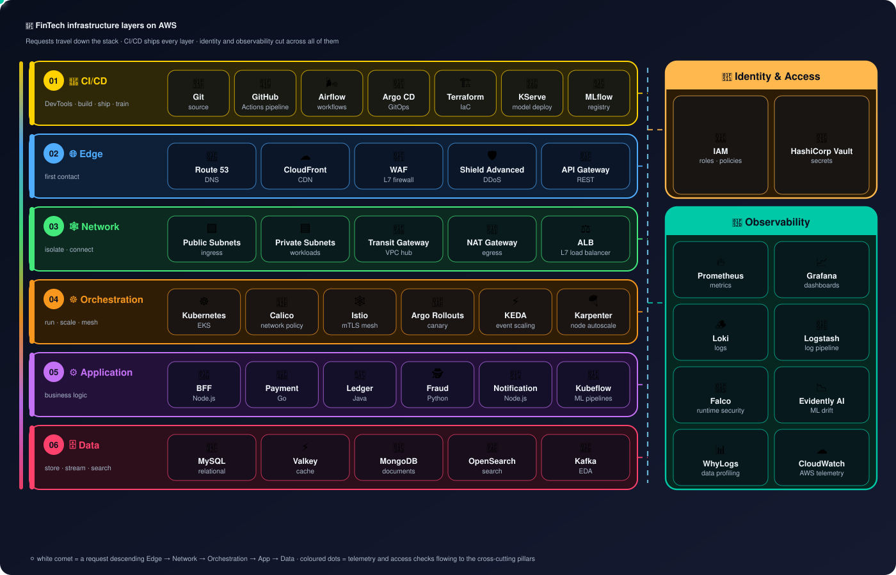
</div>

**📝 What this shows.** The platform is a stack of six layers. A customer request enters at the top (**Edge**) and travels down: through the **Network**, into **Kubernetes**, to the **Application** code and finally to the **Data** stores. **CI/CD** is the layer that ships every other layer. Two pillars stand beside the stack because every layer needs them: **Identity & Access** (who is allowed to do what) and **Observability** (can we see what is happening).

Thinking in layers keeps responsibilities clear. A network engineer can change a route without touching application code, and each layer adds its own security control, so no single mistake exposes the platform.

> 🎤 **Interview talking points**
> - "I design in layers so each team owns one concern and a change in one layer has a small blast radius."
> - "Identity and observability are not layers, they are cross-cutting: every layer authenticates, and every layer emits telemetry."

### 2.2 Regional Architecture

🔵 **Target design** (the VPCs, Transit Gateway, NAT, endpoints and EKS are 🟢 built)

<div align="center">
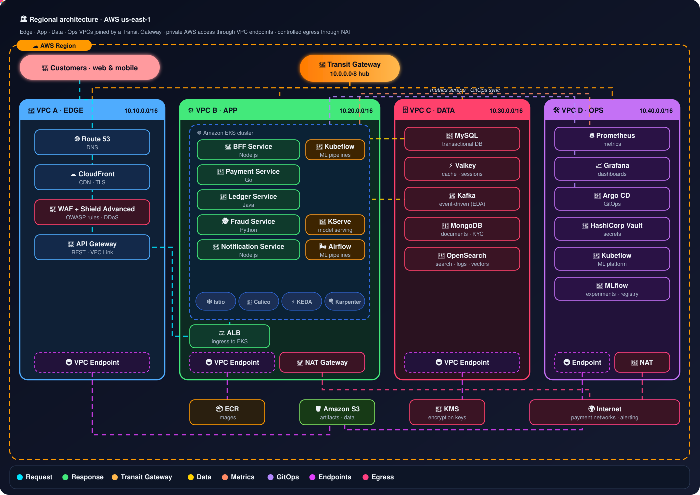
</div>

**📝 What this shows.** One AWS region, four VPCs, one hub. Each VPC has one job:

- **Edge** is the front door. It is the only place the public internet is meant to reach.
- **App** runs the workloads on EKS.
- **Data** holds the databases and has **no route to the internet at all**.
- **Ops** holds the tooling: monitoring, GitOps and secrets.

The **Transit Gateway** in the middle is the only road between them. AWS services such as ECR, S3 and KMS are reached through **VPC endpoints**, so that traffic never leaves the AWS network. Outbound calls to the internet go through a **NAT Gateway**, which allows traffic out but never in.

> 🎤 **Interview talking points**
> - "Separating edge, app, data and ops into their own VPCs is network segmentation, a core PCI-DSS requirement."
> - "The data tier has no internet path, in or out. It is reachable only over the Transit Gateway from the CIDRs I allow."

### 2.3 Tech Stack

**48 tools**, every one of them shown in the two diagrams above, grouped exactly like the layers.

#### 🚀 01 · CI/CD & DevTools

<sub>Build, test and ship apps, infrastructure and ML models</sub>


#### 🌐 02 · Edge

<sub>First contact for every request</sub>


#### 🕸️ 03 · Network

<sub>Isolate, connect and load-balance traffic</sub>


#### ☸️ 04 · Orchestration

<sub>Run, scale, secure and roll out workloads</sub>


#### ⚙️ 05 · Application

<sub>Business logic and ML pipelines</sub>


#### 🗄️ 06 · Data

<sub>Store, cache, search and stream</sub>


#### 🔑 · Identity & Access

<sub>Least privilege and secrets across every layer</sub>


#### 🔭 · Observability

<sub>Metrics, logs, runtime security and ML drift across every layer</sub>


#### ☁️ · Shared AWS Services

<sub>Reached privately through VPC endpoints</sub>


<details>
<summary><b>📋 Every tool and what it does (table)</b></summary>

| Layer | Tool | Role in this project |
|---|---|---|
| CI/CD & DevTools | **Git** | source control |
| CI/CD & DevTools | **GitHub Actions** | CI pipelines |
| CI/CD & DevTools | **Apache Airflow** | ML & data workflows |
| CI/CD & DevTools | **Argo CD** | GitOps delivery |
| CI/CD & DevTools | **Terraform** | infrastructure as code |
| CI/CD & DevTools | **KServe** | model serving |
| CI/CD & DevTools | **MLflow** | experiments & registry |
| Edge | **Route 53** | DNS |
| Edge | **CloudFront** | CDN · TLS |
| Edge | **AWS WAF** | L7 firewall |
| Edge | **Shield Advanced** | DDoS protection |
| Edge | **API Gateway** | REST API front door |
| Network | **Amazon VPC** | 4 VPCs |
| Network | **Public Subnets** | internet-facing |
| Network | **Private Subnets** | workloads & data |
| Network | **Transit Gateway** | VPC hub |
| Network | **NAT Gateway** | outbound only |
| Network | **ALB** | L7 load balancer |
| Network | **VPC Endpoints** | private AWS access |
| Orchestration | **Amazon EKS** | Kubernetes |
| Orchestration | **Calico** | network policy |
| Orchestration | **Istio** | mTLS service mesh |
| Orchestration | **Argo Rollouts** | canary · blue-green |
| Orchestration | **KEDA** | event-driven pod scaling |
| Orchestration | **Karpenter** | node autoscaling |
| Application | **Node.js** | BFF · Notification |
| Application | **Go** | Payment |
| Application | **Java** | Ledger |
| Application | **Python** | Fraud |
| Application | **Kubeflow** | ML pipelines |
| Data | **MySQL** | transactions · ledger |
| Data | **Valkey** | cache · sessions |
| Data | **MongoDB** | documents |
| Data | **OpenSearch** | search · logs |
| Data | **Apache Kafka** | event-driven (EDA) |
| Identity & Access | **AWS IAM** | roles · policies |
| Identity & Access | **HashiCorp Vault** | secrets |
| Identity & Access | **AWS KMS** | encryption keys |
| Observability | **Prometheus** | metrics |
| Observability | **Grafana** | dashboards · alerts |
| Observability | **Loki** | logs |
| Observability | **Logstash** | log pipeline |
| Observability | **Falco** | runtime security |
| Observability | **Evidently AI** | model drift |
| Observability | **WhyLogs** | data profiling |
| Observability | **CloudWatch** | AWS telemetry |
| Shared AWS Services | **Amazon ECR** | container images |
| Shared AWS Services | **Amazon S3** | artifacts · data · state |

**Total: 48 tools**

</details>

### 2.4 Layers at a Glance

| # | Layer | Tools | Purpose |
|:-:|---|---|---|
| 01 | 🚀 **CI/CD & DevTools** | Git · GitHub Actions · Airflow · Argo CD · Terraform (IaC) · KServe · MLflow | Build, test, ship apps, infrastructure and ML models |
| 02 | 🌐 **Edge** | Route 53 (DNS) · CloudFront (CDN) · AWS WAF · AWS Shield Advanced · API Gateway (REST) | First contact: DNS, caching, L7 filtering, DDoS protection, API front door |
| 03 | 🕸️ **Network** | Public subnets · Private subnets · AWS Transit Gateway · NAT Gateway · ALB · VPC endpoints | Isolate, connect and load-balance traffic |
| 04 | ☸️ **Orchestration** | Kubernetes (EKS) · Calico · Istio · Argo Rollouts · KEDA · Karpenter | Run, scale, secure and progressively deliver workloads |
| 05 | ⚙️ **Application** | BFF (Node.js) · Payment (Go) · Ledger (Java) · Fraud (Python) · Notification (Node.js) · Kubeflow ML Pipelines | Business logic and ML pipelines |
| 06 | 🗄️ **Data** | MySQL · Valkey · MongoDB · OpenSearch · Kafka (event-driven architecture) | Store, cache, search and stream data |
| 🔑 | **Identity & Access** | AWS IAM (roles, policies) · HashiCorp Vault | Least privilege and secrets, across every layer |
| 🔭 | **Observability** | Prometheus · Grafana · Loki · Logstash · Falco · Evidently AI · WhyLogs · CloudWatch | Metrics, logs, runtime security and ML/data drift, across every layer |

---

## 3. Terraform Infrastructure: The 4 VPCs

🟢 **Built** · code in [`Terraform-FinTech-Infra/`](Terraform-FinTech-Infra/) · detailed guide in [`Terraform-FinTech-Infra/README.md`](Terraform-FinTech-Infra/README.md)

### 3.1 What Terraform Builds Today

<div align="center">
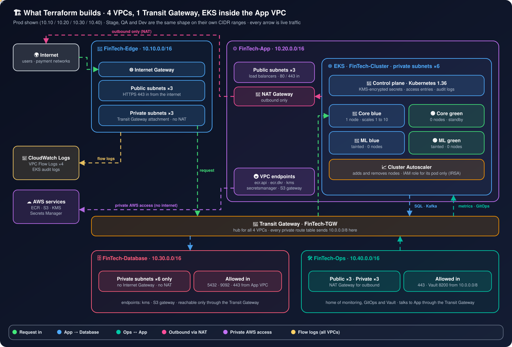
</div>

**📝 What this shows.** This is the real infrastructure that `terraform apply` creates for one environment. Follow the coloured arrows:

| Arrow | Traffic | Path |
|---|---|---|
| 🟢 Green | A request coming **in** | Internet → Edge VPC → Transit Gateway → EKS nodes in the App VPC |
| 🔵 Blue | App talking to its **database** | EKS → Transit Gateway → Database VPC |
| 🟦 Teal | **Ops** tooling | Ops VPC → Transit Gateway → App VPC (metrics, GitOps) |
| 🩷 Pink | Calls going **out** | EKS → NAT Gateway → Internet (outbound only, nothing can come back in uninvited) |
| 🟣 Purple | Private **AWS access** | EKS → VPC endpoints → ECR, S3, KMS, Secrets Manager (never over the internet) |
| 🟡 Yellow | **Flow logs** | Every VPC → CloudWatch Logs (a record of every accepted and rejected connection) |

Stage, QA and Dev are built from the **same code** and look exactly the same. Only the names and CIDR ranges change.

> 🎤 **Interview talking points**
> - "Inbound, east-west, outbound and AWS-service traffic each take a different, controlled path. That is the point of the design."
> - "Private subnets reach the internet only through NAT, which is one-way: out, never in."
> - "Flow logs on every VPC give me the evidence an auditor asks for and the data I need during an incident."

### 3.2 The 4 VPCs in Plain Words

Think of each VPC as a **separate building** with its own address range. Buildings do not share corridors, so a problem in one cannot walk into another. The Transit Gateway is the **guarded bridge** between them.

| VPC | Think of it as | What Terraform puts in it (Prod) | Internet access | Who may connect in |
|---|---|---|---|---|
| 🚪 **FinTech-Edge** `10.10.0.0/16` | The **reception desk** | 3 public + 3 private subnets, Internet Gateway | Inbound HTTPS only | Anyone on `443` (public tier). Private tier: only `10.0.0.0/8` |
| ⚙️ **FinTech-App** `10.20.0.0/16` | The **office floor** where work happens | 3 public + 6 private subnets, NAT Gateway, EKS cluster, endpoints for ECR, Secrets Manager, KMS and S3 | Out through NAT | `80`/`443` on the public tier for load balancers. Private tier: `443`, Vault `8200`, EFS `2049` from inside |
| 🗄️ **FinTech-Database** `10.30.0.0/16` | The **vault room** | 6 private subnets only, endpoints for KMS and S3 | **None.** No Internet Gateway, no NAT | Only the App VPC on `5432`, `9092`, `443` (and Ops on `443`) |
| 🛠️ **FinTech-Ops** `10.40.0.0/16` | The **control room** | 3 public + 3 private subnets, NAT Gateway | Out through NAT | Only `10.0.0.0/8` on `443` and Vault `8200` |

**The building blocks, in simple words**

- 🌐 **Public subnet**: has a route to the Internet Gateway. Only load balancers and NAT Gateways live here.
- 🔐 **Private subnet**: no route in from the internet. Nodes, databases and tools live here.
- 🔁 **NAT Gateway**: a one-way door. Private workloads can call out (for example to a payment network), but nobody outside can start a connection in.
- 🚇 **VPC endpoint**: a private tunnel to an AWS service. Image pulls from ECR and secret reads never touch the internet, and you pay less NAT traffic.
- 🔀 **Transit Gateway**: the hub. Every private route table has one extra route, `10.0.0.0/8 → Transit Gateway`. Traffic for the VPC's own `/16` stays local because the more specific route wins.
- 🧱 **Security group**: a firewall around a resource. Routes decide *where traffic can go*; security groups decide *what is allowed*.
- 📜 **VPC Flow Logs**: a logbook of every connection, kept for one year in CloudWatch.
- 🏗️ **3 Availability Zones**: subnets are spread across `us-east-1a`, `1b` and `1c`, so one data centre failing does not take the platform down.

> 🎤 **Interview talking points**
> - "Each VPC has a single purpose, so its security rules are short and easy to audit."
> - "CIDR ranges never overlap, across VPCs or across environments, so everything can be routed through one Transit Gateway without NAT tricks."
> - "Routing answers 'can the packet get there', security groups answer 'is it allowed'. You need both."

### 3.3 Hub-and-Spoke Network

<div align="center">
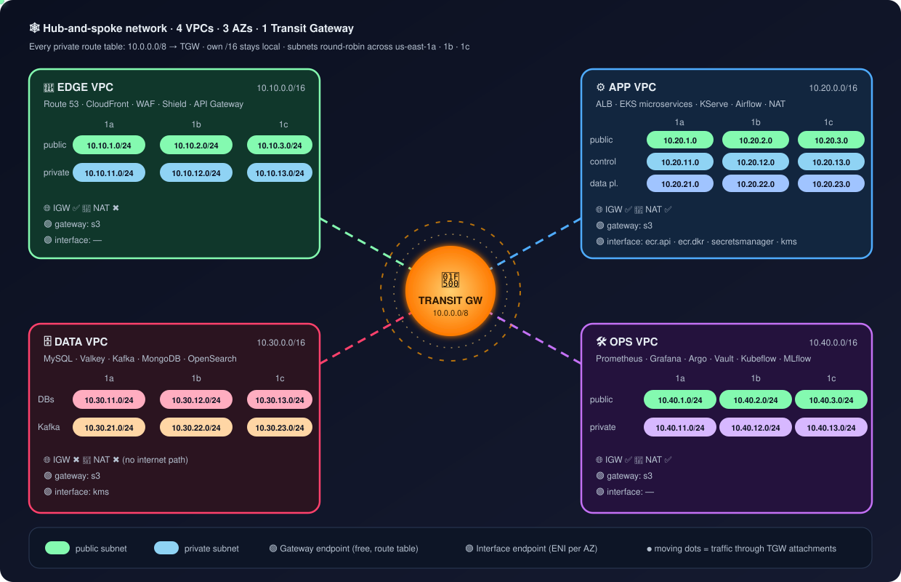
</div>

**📝 What this shows.** The exact subnets of the Prod environment, laid out per Availability Zone. Every VPC is a **spoke** and the Transit Gateway is the **hub**. The dots moving along the dashed lines are packets crossing a Transit Gateway attachment.

Notice the App VPC has two rows of private subnets: EKS spreads its control-plane network cards and its worker nodes across all six. The Data VPC is the only one with **no** Internet Gateway and **no** NAT.

> 🎤 **Interview talking points**
> - "With hub-and-spoke, adding a fifth VPC means one new attachment. With VPC peering it would mean four new connections; a full mesh needs n(n-1)/2."
> - "Subnets are assigned to AZs round-robin, so six subnets give exactly two per AZ."

### 3.4 One Module, Four VPCs

<div align="center">
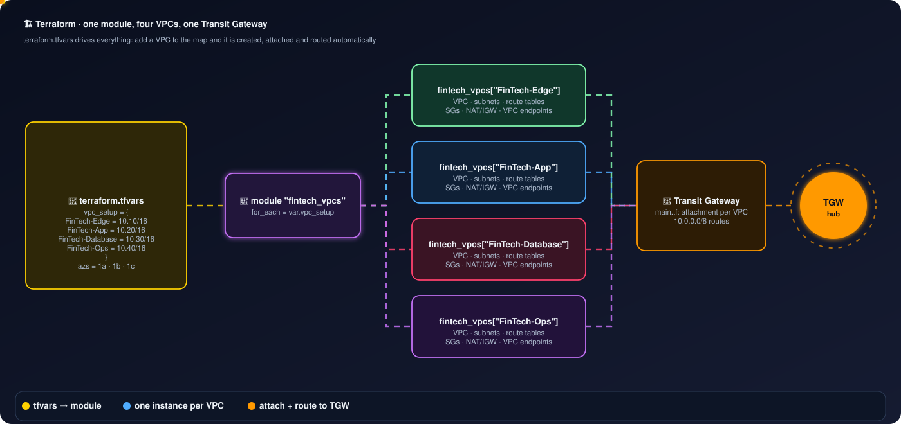
</div>

**📝 What this shows.** All four VPCs come from **one reusable module** (`Networking/modules/vpc`). The root module loops over a map in `terraform.tfvars` with `for_each`: one map entry becomes one complete VPC with its subnets, route tables, security groups, NAT, endpoints, flow logs and Transit Gateway attachment.

```hcl
module "fintech_vpcs" {
  source   = "../modules/vpc"
  for_each = var.vpc_setup          # one entry per VPC in terraform.tfvars

  vpc_name       = each.key         # e.g. "FinTech-App"
  vpc_cidr_block = each.value.cidr  # e.g. "10.20.0.0/16"
  tgw_id         = module.tgw.tgw_id
  # ...
}
```

Adding a fifth VPC is a **data change**, not a code change: add one entry to the map.

> 🎤 **Interview talking points**
> - "I use `for_each` instead of `count` because resources are tracked by name, so removing one VPC does not shift and recreate the others."
> - "One module, four environments, sixteen VPCs. Roughly thirty resources per VPC from a few dozen lines of configuration."

### 3.5 VPC Endpoints

<div align="center">
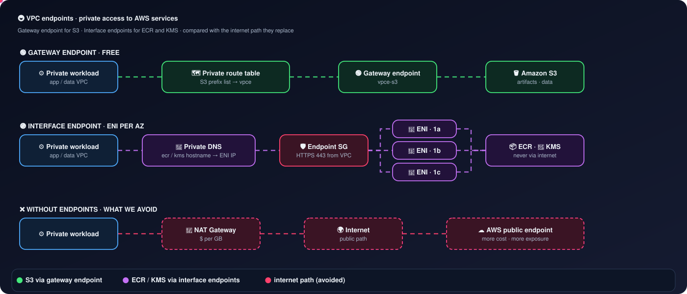
</div>

**📝 What this shows.** Two kinds of private tunnel to AWS services, and the path they replace:

- 🟢 **Gateway endpoint (S3)**: free. It is just an entry in the private route table.
- 🟣 **Interface endpoint (ECR, KMS, Secrets Manager)**: a network card in one private subnet per AZ, protected by a security group that allows HTTPS from inside the VPC only. Private DNS means application code needs **no changes**.
- ❌ **Without endpoints**: the same traffic would go through the NAT Gateway and over the public internet, costing more and exposing more.

> 🎤 **Interview talking points**
> - "Endpoints keep image pulls and secret reads on the AWS backbone, which is both cheaper and a smaller attack surface."
> - "Gateway endpoints are free, so S3 always gets one. Interface endpoints cost per AZ, so I add them only where the traffic justifies it."

### 3.6 How a Packet Picks Its Path

<div align="center">
</div>

**📝 What this shows.** The questions a route table asks about every packet leaving a pod, in order:

1. Is the destination in **my own VPC**? → deliver locally.
2. Is it an **AWS service** with an endpoint? → use the endpoint.
3. Is it in `10.0.0.0/8` (**another FinTech VPC**)? → send to the Transit Gateway.
4. Does this VPC have a **NAT Gateway**? → send out to the internet.
5. Otherwise → **dropped**. This is exactly what happens in the Data VPC, by design.

> 🎤 **Interview talking points**
> - "Route tables use longest-prefix match, so the VPC's own /16 always beats the 10.0.0.0/8 route to the Transit Gateway."
> - "No default route means no internet. I do not block the Data VPC with a rule; the path simply does not exist."

### 3.7 Transit Gateway Route Lookup

<div align="center">
</div>

**📝 What this shows.** One request from an app pod to a database, step by step. The App route table sends it to the Transit Gateway, the Transit Gateway's own route table finds which attachment owns the destination CIDR, and the packet is delivered into the Data VPC. The reply takes the same road back.

Routing only makes the connection *possible*. The Database VPC's security group still has to **allow** that port from the App VPC's CIDR.

> 🎤 **Interview talking points**
> - "Two lookups happen: the VPC route table, then the Transit Gateway route table."
> - "A next step is separate Transit Gateway route tables, so Edge can never route to Data directly, even by mistake."

### 3.8 What One Apply Creates

`terraform apply` on `Networking/Prod` creates **126 resources**:

| Resource | Count | Resource | Count |
|---|:-:|---|:-:|
| VPCs | 4 | Security groups (public, private, endpoint) | 11 |
| Subnets (9 public + 18 private) | 27 | Default security groups, locked | 4 |
| Route tables (3 public + 4 private) | 7 | S3 gateway endpoints | 4 |
| Internet Gateways | 3 | Interface endpoints | 5 |
| NAT Gateways + Elastic IPs | 2 + 2 | VPC Flow Logs (+ log group and IAM role each) | 4 |
| Transit Gateway + attachments | 1 + 4 | Routes and associations | the rest |

> 💰 **Cost note (before data charges).** Gateway endpoints are free. Interface endpoints cost about $7.30 per AZ per month each (5 × 3 AZs ≈ $110), each NAT Gateway about $33 per month (2 ≈ $66), each Transit Gateway attachment about $36 per month (4 ≈ $146) and the EKS control plane about $73 per month. That is why the destroy pipeline exists: the lab is torn down when it is not in use.

---

## 4. Traffic and Request Flows

🔵 **Target design** · these three diagrams show how the finished platform handles traffic on top of the network in section 3

### 4.1 Live Traffic Flow

<div align="center">
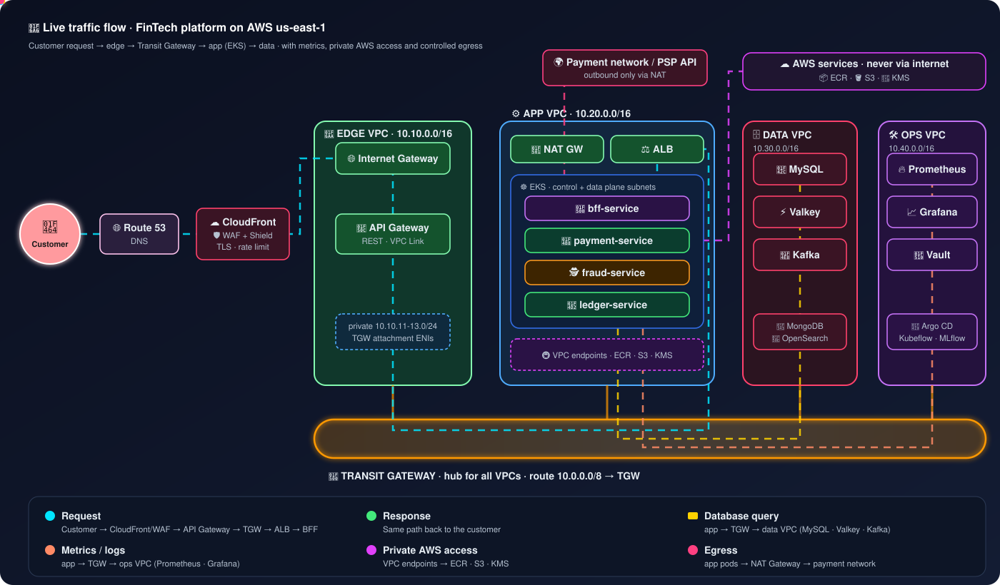
</div>

**📝 What this shows.** Six kinds of traffic moving at the same time: the customer request and its response, database queries, metrics and logs, private AWS access, and outbound calls. Each one has its own colour and its own path, and none of them shares a path it does not need.

> 🎤 **Interview talking points**
> - "North-south traffic enters at the edge; east-west traffic between VPCs always crosses the Transit Gateway."
> - "Because every traffic type has one defined path, anything on another path is an anomaly worth alerting on."

### 4.2 One Payment, Hop by Hop

<div align="center">
</div>

**📝 What this shows.** Every network hop of a single payment, numbered in order: DNS lookup, CloudFront and WAF at the edge, API Gateway, across the Transit Gateway to the load balancer and the payment pod, a short-lived database credential from Vault, the database write, the outbound call to the card network through NAT, and the response travelling back.

> 🎤 **Interview talking points**
> - "The request is filtered three times before it reaches a pod: WAF, API Gateway throttling and the load balancer."
> - "The pod never holds a long-lived database password. Vault issues a short-lived one for each session."

### 4.3 One Payment, Through the Services

<div align="center">
</div>

**📝 What this shows.** The same payment seen from the application side. The BFF hands it to the Payment service, which asks the Fraud service for a risk score. A **low-risk** payment is written to the ledger and an event is published; a **high-risk** one is held and flagged. The Notification service reacts to the event, so sending a receipt never slows down the payment itself.

> 🎤 **Interview talking points**
> - "The fraud check is synchronous because the decision is needed before money moves. Notifications are asynchronous through Kafka because they are not."
> - "Event-driven design means I can add a new consumer, such as analytics, without touching the Payment service."

---

## 5. Kubernetes Platform on EKS

🟢 **Built** · code in [`Terraform-FinTech-Infra/EKS/`](Terraform-FinTech-Infra/EKS/)

<div align="center">
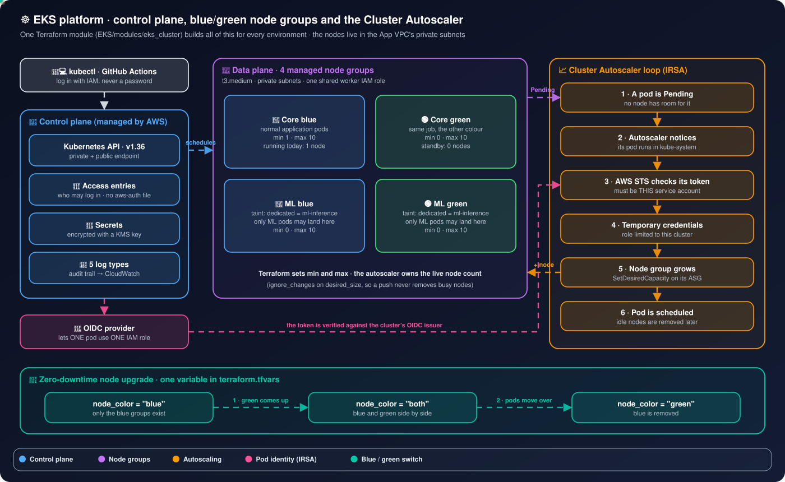
</div>

**📝 What this shows.** Everything one Terraform module (`EKS/modules/eks_cluster`) builds:

- **Control plane (left).** AWS runs the Kubernetes API. Logins use **EKS access entries** tied to IAM, Kubernetes **Secrets are encrypted** with a KMS key, and all five log types (including the **audit log**) go to CloudWatch.
- **Data plane (middle).** Four managed node groups in the App VPC's private subnets. Only **Core blue** runs a node by default. The other three exist at **zero nodes**, so they cost nothing until needed. The **ML** groups are *tainted*, which means only pods that explicitly tolerate the taint (ML inference) can land on them.
- **Cluster Autoscaler (right).** When a pod cannot be scheduled, the autoscaler adds a node; when nodes sit idle, it removes them. It gets AWS permissions through **IRSA**: its pod, and only its pod, can use one IAM role that is limited to this cluster's node groups.
- **Blue/green switch (bottom).** One variable, `node_color`, moves the cluster from `blue` → `both` → `green`. New nodes come up before old ones are removed.

> 🎤 **Interview talking points**
> - "IRSA gives one pod one IAM role, instead of every pod sharing the node's role. That is least privilege at pod level."
> - "Terraform owns `min_size` and `max_size`; the autoscaler owns `desired_size`. I use `ignore_changes` so a pipeline run never removes nodes that are busy."
> - "Node groups at zero plus scale-from-zero give me ready capacity with no idle cost."
> - "Blue/green at node-group level gives an instant rollback path for an AMI or Kubernetes upgrade."

---

## 6. Microservices

🔵 **Target design**

All five services run on **Amazon EKS in the App VPC**, behind the load balancer, inside the **Istio** mesh with **Calico** network policies. **KEDA** scales pods on load and Kafka lag.

<div align="center">

| # | Service | Language | Responsibility | Calls | Data (data VPC) |
|:-:|---|:-:|---|---|---|
| 1 | 🔀 **BFF Service** | Node.js | Single API for web and mobile; aggregates and shapes responses | Payment, Ledger | Valkey (sessions, cache) |
| 2 | 💸 **Payment Service** | Go | Payment initiation and orchestration | Fraud, Ledger, Kafka | MySQL |
| 3 | 📒 **Ledger Service** | Java | Double-entry ledger and balances | – | MySQL, OpenSearch (search, audit) |
| 4 | 🕵️ **Fraud Service** | Python | Real-time fraud scoring | KServe model | MongoDB (fraud cases) |
| 5 | 🔔 **Notification Service** | Node.js | Email, SMS and push from payment events | – | Kafka (consumer), MongoDB |

</div>

| ML component | Where | Role |
|---|---|---|
| 🚀 **KServe** | app VPC (EKS) | Serves the fraud model to the Fraud Service |
| 🌬️ **Airflow** | app VPC (EKS) | Orchestrates data and training workflows |
| 🧪 **Kubeflow** | app + ops VPCs | ML pipelines: train and evaluate |
| 📒 **MLflow** | ops VPC | Experiment tracking and model registry |

<div align="center">
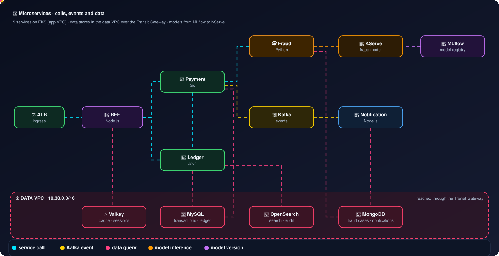
</div>

**📝 What this shows.** How the five services depend on each other. Solid service calls go left to right from the load balancer. Kafka events decouple the Notification service. Every database lives in the **Data VPC** and is reached over the Transit Gateway, and the Fraud service calls a model served by **KServe**.

> 🎤 **Interview talking points**
> - "Each service owns its data store. No two services share a database, so they can be deployed and scaled independently."
> - "The BFF (backend for frontend) gives web and mobile one API, so the internal services can change without breaking clients."

---

## 7. Security

Every layer adds its own control, and nothing depends on a single defence.

### 7.1 Security Checkpoints

🔵 **Target design**

<div align="center">
</div>

**📝 What this shows.** A clean request passes nine gates on its way to a service. A malicious one (here, an SQL injection) is stopped early at the WAF and never reaches the network. The six rows underneath are the defence layers: edge, network, orchestration, identity, detection, and model and data trust.

> 🎤 **Interview talking points**
> - "Defence in depth: if one control fails or is misconfigured, the next one still stands."
> - "The earlier a bad request is dropped, the cheaper it is. That is why WAF and Shield sit at the edge."

### 7.2 Checkov Security Scan

🟢 **Built**

<div align="center">
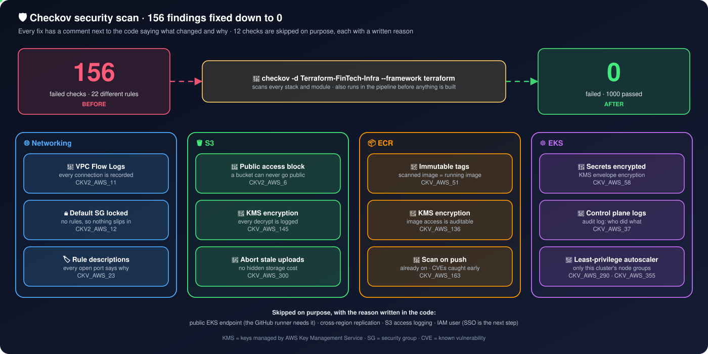
</div>

**📝 What this shows.** [Checkov](https://www.checkov.io/) reads the Terraform code and compares it with hundreds of security rules. The first scan found **156 failures across 22 rules**. After the fixes it reports **0 failed, 1000 passed**. Each fix has a comment next to the code that says **what changed and why**, for example:

```hcl
# CHECKOV FIX (CKV2_AWS_12)
# WHAT: took over the VPC's built-in "default" security group and gave it NO rules.
# WHY:  AWS creates this group in every VPC and it allows traffic by default. Anything launched
#       without a security group lands in it, so it must allow nothing (CIS AWS benchmark 5.4).
resource "aws_default_security_group" "default" {
  vpc_id = aws_vpc.vpc.id
}
```

Twelve checks are **skipped on purpose**, each with the reason written in the code. Example: the EKS public endpoint stays on because the GitHub-hosted runner and the engineer's machine sit outside the VPC, and access is still protected by IAM authentication. The same scan now runs **inside the pipeline**, before anything is created.

> 🎤 **Interview talking points**
> - "Security scanning is shift-left: the pipeline fails on a misconfiguration before any resource exists."
> - "I do not blindly fix or blindly suppress. Every skip has a written, reviewable reason."
> - "The biggest wins were VPC flow logs, locking the default security group, KMS encryption for S3, ECR and Kubernetes secrets, and scoping the autoscaler's IAM policy to its own cluster."

### 7.3 IAM Roles per Environment

🟢 **Built** · code in [`Terraform-FinTech-Infra/IAM/`](Terraform-FinTech-Infra/IAM/)

<div align="center">
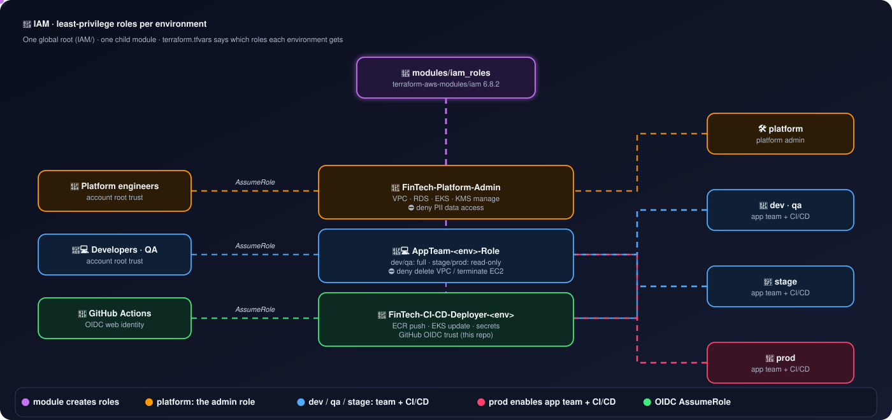
</div>

**📝 What this shows.** Three kinds of role, created by one module that runs once per environment:

| Role | Who uses it | What it may do | Guardrail (explicit Deny) |
|---|---|---|---|
| `FinTech-Platform-Admin` | Platform engineers | Manage VPC, RDS, EKS, KMS | Cannot read customer data (S3 objects, DB connect, KMS decrypt) |
| `AppTeam-<env>-Role` | Developers and QA | **Full** in `dev` and `qa`, **read-only** in `stage` and `prod` | Cannot delete VPCs, subnets, the Transit Gateway or terminate instances |
| `FinTech-CI-CD-Deployer-<env>` | GitHub Actions | Push images, update the cluster, read secrets | Trusts only this repository through OIDC |

The module works out the permissions **from the environment name**, so `stage` and `prod` are automatically stricter without any extra code.

> 🎤 **Interview talking points**
> - "An explicit Deny always wins over any Allow, so the guardrails cannot be bypassed by attaching another policy."
> - "Even the platform admin cannot read customer data. Managing the infrastructure and reading the data are separate duties."

### 7.4 GitHub Actions to AWS Without Keys

🟢 **Built**

<div align="center">
</div>

**📝 What this shows.** How the pipeline logs in to AWS with **no stored access keys**. GitHub issues a signed identity token for the workflow run. AWS STS checks that the token really comes from **this repository**, and only then hands back **temporary credentials** that expire on their own.

> 🎤 **Interview talking points**
> - "There is no long-lived secret to leak or rotate. Each run gets credentials that last minutes."
> - "The trust policy pins the role to one repository, so a workflow in any other repository cannot assume it."

---

## 8. Infrastructure as Code

🟢 **Built**

### 8.1 Folder Layout and Environments

Every stack follows the same pattern: **reusable child modules** in `modules/`, and **root folders** where `terraform` is run.

- 🌍 **Global stacks** (one copy for the whole AWS account): `IAM/`, `S3/`, `ECR/`
- 🧪 **Environment stacks** (one root folder per environment): `Networking/` and `EKS/`, each with `Prod/`, `Stage/`, `QA/` and `Dev/`

```text
Terraform-FinTech-Infra/
├── IAM/                         # GLOBAL: roles for every environment
│   └── modules/iam_roles/
├── S3/                          # GLOBAL: compliance buckets
│   └── modules/s3_bucket/
├── ECR/                         # GLOBAL: container registry
│   └── modules/ecr_repository/
├── Networking/
│   ├── modules/vpc/             # one VPC (reused 4 times per environment)
│   ├── modules/tgw/             # the Transit Gateway
│   └── Prod/ Stage/ QA/ Dev/    # one root per environment
└── EKS/
    ├── modules/eks_cluster/     # control plane, node groups, IAM, OIDC, autoscaler
    └── Prod/ Stage/ QA/ Dev/    # one root per environment
```

Every root folder holds the same seven files, so anyone who knows one stack can find their way around all of them:

| File | Question it answers |
|---|---|
| `terraform.tfvars` | **What** values does this stack use? (the only file you edit day to day) |
| `variables.tf` | **Which** inputs exist, and what type are they? |
| `locals.tf` | What can be **worked out** from those inputs? |
| `main.tf` | **What** gets built, and from which module? |
| `outputs.tf` | What do we **get back** after apply? |
| `backend.tf` / `providers.tf` | **Where** is the state, and which AWS region? |

**The four environments use the same code and differ only in `terraform.tfvars`:**

| Environment | VPC CIDRs (Edge · App · Database · Ops) | EKS cluster | Node groups |
|---|---|---|---|
| **Prod** | `10.10` · `10.20` · `10.30` · `10.40` | `FinTech-Cluster` | blue + green |
| **Stage** | `10.50` · `10.60` · `10.70` · `10.80` | `FinTech-Cluster-Stage` | blue |
| **QA** | `10.90` · `10.100` · `10.110` · `10.120` | `FinTech-Cluster-QA` | blue |
| **Dev** | `10.130` · `10.140` · `10.150` · `10.160` | `FinTech-Cluster-Dev` | blue |

> 🎤 **Interview talking points**
> - "Environments are folders, not branches or workspaces, so the difference between Prod and Stage is visible in a normal file diff."
> - "The module is the single source of truth. A fix made once reaches every environment."
> - "CIDR ranges are planned so no two VPCs overlap anywhere, which keeps future cross-environment connectivity possible."

### 8.2 Remote State, One File per Stack

<div align="center">
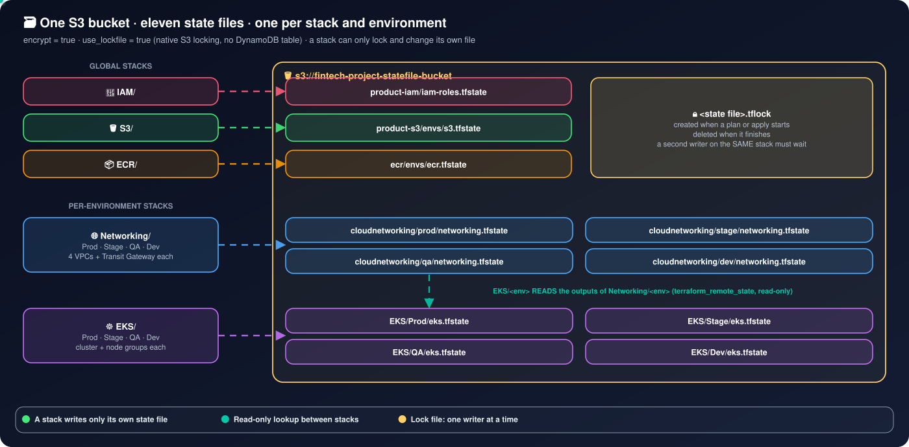
</div>

**📝 What this shows.** Terraform remembers what it built in a **state file**. Here every stack and every environment has **its own** state file inside one encrypted S3 bucket: three global files and four each for Networking and EKS.

The teal arrow is the only link between stacks: `EKS/<env>` **reads** the outputs of `Networking/<env>` (subnet IDs and the security group) through `terraform_remote_state`. It is read-only, so EKS can never change the network.

**Why split the state?**

- 💥 **Small blast radius.** A mistake in the QA network cannot touch the Prod cluster.
- ⚡ **Faster plans.** Each stack only refreshes its own resources.
- 🔒 **Parallel work.** Different stacks lock different files.

> 🎤 **Interview talking points**
> - "`terraform destroy` empties a state file but does not delete it. The same file is reused on the next apply."
> - "Remote state outputs are a contract between stacks: the network team publishes, application stacks consume."
> - "Bucket versioning lets me roll back a state file if it is ever corrupted."

### 8.3 State Locking

<div align="center">
</div>

**📝 What this shows.** What happens when two people run `terraform apply` on the same stack. The first run creates a small `.tflock` file next to the state. The second run sees the lock and stops instead of overwriting the first one's work. When the first run finishes, the lock is deleted and the second can proceed.

This uses Terraform's **native S3 locking** (`use_lockfile = true`), so no DynamoDB table is needed.

> 🎤 **Interview talking points**
> - "Without locking, two concurrent applies can corrupt the state. Locking makes writes one at a time."
> - "Since Terraform 1.10 the S3 backend can lock by itself, which removes the DynamoDB table older setups needed."

### 8.4 Pinned Versions

| Component | Version | Where it is set |
|---|---|---|
| Terraform | `~> 1.17` (pipeline uses `1.17.2`) | every module's `versions.tf` |
| AWS provider | `~> 6.72` | every module's `versions.tf` + `.terraform.lock.hcl` |
| Helm / TLS providers | `~> 3.3` / `~> 4.0` | `EKS/modules/eks_cluster/versions.tf` |
| terraform-aws-modules/iam | `6.8.2` | `IAM/modules/iam_roles/main.tf` |
| Kubernetes (EKS) | `1.36` | `EKS/<env>/terraform.tfvars` |
| Cluster Autoscaler | chart `9.60.0`, image `v1.36.2` | `EKS/<env>/terraform.tfvars` |
| Checkov | `3.4.3` | the deploy workflow |

---

## 9. CI/CD

### 9.1 Infrastructure Pipeline and Environments

🟢 **Built** · workflows in [`.github/workflows/`](.github/workflows/)

<div align="center">
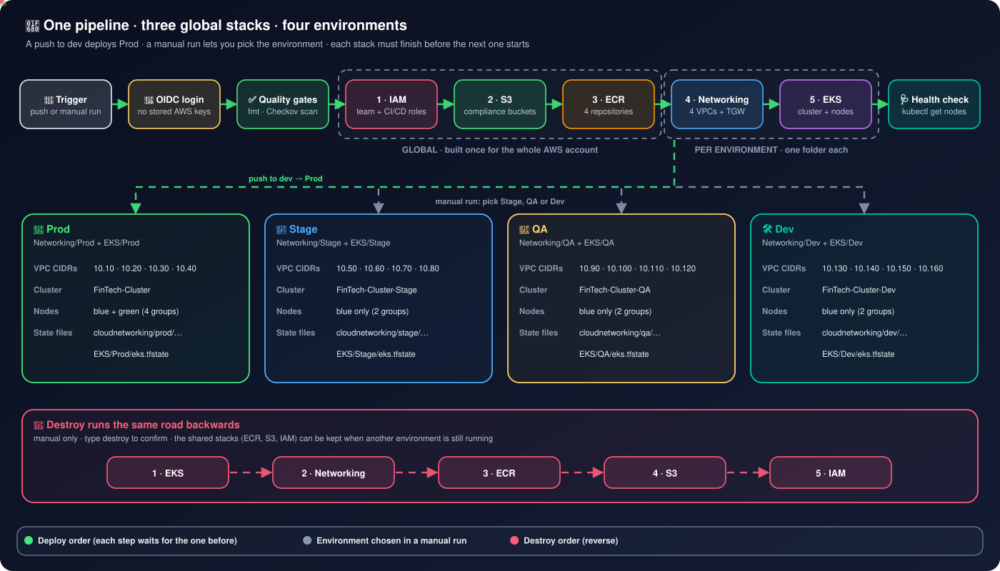
</div>

**📝 What this shows.**

- **Top row: the deploy pipeline** (`4.fintech-infra-deploy.yaml`). It logs in with OIDC, runs two quality gates (`terraform fmt` and the Checkov scan) and then builds the stacks **in dependency order** on a single runner: IAM → S3 → ECR → Networking → EKS. Each step must succeed before the next one starts. Networking has to finish before EKS because EKS is placed inside the network's subnets.
- **Middle: the four environments.** A push to `dev` that changes Prod-related code deploys **Prod**. A manual run lets you pick Stage, QA or Dev.
- **Bottom: the destroy pipeline** (`5.fintech-infra-destroy.yaml`). Manual only, with a typed confirmation. It runs the same road **backwards**, because a VPC cannot be deleted while a cluster is still attached to it.

Deploy and destroy share one **concurrency group**, so they can never run at the same time and fight over the same state.

> 🎤 **Interview talking points**
> - "Every stack runs the same four commands: init, validate, plan to a file, apply that file. What was reviewed is exactly what is applied."
> - "Path filters mean a change to the Stage folder or the README does not redeploy Prod."
> - "The destroy workflow needs a typed confirmation and only runs from one branch. Destructive actions should be hard to trigger by accident."

### 9.2 Application Delivery and GitOps

🔵 **Target design**

<div align="center">
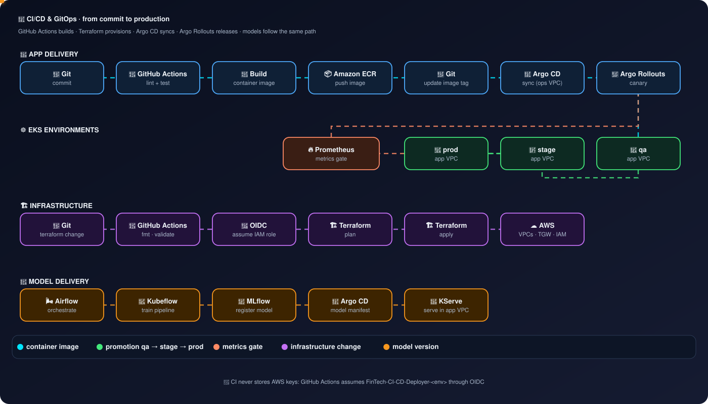
</div>

**📝 What this shows.** Three delivery paths that share the same principles:

- **Applications:** GitHub Actions builds and scans an image, pushes it to ECR and updates the image tag in Git. **Argo CD** notices the change and syncs the cluster, and **Argo Rollouts** releases it as a canary, promoted from `qa` to `stage` to `prod` only when the metrics look healthy.
- **Infrastructure:** the Terraform pipeline from section 9.1.
- **Models:** Airflow and Kubeflow train, MLflow registers, and KServe serves, through the same GitOps path.

> 🎤 **Interview talking points**
> - "With GitOps, Git is the single source of truth. The cluster pulls its desired state, so CI never needs cluster-admin credentials."
> - "A canary release exposes a new version to a small share of traffic first, and rolls back automatically if error rates rise."

---

## 10. Observability

🔵 **Target design**

<div align="center">
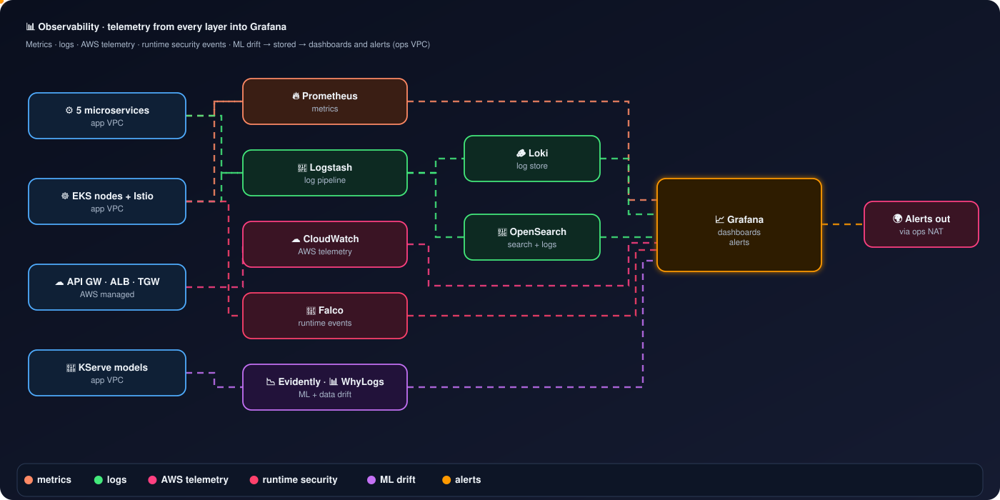
</div>

**📝 What this shows.** Five kinds of signal, each collected by the right tool and all ending in **Grafana**: metrics (Prometheus), logs (Logstash → Loki and OpenSearch), AWS telemetry (CloudWatch), runtime security events (Falco) and model drift (Evidently AI, WhyLogs). The tooling lives in the **Ops VPC** and reaches every other VPC over the Transit Gateway.

Already in place today: **VPC Flow Logs** for all four VPCs and the **EKS control-plane and audit logs**, both in CloudWatch.

> 🎤 **Interview talking points**
> - "Metrics tell me something is wrong, logs tell me why, and traces tell me where."
> - "Keeping the monitoring stack in its own VPC means it stays up, and stays trustworthy, when the application VPC has a problem."

---

## 11. MLOps

🔵 **Target design**

<div align="center">
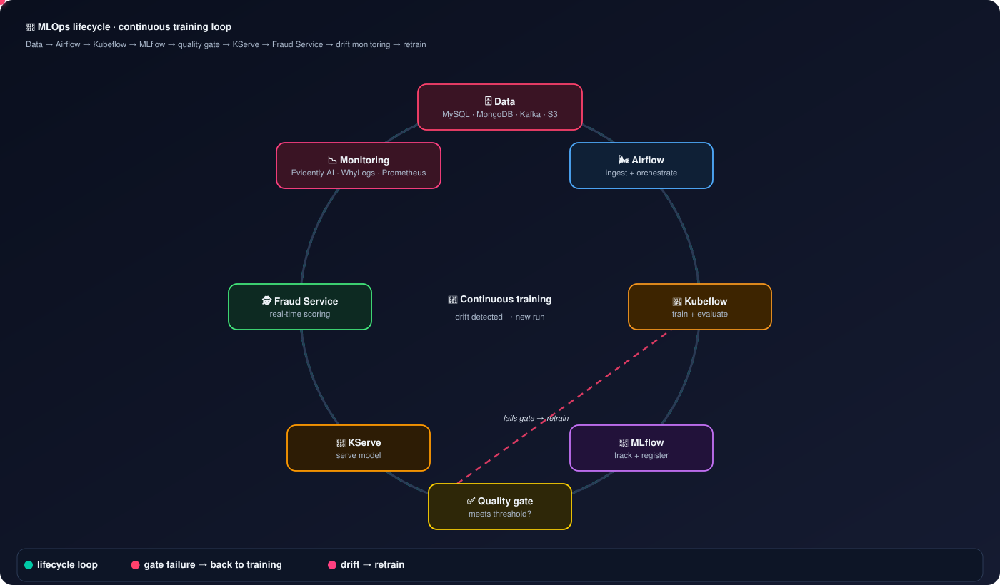
</div>

**📝 What this shows.** The life of the fraud model as a loop, not a one-off. Data is ingested, a model is trained and evaluated, and it is registered only if it passes a **quality gate**. KServe serves it to the Fraud service. Monitoring watches for **drift** (real-world data slowly stops looking like the training data), and drift triggers a new training run.

> 🎤 **Interview talking points**
> - "A model is deployed like any other artefact: versioned, gated and rolled out through GitOps."
> - "Drift detection closes the loop, so the model is retrained on evidence rather than on a calendar."

---

## 12. Roadmap

<div align="center">
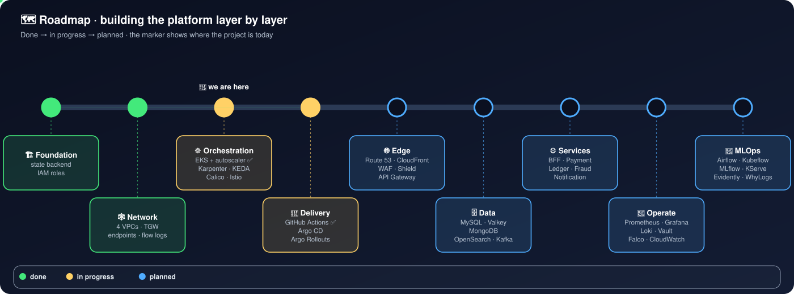
</div>

**📝 What this shows.** Where the project is today. Foundation and Network are complete. **Orchestration** and **Delivery** are in progress: the EKS cluster, the autoscaler and the infrastructure pipeline are built, and the platform add-ons and GitOps tools come next.

| Status | Item |
|:--:|---|
| ✅ | Remote backend: one state file per stack and environment, native S3 locking |
| ✅ | IAM: reusable module, roles for platform, dev, qa, stage and prod, GitHub OIDC for CI/CD |
| ✅ | Network: 4 VPCs, Transit Gateway, NAT, VPC endpoints, flow logs, locked default security groups |
| ✅ | Storage and registry: encrypted S3 buckets with lifecycle rules, ECR with immutable tags |
| ✅ | EKS: cluster, blue/green node groups, Cluster Autoscaler, encrypted secrets, audit logs |
| ✅ | Four environments (Prod, Stage, QA, Dev) from one set of modules |
| ✅ | Checkov: 0 failed checks, and the scan runs in the pipeline |
| ✅ | GitHub Actions deploy and destroy pipelines |
| 🚧 | ECR pull-through cache, so cluster add-on images do not depend on the NAT path |
| 🚧 | IAM Identity Center (SSO) for people, replacing root credentials and the IAM user |
| 🔜 | Transit Gateway segmentation (separate route tables so Edge cannot reach Data) |
| 🔜 | Platform add-ons: Karpenter, KEDA, Calico, Istio, Argo CD, Argo Rollouts |
| 🔜 | Edge: Route 53, CloudFront, WAF, Shield Advanced, API Gateway |
| 🔜 | Data, the five services, observability stack and MLOps |

---

## 13. Repository Structure

```text
FinTech-Enterprise-Project-Infra-Terraform/
├── .github/workflows/
│   ├── 4.fintech-infra-deploy.yaml    # deploy: IAM → S3 → ECR → Networking → EKS
│   ├── 5.fintech-infra-destroy.yaml   # destroy: the reverse order, manual only
│   └── 1–3 …                          # older practice workflows, disabled
├── docs/diagrams/                     # the animated SVG diagrams used in the READMEs
├── Terraform-FinTech-Infra/           # all infrastructure code (see its own README)
│   ├── IAM/ · S3/ · ECR/              # global stacks
│   ├── Networking/                    # modules + Prod / Stage / QA / Dev
│   └── EKS/                           # modules + Prod / Stage / QA / Dev
├── Terraform-Coding/ · demo/          # earlier Terraform practice
└── README.md
```

**Deploy it yourself**

```bash
# From GitHub: Actions → "4. FinTech Infra - Deploy" → Run workflow → branch dev → pick the environment

# Or locally, one stack at a time, in this order:
cd Terraform-FinTech-Infra/IAM              # then S3, ECR, Networking/Prod, EKS/Prod
terraform init
terraform plan -var-file="terraform.tfvars" -out plan1
terraform apply plan1
```

---

<div align="center">

### 👩‍💻 Built by a DevOps engineer, for DevOps engineers

⭐ Star this repo to follow along as it grows.


</div>

---

## 📚 Class Notes: Terraform, AWS Infrastructure, EKS and Security (Infra repo)

This section holds the class notes that apply to this infra repo. Terraform code in `Terraform-FinTech-Infra/` is applied by `4.fintech-infra-deploy.yaml` and `5.fintech-infra-destroy.yaml`.

### Terraform basics

- **HCL (HashiCorp Configuration Language)** in `*.tf` files. Every block has a type and a name, and every argument is `key = value`.
- **provider** sets the cloud and region. **resource** creates an object. **data** reads an existing object. **variable** takes input. **output** shows a value.
- **Interpolation:** `resource_type.resource_name.attribute`, for example `aws_instance.example.id`.
- **Dependencies:** implicit (one resource references another) or explicit (`depends_on`).

Files in a Terraform folder:

| File | Holds |
|---|---|
| `main.tf` | providers, resources, data |
| `variables.tf` | input variables |
| `output.tf` | output values |
| `versions.tf` | Terraform and provider version limits |
| `backend.tf` | where the remote state is stored and how it is locked |
| `*.tfvars` | runtime values for variables |

Remote state with S3 native locking (no DynamoDB table):

```hcl
terraform {
  backend "s3" {
    bucket       = "<your-tfstate-bucket>"
    key          = "<env>/<module>.tfstate"
    region       = "us-east-1"
    encrypt      = true
    use_lockfile = true
  }
}
```

Keep the S3 state bucket versioned so you can recover earlier state. Use one state file per environment and per module.

### Terraform workflow

```bash
terraform init
terraform validate
terraform plan -var-file="dev.tfvars" -out planfile
terraform apply planfile
terraform show
terraform plan -var-file="dev.tfvars" -out destroyfile -destroy   # plan a destroy
terraform apply destroyfile
terraform import aws_instance.example <instance-id>               # bring an existing resource under Terraform
terraform console                                                 # test functions, e.g. max(1,31,12)
```

### Loops, dynamic blocks and count

- `count = length(var.user_names)` creates one resource per list item. Use `count.index` to pick the item.
- `count = 0` creates nothing. Useful for turning a resource off.
- Use `count` when you need several identical resources. Use a `dynamic` block when one resource needs several child blocks, such as the rules in a security group.

### Modules

A module is reusable code. The root project calls child modules and passes values between them.

```hcl
module "eip" {
  source     = "../modules/eip"
  instanceid = module.instance.instanceid
}
```

Example from class: an `instance` module outputs `instanceid`, and an `eip` module takes it as input.

### Infra layout (this repo)

| Folder | Purpose | Environments |
|---|---|---|
| `IAM` | Roles for each environment. Terraform assumes the role before it changes infra. | Dev, QA, Stage, Prod |
| `S3` | Versioned state and data buckets, with lifecycle rules | all |
| `ECR` | Base images (Java, Node, Go) and app images (Ledger, Payment, Notification, BFF) | all |
| `Networking` | VPCs, subnets, gateways, endpoints | QA, Stage, Prod |
| `EKS` | Kubernetes cluster and node groups | Dev, QA, Stage, Prod |

**Network layout (4 VPCs, 24 subnets)**

| VPC | Public subnets | Private subnets | Key resources |
|---|---|---|---|
| A (Edge) | 0 | 3 | Private subnets for the API gateway |
| B (App) | 3 | 6 | Public subnets for ALB and NAT. Private subnets for the control plane and data plane. |
| C (Data) | 0 | 6 | Private subnets for MySQL, MongoDB and Valkey. Private subnets for Kafka and OpenSearch. |
| D (Ops) | 3 | 3 | Private subnets for Prometheus, Grafana, Vault and MLflow. Public subnets for NAT. |

Use three subnets across three availability zones for high availability. Use VPC endpoints so private subnets can reach AWS services without the internet.

### Trigger rules in this repo

- `4.fintech-infra-deploy.yaml` runs on push to `dev`, but only when a file in the listed folders changes. Changes to docs or the README do not trigger it.
- `5.fintech-infra-destroy.yaml` and the other workflows are run by hand.
- Add `[skip ci]` to commit messages for doc-only changes.

Install the tools (from class):

```bash
# kubectl
curl -LO "https://dl.k8s.io/release/$(curl -L -s https://dl.k8s.io/release/stable.txt)/bin/linux/amd64/kubectl"
chmod +x ./kubectl && sudo mv ./kubectl /usr/local/bin/kubectl

# helm
curl https://raw.githubusercontent.com/helm/helm/main/scripts/get-helm-3 | bash

# AWS CLI v2
curl "https://awscli.amazonaws.com/awscli-exe-linux-x86_64.zip" -o "awscliv2.zip"
sudo apt install -y unzip && unzip awscliv2.zip
sudo ./aws/install --bin-dir /usr/bin --install-dir /usr/bin/aws-cli --update
aws --version
```

AWS credentials go in GitHub secrets (`AWS_ACCESS_KEY_ID`, `AWS_SECRET_ACCESS_KEY`), not in files. On your own machine, use `aws login` or `aws configure`.

### EKS

- **Managed node groups:** AWS runs the control plane, and you run the data plane (worker nodes).
- **Auto Mode:** AWS runs both.
- Each node group needs a minimum and maximum size, a scaling policy, an instance type, and the private subnets it runs in (three, for high availability).
- The Cluster Autoscaler adds and removes nodes based on pending pods. A plain Auto Scaling Group only scales on CPU or memory percentage.

```bash
terraform plan -var="eksversion=1.34" -var="caversion=v1.34.4" -out eks1.34
terraform apply eks1.34
kubectl get pods -l app.kubernetes.io/name=aws-cluster-autoscaler -n kube-system
```

Upgrade with blue/green node groups: upgrade the control plane, add green node groups, cordon and drain the blue nodes, then remove the blue group. Use labels, taints and PodDisruptionBudgets so the pods stay available.

### Backup with Velero

```bash
velero install --provider aws --plugins velero/velero-plugin-for-aws:v1.10.0 \
  --bucket <your-velero-bucket> --secret-file ~/.aws/credentials \
  --backup-location-config region=us-east-1 --snapshot-location-config region=us-east-1
velero backup create backup.1
velero restore create --from-backup backup.1
```

### Capacity planning

Every cluster runs four kinds of workload:

1. Kubernetes system components (kube-proxy, kubelet, CoreDNS)
2. Platform add-ons (Calico, Argo CD, Cluster Autoscaler, logging, monitoring, security, MLflow, KServe)
3. Core microservices (Ledger, Payment, Notification, BFF)
4. ML microservices (fraud model serving)

Put them on separate node groups with labels and taints. Core services and platform tools share node group 1. ML services get node group 2 with a GPU.

Add 10% CPU and 20% memory as overhead for the operating system and the platform.

### Observability (MELT)

- **Prometheus:** time-series metrics from targets.
- **Grafana:** dashboards. Add Prometheus as a data source at `http://prometheus-server:80`.
- **Loki and Grafana Alloy:** logs and Kubernetes events.
- **Fluent Bit and OpenSearch:** application logs. Fluent Bit collects them and OpenSearch stores and visualises them.

Dashboards to import in Grafana: 6417 and 14623 (cluster health), 15760 (pod health).

### Zero Trust

- **Infra level:** segregate networks, as the four VPCs do.
- **Cluster level:**
  1. RBAC (user accounts, service accounts, roles, ClusterRoleBinding)
  2. Network policies (ingress, egress, CNI)
  3. Resource policies (limit the number of objects and total CPU and memory per namespace)
  4. Runtime security (Falco and Falcosidekick)
- **App level:** verify the YAML and the Docker image before deployment.

### Security services

| Service | Purpose |
|---|---|
| GuardDuty | Threat detection across the account |
| CloudTrail | Records every API call (audit trail) |
| AWS Config | Checks resources against compliance rules (for example, MFA on IAM users) |
| Macie | Finds sensitive data (PII, credentials) in S3 buckets |
| Comprehend | Detects and redacts PII in text as it arrives |
| Shield | DDoS protection |
| WAF | Blocks common web attacks, such as SQL injection and cross-site scripting |

Use Macie to scan whole buckets on a schedule. Use Comprehend to scan each record as it arrives.

### Terraform best practices (from class)

- One S3 bucket per app team, covering all environments.
- One state file per environment and per module.
- Use S3 native locking (`.tflock` next to the state file).
- Put reusable code in `modules/`. Put environment-specific values in each environment folder.

### Responsibilities

- Build Terraform modules that provision AWS infrastructure.
- Set up the CI pipeline with DevSecOps checks for the Terraform code (Checkov and terraform plan).
- Set up an AIOps pipeline that fixes Checkov findings on pull requests.
- Work with Infosec to set guardrails.
