# 🏦 Terraform-FinTech-Infra

> Production-grade AWS infrastructure for the **FinTech Enterprise Platform**, written entirely in Terraform.
> Five independent stacks (**S3 · Networking · IAM · ECR · EKS**) each with its own remote state, wired together through outputs and `terraform_remote_state`.


---

## 📑 Table of Contents

1. [Platform at a Glance](#-1-platform-at-a-glance)
2. [Deployment Order](#-2-deployment-order)
3. [Remote State & Cross-Stack Wiring](#-3-remote-state--cross-stack-wiring)
4. [Networking – Hub-and-Spoke VPC Design](#-4-networking--hub-and-spoke-vpc-design)
5. [EKS – Control Plane & Data Plane](#-5-eks--control-plane--data-plane)
6. [Blue / Green Node Group Switch](#-6-blue--green-node-group-switch)
7. [Cluster Autoscaler with IRSA](#-7-cluster-autoscaler-with-irsa)
8. [IAM – Environment Role Matrix](#-8-iam--environment-role-matrix)
9. [S3 – Compliance Storage Lifecycle](#-9-s3--compliance-storage-lifecycle)
10. [ECR – Container Registry](#-10-ecr--container-registry)
11. [Repository Tree](#-11-repository-tree)
12. [Conventions](#-12-conventions)
13. [How to Deploy](#-13-how-to-deploy)
14. [Roadmap](#-14-roadmap)

---

## 🌐 1. Platform at a Glance

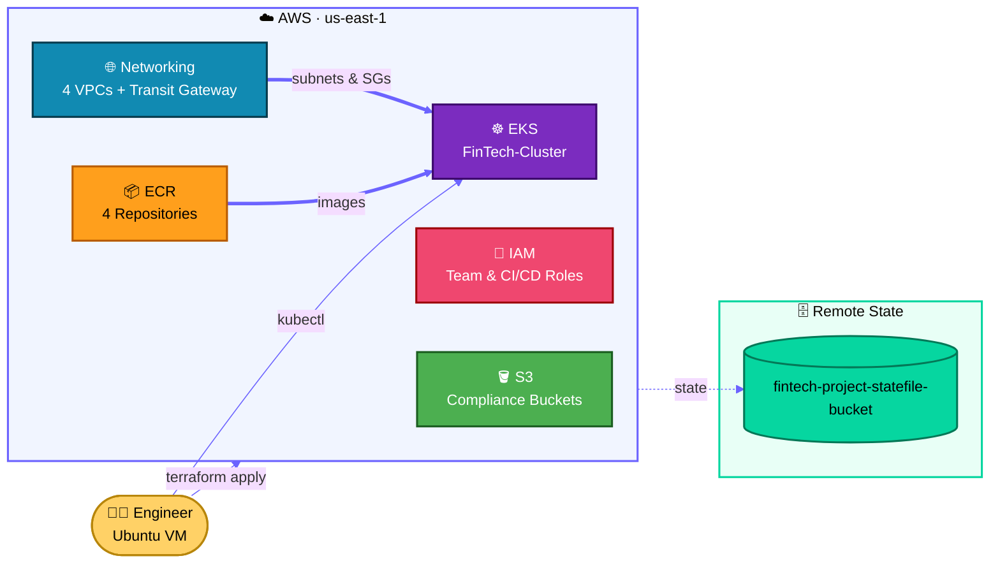

**Explanation.** The platform is split into five **independently deployable Terraform stacks**. Each stack owns one concern and one state file, which keeps the blast radius of any change small: a mistake in an IAM change can never touch a VPC. Stacks share information only through **outputs read via `terraform_remote_state`** (Networking → EKS) rather than hard-coded IDs, so resources can be rebuilt without editing other stacks. All state lives in a single versioned S3 bucket with native S3 lock files (`use_lockfile = true`), so no DynamoDB table is needed.

### 📊 Resources managed per stack

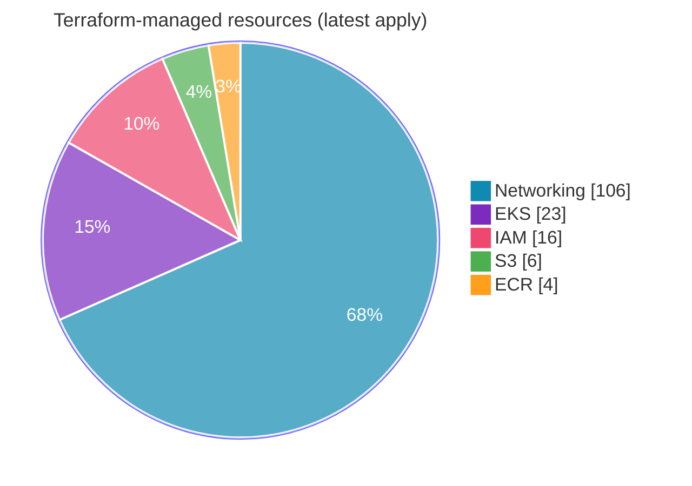

**Explanation.** Networking dominates the resource count because every VPC fans out into subnets, route tables, associations, security groups, VPC endpoints and a Transit Gateway attachment. EKS is small in resource count but the most complex stack operationally, since it spans AWS (cluster, node groups, IAM, OIDC) and Kubernetes (Helm release).

---

## 🚦 2. Deployment Order

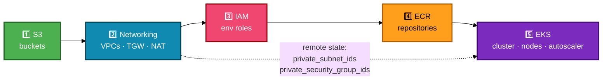

**Explanation.** Only one ordering is mandatory: **Networking must exist before EKS**, because the EKS stack places the control plane and every node group into the private subnets and security group that Networking publishes as outputs. S3, IAM and ECR have no hard dependencies and could run in parallel, but a fixed order keeps deployments predictable and easy to audit. Destroying runs in the reverse order (EKS first, Networking last).

---

## 🔗 3. Remote State & Cross-Stack Wiring

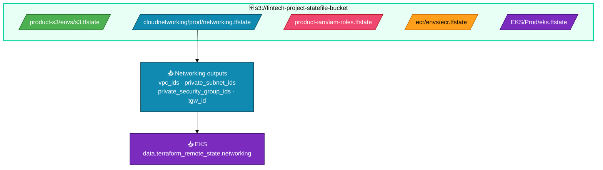

**Explanation.** Each stack writes to its own key in the state bucket, so `terraform destroy` on one stack only empties that stack's state file; the file itself remains (with `resources: []`) and is reused on the next apply. EKS consumes Networking through `terraform_remote_state` and filters the `FinTech-App` private subnets down to three Availability Zones with a `data "aws_subnets"` lookup. This is the **producer/consumer** pattern used by large platform teams: the network team owns the VPC, application stacks only read from it.

---

## 🌐 4. Networking – Hub-and-Spoke VPC Design

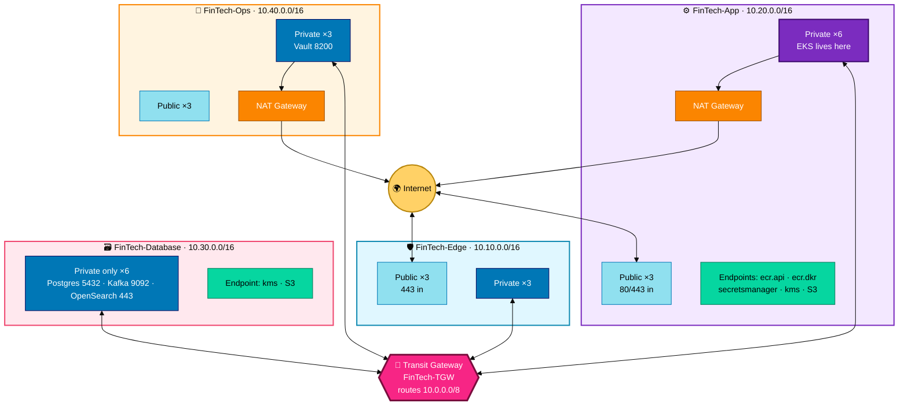

**Explanation.** Four purpose-built VPCs are created from **one reusable child module** (`Networking/module`) driven by a `for_each` over `vpc_setup` in `terraform.tfvars`, so adding a VPC is a data change, not a code change.

| VPC | Role | Internet exposure | Key controls |
|---|---|---|---|
| **FinTech-Edge** | Ingress / WAF tier | Public 443 only | No NAT, private egress limited to `10.0.0.0/8` |
| **FinTech-App** | EKS workloads | Public 80/443 via LB, private via NAT | Interface endpoints keep ECR, Secrets Manager and KMS traffic off the internet |
| **FinTech-Database** | Data tier | **None** (no public subnets, no NAT) | Ingress only from the App (and Ops for OpenSearch) CIDRs |
| **FinTech-Ops** | Tooling / Vault | Egress via NAT only | Vault 8200 reachable only from `10.0.0.0/8` |

The **Transit Gateway** is the single hub that connects all VPCs; every private route table sends `10.0.0.0/8` to it. This replaces a mesh of VPC peerings and is the standard enterprise topology for regulated (PCI-DSS) segmentation.

---

## ☸️ 5. EKS – Control Plane & Data Plane

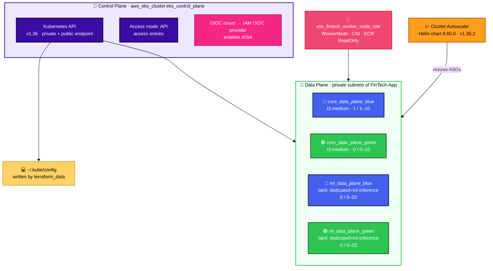

**Explanation.**

- **Control plane.** Placed in the `FinTech-App` private subnets across `us-east-1a/b/c`, protected by the App private security group. Authentication uses the modern **EKS access entries** API (no `aws-auth` ConfigMap). Root and the `hassan_iam_role` DevOps role are granted access explicitly.
- **Data plane.** Four managed node groups share one worker IAM role. Only `core_data_plane_blue` runs a node by default; the other three are **provisioned at zero** so they cost nothing until scaled. ML groups carry a `NO_SCHEDULE` taint so only ML inference pods (with a matching toleration) land on them.
- **Safe rollouts.** Every node group uses `create_before_destroy` and `max_unavailable = 1`: new capacity comes up before old nodes are drained.
- **Developer experience.** A `terraform_data` resource runs `aws eks update-kubeconfig` automatically after the cluster is created, so `kubectl` works immediately on the deploying machine.

---

## 🔁 6. Blue / Green Node Group Switch

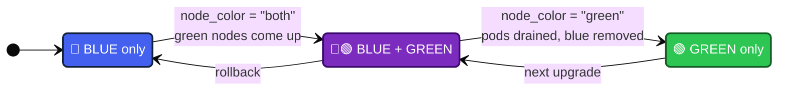

**Explanation.** A single validated variable, `node_color` (`blue` | `green` | `both`), drives the `count` of every node group:

```hcl
count = var.node_color == "blue"  || var.node_color == "both" ? 1 : 0   # blue groups
count = var.node_color == "green" || var.node_color == "both" ? 1 : 0   # green groups
```

Upgrades become a **zero-downtime, three-step change in `terraform.tfvars`**: switch to `both`, let workloads move to the new nodes, then switch to the new colour. Rollback is the same change in reverse. The current value is `both`, so all four groups exist.

---

## 📈 7. Cluster Autoscaler with IRSA

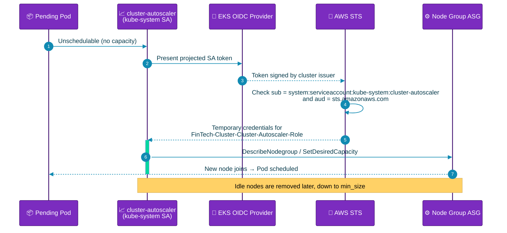

**Explanation.** The autoscaler is installed by Terraform with the official Helm chart, and it gets AWS permissions through **IAM Roles for Service Accounts (IRSA)**, with no access keys anywhere:

1. **`aws_iam_policy`**: least-privilege actions to read and resize Auto Scaling Groups. `eks:DescribeNodegroup` allows scaling **up from zero**, which the green and ML groups rely on.
2. **`aws_iam_role`**: trusts *only* the `kube-system/cluster-autoscaler` service account of *this* cluster (`sub` + `aud` conditions).
3. **`aws_iam_role_policy_attachment`**: binds policy to role.
4. **`helm_release`**: installs the chart, annotates the service account with the role ARN, and auto-discovers node groups by cluster tag. It waits for IAM and for the first node group to exist.

---

## 🔐 8. IAM – Environment Role Matrix

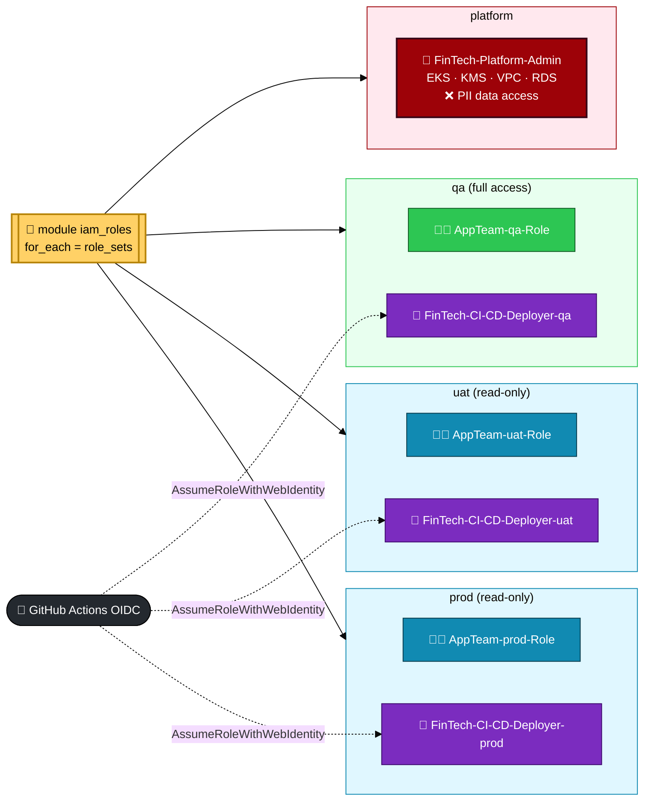

**Explanation.** The IAM stack calls one wrapper module (`IAM/iam_roles`, built on `terraform-aws-modules/iam`) once per environment in `role_sets`. The module **derives permissions from the environment name**: environments listed in `read_only_environments` (`uat`, `prod`) automatically receive restricted actions, enforcing least privilege without per-environment code. Guardrails are explicit `Deny` statements (no PII reads for platform admins, no VPC/TGW deletion for app teams), and CI/CD roles trust **GitHub Actions OIDC** scoped to this repository, so pipelines need no stored keys.

---

## 🪣 9. S3 – Compliance Storage Lifecycle

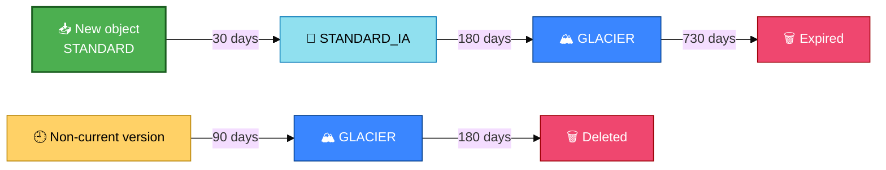

**Explanation.** Buckets `muntaha-fintech-dvc-data-lake` and `muntaha-fintech-applog` are created by one module with `for_each`, each with **versioning enabled** and a tiered lifecycle policy that keeps data for two years (a common retention baseline for financial audit logs) while moving cold data to cheaper storage classes automatically. Adding a bucket is a one-line change in `S3/terraform.tfvars`. Names carry a `muntaha-` prefix because S3 bucket names are global across all AWS accounts.

---

## 📦 10. ECR – Container Registry

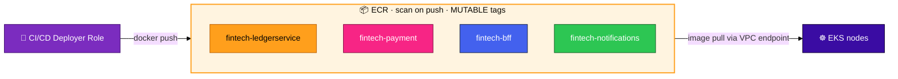

**Explanation.** One repository per microservice, created with `for_each` over a set. **Image scanning on push** surfaces CVEs before an image ever reaches the cluster. Nodes pull images through the `ecr.api` / `ecr.dkr` interface endpoints and the S3 gateway endpoint in the App VPC, so image traffic never leaves the AWS network.

---

## 🌳 11. Repository Tree

```text
Terraform-FinTech-Infra/
├── 📄 README.md                      ← you are here
│
├── 🪣 S3/                            ── Stack 1 · compliance buckets
│   ├── backend.tf                    state → product-s3/envs/s3.tfstate
│   ├── providers.tf · variables.tf · locals.tf · main.tf · outputs.tf
│   ├── terraform.tfvars              bucket names, environment, tags
│   └── modules/                      reusable bucket module
│       └── main.tf · variables.tf · locals.tf · outputs.tf · versions.tf
│
├── 🌐 Networking/                    ── Stack 2 · VPCs + Transit Gateway
│   ├── backend.tf                    state → cloudnetworking/prod/networking.tfstate
│   ├── providers.tf · variables.tf · locals.tf · main.tf · outputs.tf
│   ├── terraform.tfvars              vpc_setup: Edge · App · Database · Ops
│   ├── module/                       one VPC: subnets, RTs, NAT, SGs, endpoints, TGW attach
│   │   └── main.tf · variables.tf · outputs.tf · version.tf
│   └── tgw/                          the Transit Gateway hub
│       └── main.tf · variables.tf · outputs.tf · version.tf
│
├── 🔐 IAM/                           ── Stack 3 · environment roles
│   ├── backend.tf                    state → product-iam/iam-roles.tfstate
│   ├── providers.tf · variables.tf · locals.tf · main.tf · outputs.tf
│   ├── terraform.tfvars              role_sets: platform · qa · uat · prod
│   └── iam_roles/                    wrapper over terraform-aws-modules/iam
│       └── main.tf · variables.tf · locals.tf · outputs.tf · versions.tf
│
├── 📦 ECR/                           ── Stack 4 · container registry
│   ├── backend.tf                    state → ecr/envs/ecr.tfstate
│   ├── providers.tf · variables.tf · main.tf
│   ├── terraform.tfvars
│   └── modules/
│       └── main.tf · variables.tf · outputs.tf · versions.tf
│
└── ☸️ EKS/                           ── Stack 5 · Kubernetes platform
    ├── backend.tf                    state → EKS/Prod/eks.tfstate
    ├── versions.tf                   aws ~> 6.72 · tls ~> 4.0 · helm ~> 3.3
    ├── providers.tf                  aws + helm (exec auth via aws eks get-token)
    ├── variables.tf · outputs.tf
    ├── terraform.tfvars              cluster, node names, node_color, autoscaler versions
    ├── IAM.tf                        cluster role, worker role, DevOps user/role
    ├── EKS_Control_Plane.tf          remote state, subnets, cluster, access entries
    ├── EKS_Data_Plane.tf             4 node groups (core/ml × blue/green) + kubeconfig
    ├── OIDC.tf                       IAM OIDC provider for IRSA
    ├── EKS_Cluster_Autoscaler.tf     IRSA policy/role + Helm release
    └── testapp.yaml                  sample workload for testing
```

---

## 📐 12. Conventions

| Rule | Example | Why |
|---|---|---|
| Terraform identifiers are `snake_case` | `aws_eks_cluster.eks_control_plane` | One consistent style across every stack and module |
| AWS-facing names keep their own style | `FinTech-App`, `FinTech-Cluster-Role` | Renaming them would **replace** live resources |
| Values come from `terraform.tfvars` | `node_color`, node group names | Root variables have **no defaults**: config is explicit and reviewable |
| One state file per stack | `EKS/Prod/eks.tfstate` | Small blast radius, independent lifecycles |
| `backend.tf` is never edited casually | — | Changing a key orphans existing state |
| Child modules own version pins | `modules/versions.tf` | Roots stay clean; upgrades happen in one place |

---

## 🚀 13. How to Deploy

```bash
# Run in this order: S3 → Networking → IAM → ECR → EKS
for stack in S3 Networking IAM ECR EKS; do
  cd Terraform-FinTech-Infra/$stack
  terraform init
  terraform fmt
  terraform validate
  terraform plan -var-file="terraform.tfvars" -out plan1
  terraform apply plan1
  cd - >/dev/null
done

# After EKS finishes, kubeconfig is already written:
kubectl get nodes
kubectl get pods -n kube-system
```

> ⚠️ **Destroy in reverse order** (EKS → ECR → IAM → Networking → S3). EKS depends on Networking's subnets.

---

## 🗺️ 14. Roadmap

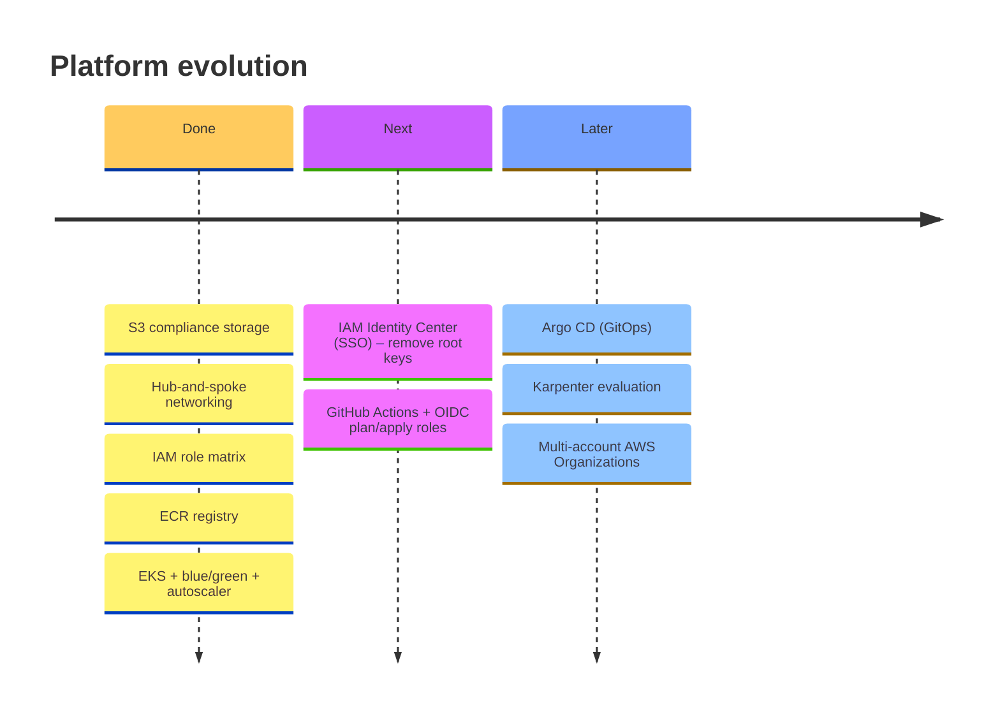

**Explanation.** The infrastructure layer is in place. The next milestone is **identity hardening**: replacing long-lived credentials with IAM Identity Center for people and GitHub Actions OIDC for pipelines, which mirrors how regulated enterprises operate. After that the focus moves to GitOps-driven application delivery.
