# 🏦 Terraform-FinTech-Infra

> Production-grade AWS infrastructure for the **FinTech Enterprise Platform**, written entirely in Terraform.
> Five independent stacks (**S3 · Networking · IAM · ECR · EKS**), each with its own remote state, wired together through outputs and `terraform_remote_state`.


> 💡 The diagrams are written in **Mermaid** and render automatically on **GitHub**.
> In VS Code, install the *Markdown Preview Mermaid Support* extension to see them in the preview.

---

## 📑 Table of Contents

1. [Platform at a Glance](#-1-platform-at-a-glance)
2. [Resources per Stack](#-2-resources-per-stack)
3. [Deployment Order](#-3-deployment-order)
4. [Remote State and Cross-Stack Wiring](#-4-remote-state-and-cross-stack-wiring)
5. [Networking: Hub-and-Spoke VPC Design](#-5-networking-hub-and-spoke-vpc-design)
6. [EKS: Control Plane and Data Plane](#-6-eks-control-plane-and-data-plane)
7. [Blue / Green Node Group Switch](#-7-blue--green-node-group-switch)
8. [Cluster Autoscaler with IRSA](#-8-cluster-autoscaler-with-irsa)
9. [IAM: Environment Role Matrix](#-9-iam-environment-role-matrix)
10. [S3: Compliance Storage Lifecycle](#-10-s3-compliance-storage-lifecycle)
11. [ECR: Container Registry](#-11-ecr-container-registry)
12. [Repository Tree](#-12-repository-tree)
13. [Conventions](#-13-conventions)
14. [How to Deploy](#-14-how-to-deploy)
15. [Roadmap](#-15-roadmap)

---

## 🌐 1. Platform at a Glance

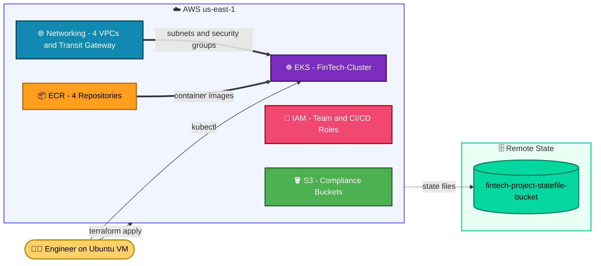

### 📝 Explanation
The platform is split into five **independently deployable Terraform stacks**. Each stack owns one concern and one state file, which keeps the **blast radius** of a change small: a mistake in IAM can never touch a VPC. Stacks share data only through **outputs read with `terraform_remote_state`** (Networking → EKS), never through hard-coded IDs, so any stack can be rebuilt without editing the others. All state lives in one versioned S3 bucket with **native S3 lock files** (`use_lockfile = true`), so no DynamoDB lock table is needed.

> 🎤 **Interview talking points**
> - "I split infrastructure into stacks by lifecycle and ownership to reduce blast radius."
> - "Stacks communicate through remote-state outputs, which is the producer/consumer pattern."
> - "State is remote, encrypted and locked using S3 native locking (Terraform 1.10+)."

---

## 📊 2. Resources per Stack

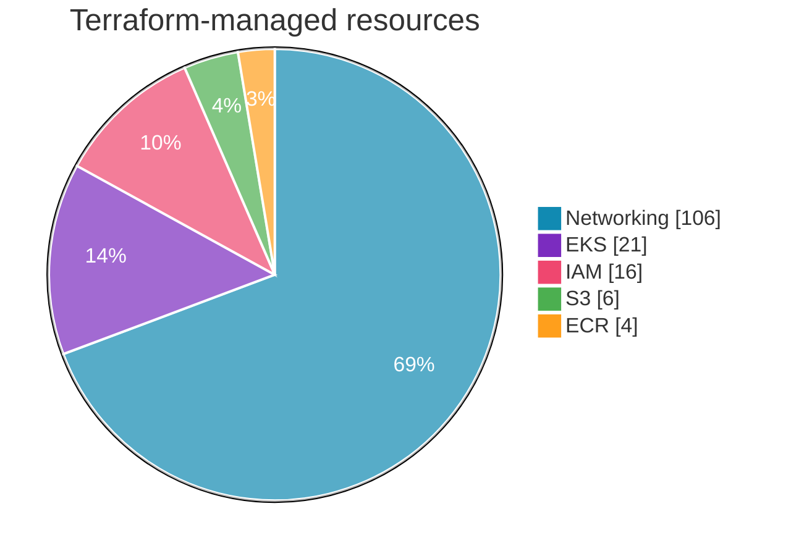

### 📝 Explanation
Networking has the most resources because every VPC fans out into subnets, route tables, route-table associations, security groups, VPC endpoints and a Transit Gateway attachment. EKS has fewer resources but is the most complex stack operationally: it spans **AWS** (cluster, node groups, IAM, OIDC) and **Kubernetes** (the Helm release).

> 🎤 **Interview talking points**
> - "One reusable VPC module creates about 25 resources per VPC; four VPCs give 106 resources from very little code."
> - "Resource count is not complexity: EKS is small but crosses the AWS and Kubernetes boundary."

---

## 🚦 3. Deployment Order

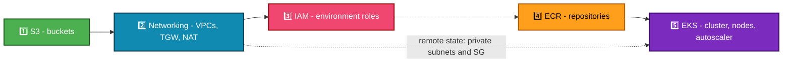

### 📝 Explanation
Only one ordering is mandatory: **Networking must exist before EKS**, because EKS places the control plane and every node group in the private subnets and security group that Networking publishes as outputs. S3, IAM and ECR have no hard dependencies, but a fixed order keeps deployments predictable and auditable. **Destroy runs in reverse** (EKS first, Networking last).

> 🎤 **Interview talking points**
> - "Dependencies between stacks are explicit through remote state, so the order is enforced by data, not by memory."
> - "Destroying in reverse order avoids errors like deleting subnets that still have ENIs attached."

---

## 🔗 4. Remote State and Cross-Stack Wiring

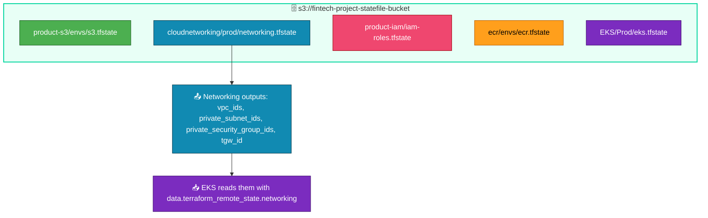

### 📝 Explanation
Each stack writes to **its own key** in the state bucket. `terraform destroy` empties a state file (`resources: []`) but does **not** delete it; the same file is reused on the next apply. EKS consumes Networking through `terraform_remote_state` and narrows the `FinTech-App` private subnets to three Availability Zones with a `data "aws_subnets"` lookup. This is the **producer/consumer** pattern used by platform teams: the network team owns the VPC, and application stacks only read from it.

> 🎤 **Interview talking points**
> - "Separate state keys mean separate locks, so two teams can apply different stacks at the same time."
> - "Bucket versioning lets us roll back a corrupted state file."
> - "`terraform_remote_state` is read-only, so the consumer can never change the producer's resources."

---

## 🌐 5. Networking: Hub-and-Spoke VPC Design

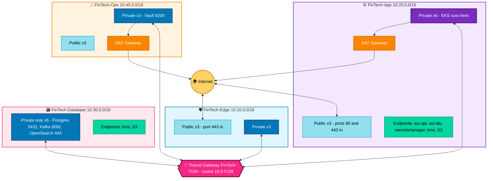

### 📝 Explanation
Four purpose-built VPCs are created from **one reusable child module** (`Networking/module`) using `for_each` over `vpc_setup` in `terraform.tfvars`. Adding a VPC is a data change, not a code change.

| VPC | Role | Internet exposure | Key controls |
|---|---|---|---|
| **FinTech-Edge** | Ingress / WAF tier | Public 443 only | No NAT; private egress limited to `10.0.0.0/8` |
| **FinTech-App** | EKS workloads | Public 80/443 via load balancer, private egress via NAT | Interface endpoints keep ECR, Secrets Manager and KMS traffic off the internet |
| **FinTech-Database** | Data tier | **None** (no public subnets, no NAT) | Ingress only from the App CIDR (and Ops for OpenSearch) |
| **FinTech-Ops** | Tooling / Vault | Egress via NAT only | Vault 8200 reachable only from `10.0.0.0/8` |

The **Transit Gateway** is the single hub connecting every VPC; each private route table sends `10.0.0.0/8` to it. This replaces a mesh of VPC peerings and is the standard enterprise topology for **PCI-DSS network segmentation**.

> 🎤 **Interview talking points**
> - "Hub-and-spoke with a Transit Gateway scales linearly; full-mesh peering needs n(n-1)/2 connections."
> - "The database VPC has no internet path at all, which is a core PCI-DSS segmentation control."
> - "VPC endpoints cut NAT costs and keep image pulls and secret reads on the AWS backbone."

---

## ☸️ 6. EKS: Control Plane and Data Plane

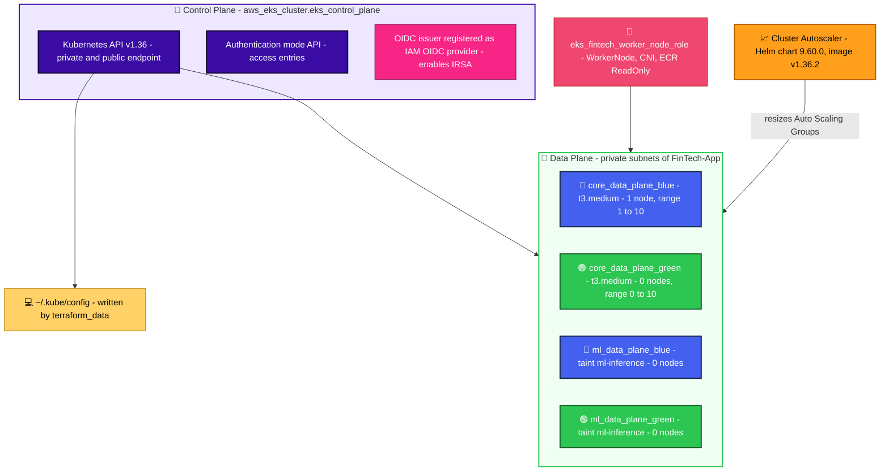

### 📝 Explanation
- **Control plane.** Runs in the `FinTech-App` private subnets across `us-east-1a/b/c`, protected by the App private security group. Authentication uses the modern **EKS access entries API** (no `aws-auth` ConfigMap). The cluster creator gets admin automatically through `bootstrap_cluster_creator_admin_permissions`, and the DevOps role `hassan_iam_role` is granted access explicitly.
- **Data plane.** Four managed node groups share one worker IAM role. Only `core_data_plane_blue` runs a node by default; the other three are **provisioned at zero**, so they cost nothing until they scale. ML groups carry a `NO_SCHEDULE` taint so only ML inference pods with a matching toleration land on them.
- **Safe rollouts.** Every node group uses `create_before_destroy` and `max_unavailable = 1`: new capacity comes up before old nodes are drained.
- **Developer experience.** A `terraform_data` resource runs `aws eks update-kubeconfig` after the cluster is created, so `kubectl` works immediately.

> 🎤 **Interview talking points**
> - "Access entries replace the fragile aws-auth ConfigMap and are managed as IAM-native resources in Terraform."
> - "Taints isolate expensive ML nodes; tolerations opt specific workloads in."
> - "Node groups at zero give ready-to-use capacity with zero idle cost."

---

## 🔁 7. Blue / Green Node Group Switch

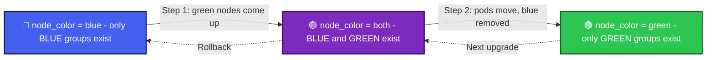

### 📝 Explanation
A single validated variable, `node_color` (`blue`, `green` or `both`), drives the `count` of every node group:

```hcl
count = var.node_color == "blue"  || var.node_color == "both" ? 1 : 0   # blue groups
count = var.node_color == "green" || var.node_color == "both" ? 1 : 0   # green groups
```

Upgrades become a **zero-downtime change in `terraform.tfvars`**: switch to `both`, let workloads move to the new nodes, then switch to the new colour. Rollback is the same change in reverse. The current value is `both`, so all four node groups exist.

> 🎤 **Interview talking points**
> - "Blue/green at the node-group level lets me upgrade AMIs or Kubernetes versions with an instant rollback path."
> - "A `validation` block rejects typos, so a wrong value can never silently delete every node group."

---

## 📈 8. Cluster Autoscaler with IRSA

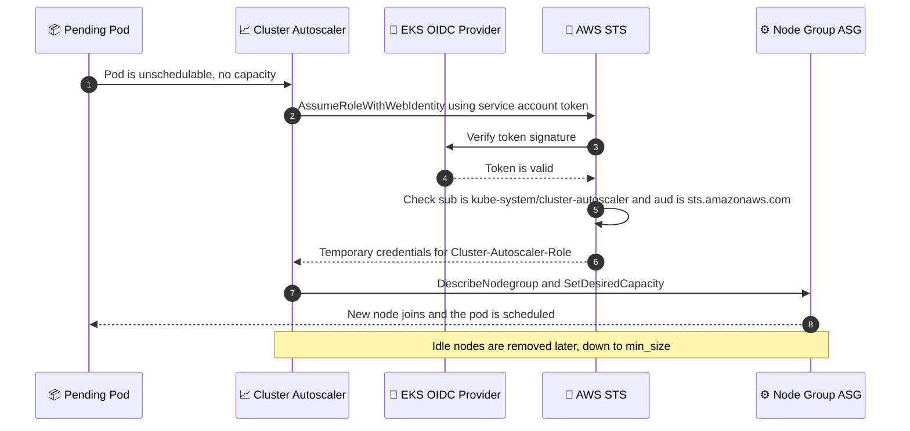

### 📝 Explanation
The autoscaler is installed by Terraform with the official Helm chart. It gets AWS permissions through **IAM Roles for Service Accounts (IRSA)**, so there are no access keys anywhere:

1. **`aws_iam_policy`**: least-privilege actions to read and resize Auto Scaling Groups. `eks:DescribeNodegroup` enables **scaling up from zero**, which the green and ML groups rely on.
2. **`aws_iam_role`**: trusts **only** the `kube-system/cluster-autoscaler` service account of **this** cluster, checked with `sub` and `aud` conditions.
3. **`aws_iam_role_policy_attachment`**: binds the policy to the role.
4. **`helm_release`**: installs the chart, annotates the service account with the role ARN, and auto-discovers node groups by their cluster tag. It waits for IAM and for the first node group.

> 🎤 **Interview talking points**
> - "IRSA gives each pod its own IAM role instead of sharing the node role, which is least privilege at pod level."
> - "The `sub` condition pins the role to one namespace and service account; `aud` pins it to STS."
> - "Cluster Autoscaler needs node group metadata to scale from zero, because no node exists to copy labels from."

---

## 🔐 9. IAM: Environment Role Matrix

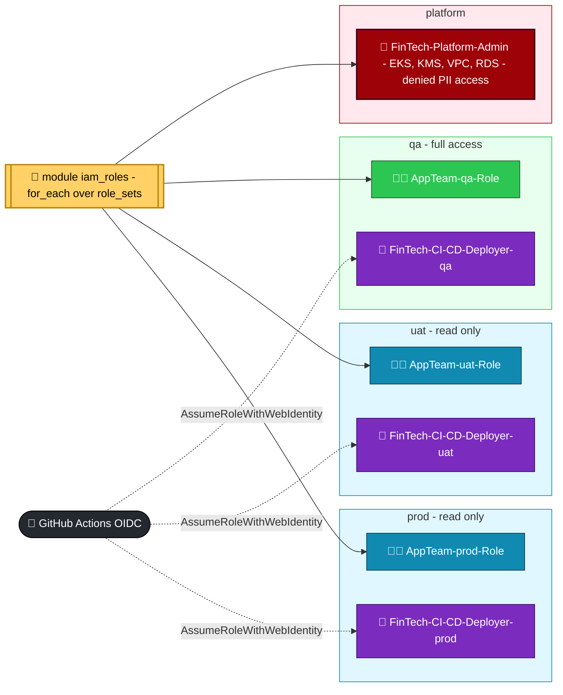

### 📝 Explanation
The IAM stack calls one wrapper module (`IAM/iam_roles`, built on `terraform-aws-modules/iam`) once per environment in `role_sets`. The module **derives permissions from the environment name**: environments listed in `read_only_environments` (`uat`, `prod`) automatically get restricted actions, which enforces least privilege without per-environment code. Guardrails are explicit `Deny` statements (no PII reads for platform admins, no VPC/TGW deletion for app teams). CI/CD roles trust **GitHub Actions OIDC** scoped to this repository, so pipelines need no stored keys.

> 🎤 **Interview talking points**
> - "An explicit Deny always wins over any Allow in IAM evaluation, so guardrails cannot be bypassed by attaching another policy."
> - "Environment-aware permissions: same module, stricter rights in uat and prod automatically."
> - "GitHub OIDC removes long-lived CI secrets; each workflow run gets short-lived credentials."

---

## 🪣 10. S3: Compliance Storage Lifecycle

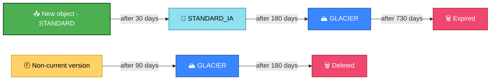

### 📝 Explanation
The buckets `muntaha-fintech-dvc-data-lake` and `muntaha-fintech-applog` are created by one module with `for_each`. Each has **versioning enabled** and a tiered lifecycle policy that keeps data for two years (a common retention baseline for financial audit logs) while moving cold data to cheaper storage classes automatically. Adding a bucket is a one-line change in `S3/terraform.tfvars`. The names carry a `muntaha-` prefix because S3 bucket names are **global across all AWS accounts**.

> 🎤 **Interview talking points**
> - "Lifecycle rules automate cost optimisation: STANDARD to IA to Glacier as data cools."
> - "Versioning protects against accidental deletes and overwrites; non-current versions have their own expiry."

---

## 📦 11. ECR: Container Registry

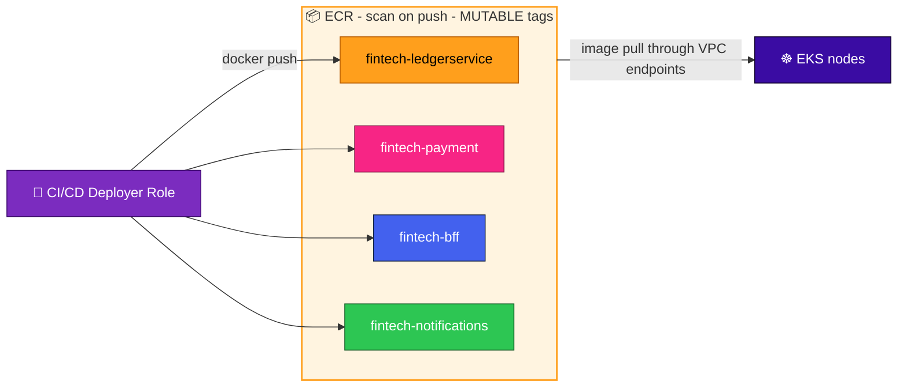

### 📝 Explanation
One repository per microservice, created with `for_each` over a set. **Image scanning on push** reports CVEs before an image reaches the cluster. Nodes pull images through the `ecr.api` and `ecr.dkr` interface endpoints and the S3 gateway endpoint in the App VPC, so image traffic never leaves the AWS network.

> 🎤 **Interview talking points**
> - "One repo per service gives per-service permissions, lifecycle policies and scan results."
> - "For production I would switch to IMMUTABLE tags so a tag always points to the same image."

---

## 🌳 12. Repository Tree

```text
Terraform-FinTech-Infra/
├── 📄 README.md                      ← you are here
│
├── 🪣 S3/                            ── Stack 1 · compliance buckets
│   ├── backend.tf                    state → product-s3/envs/s3.tfstate
│   ├── providers.tf · variables.tf · locals.tf · main.tf · outputs.tf
│   ├── terraform.tfvars              bucket names, environment, tags
│   └── modules/                      reusable bucket module
│       └── main.tf · variables.tf · locals.tf · outputs.tf · versions.tf
│
├── 🌐 Networking/                    ── Stack 2 · VPCs + Transit Gateway
│   ├── backend.tf                    state → cloudnetworking/prod/networking.tfstate
│   ├── providers.tf · variables.tf · locals.tf · main.tf · outputs.tf
│   ├── terraform.tfvars              vpc_setup: Edge · App · Database · Ops
│   ├── module/                       one VPC: subnets, RTs, NAT, SGs, endpoints, TGW attach
│   │   └── main.tf · variables.tf · outputs.tf · version.tf
│   └── tgw/                          the Transit Gateway hub
│       └── main.tf · variables.tf · outputs.tf · version.tf
│
├── 🔐 IAM/                           ── Stack 3 · environment roles
│   ├── backend.tf                    state → product-iam/iam-roles.tfstate
│   ├── providers.tf · variables.tf · locals.tf · main.tf · outputs.tf
│   ├── terraform.tfvars              role_sets: platform · qa · uat · prod
│   └── iam_roles/                    wrapper over terraform-aws-modules/iam
│       └── main.tf · variables.tf · locals.tf · outputs.tf · versions.tf
│
├── 📦 ECR/                           ── Stack 4 · container registry
│   ├── backend.tf                    state → ecr/envs/ecr.tfstate
│   ├── providers.tf · variables.tf · main.tf
│   ├── terraform.tfvars
│   └── modules/
│       └── main.tf · variables.tf · outputs.tf · versions.tf
│
└── ☸️ EKS/                           ── Stack 5 · Kubernetes platform
    ├── backend.tf                    state → EKS/Prod/eks.tfstate
    ├── versions.tf                   aws ~> 6.72 · tls ~> 4.0 · helm ~> 3.3
    ├── providers.tf                  aws + helm (exec auth via aws eks get-token)
    ├── variables.tf · outputs.tf
    ├── terraform.tfvars              cluster, node names, node_color, autoscaler versions
    ├── IAM.tf                        cluster role, worker role, DevOps user/role
    ├── EKS_Control_Plane.tf          remote state, subnets, cluster, access entries
    ├── EKS_Data_Plane.tf             4 node groups (core/ml × blue/green) + kubeconfig
    ├── OIDC.tf                       IAM OIDC provider for IRSA
    ├── EKS_Cluster_Autoscaler.tf     IRSA policy/role + Helm release
    └── testapp.yaml                  sample workload for testing
```

### 📝 Explanation
Every stack follows the **same root file layout** (`backend.tf`, `providers.tf`, `variables.tf`, `main.tf`, `outputs.tf`, `terraform.tfvars`), and reusable logic lives in a child module folder. Anyone who knows one stack can navigate all of them.

> 🎤 **Interview talking points**
> - "A consistent layout across stacks reduces onboarding time and review mistakes."
> - "Root modules hold configuration; child modules hold reusable logic and version pins."

---

## 📐 13. Conventions

| Rule | Example | Why |
|---|---|---|
| Terraform identifiers are `snake_case` | `aws_eks_cluster.eks_control_plane` | One consistent style across every stack and module |
| AWS-facing names keep their own style | `FinTech-App`, `FinTech-Cluster-Role` | Renaming them would **replace** live resources |
| Values come from `terraform.tfvars` | `node_color`, node group names | Root variables have **no defaults**: configuration is explicit and reviewable |
| One state file per stack | `EKS/Prod/eks.tfstate` | Small blast radius, independent lifecycles |
| `backend.tf` is never edited casually | — | Changing a key orphans the existing state |
| Child modules own version pins | `modules/versions.tf` | Roots stay clean; upgrades happen in one place |

---

## 🚀 14. How to Deploy

```bash
# Run in this order: S3 → Networking → IAM → ECR → EKS
for stack in S3 Networking IAM ECR EKS; do
  cd Terraform-FinTech-Infra/$stack
  terraform init
  terraform fmt
  terraform validate
  terraform plan -var-file="terraform.tfvars" -out plan1
  terraform apply plan1
  cd - >/dev/null
done

# After EKS finishes, kubeconfig is already written:
kubectl get nodes
kubectl get pods -n kube-system
```

> ⚠️ **Destroy in reverse order** (EKS → ECR → IAM → Networking → S3), because EKS depends on Networking's subnets.

---

## 🗺️ 15. Roadmap

```mermaid
flowchart LR
    subgraph DONE["✅ Done"]
        direction TB
        D1["S3 compliance storage"]:::done
        D2["Hub-and-spoke networking"]:::done
        D3["IAM role matrix"]:::done
        D4["ECR registry"]:::done
        D5["EKS with blue/green and autoscaler"]:::done
    end
    subgraph NEXT["🔜 Next"]
        direction TB
        N1["IAM Identity Center SSO - remove root keys"]:::next
        N2["GitHub Actions with OIDC plan and apply roles"]:::next
    end
    subgraph LATER["🔭 Later"]
        direction TB
        L1["Argo CD GitOps"]:::later
        L2["Karpenter evaluation"]:::later
        L3["Multi-account AWS Organizations"]:::later
    end
    DONE --> NEXT --> LATER

    classDef done  fill:#2DC653,stroke:#155D27,color:#fff
    classDef next  fill:#FF9F1C,stroke:#B85C00,color:#000
    classDef later fill:#4361EE,stroke:#14213D,color:#fff
    style DONE  fill:#E8FFEF,stroke:#2DC653,stroke-width:2px
    style NEXT  fill:#FFF4E0,stroke:#FF9F1C,stroke-width:2px
    style LATER fill:#E8EEFF,stroke:#4361EE,stroke-width:2px
```

### 📝 Explanation
The infrastructure layer is complete. The next milestone is **identity hardening**: IAM Identity Center for people and GitHub Actions OIDC for pipelines, replacing long-lived credentials the way regulated enterprises operate. After that, application delivery moves to **GitOps** with Argo CD.

> 🎤 **Interview talking points**
> - "My next step is removing every long-lived credential: SSO for humans, OIDC for machines."
> - "GitOps makes Git the single source of truth for what runs in the cluster."
