# 🏦 Terraform-FinTech-Infra

> All the AWS infrastructure of the **FinTech Enterprise Platform**, written in Terraform.
> Five stacks (**IAM · S3 · ECR · Networking · EKS**), four environments (**Prod · Stage · QA · Dev**), one pipeline, zero stored AWS keys.


---

## 📑 Table of Contents

| # | Section | What you will find |
|:-:|---|---|
| 1 | [What This Folder Builds](#1-what-this-folder-builds) | The big picture, with live traffic flows |
| 2 | [The 4 VPCs in Plain Words](#2-the-4-vpcs-in-plain-words) | What each VPC is for and how they connect |
| 3 | [Folder Layout and Environments](#3-folder-layout-and-environments) | Modules, root folders, Prod / Stage / QA / Dev |
| 4 | [The Stacks, One by One](#4-the-stacks-one-by-one) | IAM · S3 · ECR · Networking · EKS |
| 5 | [Remote State](#5-remote-state) | Eleven state files, locking, how stacks share data |
| 6 | [Security Hardening with Checkov](#6-security-hardening-with-checkov) | What was fixed, what is skipped and why |
| 7 | [CI/CD Pipelines](#7-cicd-pipelines) | Deploy and destroy from GitHub Actions |
| 8 | [Conventions](#8-conventions) | The rules every stack follows |
| 9 | [How to Deploy and Destroy](#9-how-to-deploy-and-destroy) | Commands for the pipeline and for your laptop |
| 10 | [Known Issues and Roadmap](#10-known-issues-and-roadmap) | What is open and what comes next |
| 11 | [Interview Cheat Sheet](#11-interview-cheat-sheet) | Quick questions and answers to revise from |

> **How to read this page:** every diagram is animated and has an explanation directly under it, followed by **🎤 interview talking points**. Section 11 collects the most common interview questions in one place.

---

## 1. What This Folder Builds

<div align="center">
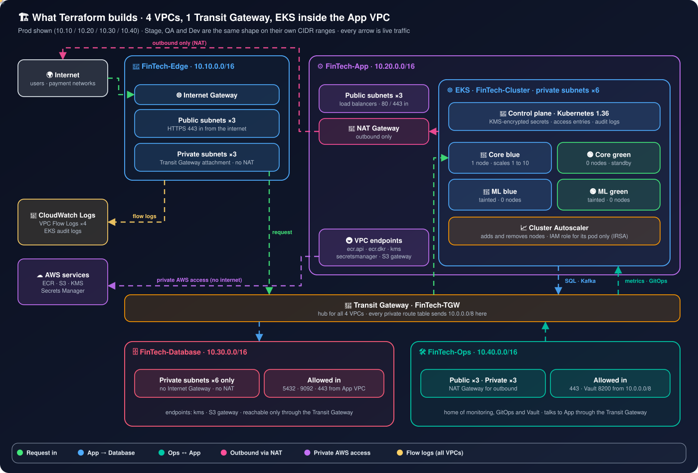
</div>

**📝 What this shows.** The real infrastructure one environment gets from `terraform apply`. Four VPCs sit around one Transit Gateway, and the EKS cluster lives in the App VPC's private subnets. Follow the coloured arrows:

| Arrow | Traffic | Path |
|---|---|---|
| 🟢 Green | A request coming **in** | Internet → Edge VPC → Transit Gateway → EKS nodes in the App VPC |
| 🔵 Blue | App talking to its **database** | EKS → Transit Gateway → Database VPC |
| 🟦 Teal | **Ops** tooling | Ops VPC → Transit Gateway → App VPC |
| 🩷 Pink | Calls going **out** | EKS → NAT Gateway → Internet (one way: out, never in) |
| 🟣 Purple | Private **AWS access** | EKS → VPC endpoints → ECR, S3, KMS, Secrets Manager |
| 🟡 Yellow | **Flow logs** | Every VPC → CloudWatch Logs |

**The five stacks**

| Stack | Scope | What it creates | Resources |
|---|---|---|:-:|
| 🔐 **IAM** | Global | Roles for the platform team, app teams and CI/CD, per environment | 20 |
| 🪣 **S3** | Global | 2 versioned, KMS-encrypted compliance buckets with lifecycle rules | 10 |
| 📦 **ECR** | Global | 4 container repositories (immutable tags, scan on push) | 4 |
| 🌐 **Networking** | Per environment | 4 VPCs, Transit Gateway, NAT, endpoints, flow logs | 126 |
| ☸️ **EKS** | Per environment | Cluster, 4 node groups, IAM, OIDC, Cluster Autoscaler | ~26 |

> 🎤 **Interview talking points**
> - "I split the infrastructure into stacks by lifecycle. IAM, S3 and ECR are account-wide; Networking and EKS exist once per environment."
> - "Inbound, east-west, outbound and AWS-service traffic each take a different, controlled path."
> - "Private subnets reach the internet only through NAT, which is one-way."

---

## 2. The 4 VPCs in Plain Words

Think of each VPC as a **separate building** with its own address range. Buildings do not share corridors, so a problem in one cannot walk into another. The **Transit Gateway** is the guarded bridge between them.

| VPC | Think of it as | What is inside (Prod) | Internet | Who may connect in |
|---|---|---|---|---|
| 🚪 **FinTech-Edge** `10.10.0.0/16` | The **reception desk** | 3 public + 3 private subnets, Internet Gateway | Inbound HTTPS only | Anyone on `443` (public). Private tier: only `10.0.0.0/8` |
| ⚙️ **FinTech-App** `10.20.0.0/16` | The **office floor** | 3 public + 6 private subnets, NAT, the EKS cluster, endpoints for ECR, Secrets Manager, KMS, S3 | Out through NAT | `80`/`443` on the public tier. Private tier: `443`, Vault `8200`, EFS `2049` |
| 🗄️ **FinTech-Database** `10.30.0.0/16` | The **vault room** | 6 private subnets only, endpoints for KMS and S3 | **None at all** | Only the App VPC on `5432`, `9092`, `443` (and Ops on `443`) |
| 🛠️ **FinTech-Ops** `10.40.0.0/16` | The **control room** | 3 public + 3 private subnets, NAT | Out through NAT | Only `10.0.0.0/8` on `443` and Vault `8200` |

<div align="center">
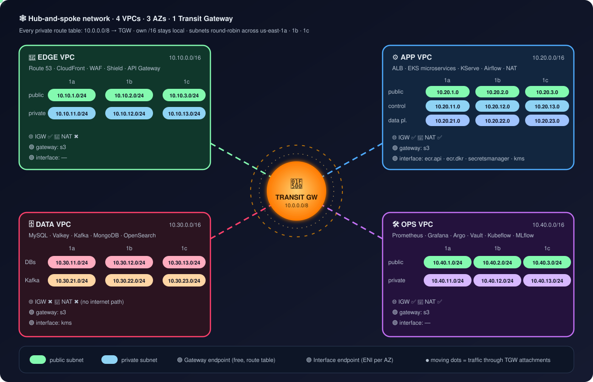
</div>

**📝 What this shows.** The exact Prod subnets, laid out per Availability Zone. Every VPC is a **spoke**, the Transit Gateway is the **hub**, and the moving dots are packets crossing an attachment. The Database VPC is the only one with **no** Internet Gateway and **no** NAT.

**The building blocks, in simple words**

| Term | Simple meaning |
|---|---|
| 🌐 **Public subnet** | Has a route to the Internet Gateway. Only load balancers and NAT Gateways live here |
| 🔐 **Private subnet** | No way in from the internet. Nodes, databases and tools live here |
| 🔁 **NAT Gateway** | A one-way door. Private workloads can call out; nobody outside can call in |
| 🚇 **VPC endpoint** | A private tunnel to an AWS service, so ECR pulls and secret reads skip the internet |
| 🔀 **Transit Gateway** | The hub. Every private route table sends `10.0.0.0/8` to it |
| 🧱 **Security group** | A firewall around a resource. Routes decide *where traffic can go*; security groups decide *what is allowed* |
| 📜 **VPC Flow Logs** | A logbook of every accepted and rejected connection, kept one year in CloudWatch |
| 🏗️ **Availability Zone** | A separate data centre. Subnets are spread over three, so one failing does not stop the platform |

> 🎤 **Interview talking points**
> - "Each VPC has one job, so its firewall rules are short and easy to audit. That is network segmentation, a PCI-DSS requirement."
> - "Hub-and-spoke scales linearly: a new VPC is one attachment. A full mesh of peerings needs n(n-1)/2 connections."
> - "The Database VPC is not blocked by a rule. It simply has no route to the internet."

---

## 3. Folder Layout and Environments

```text
Terraform-FinTech-Infra/
│
├── 🔐 IAM/                              GLOBAL · roles for every environment
│   ├── backend.tf · providers.tf · variables.tf · locals.tf · main.tf · outputs.tf
│   ├── terraform.tfvars                 which roles each environment gets
│   └── modules/iam_roles/               wrapper around terraform-aws-modules/iam
│
├── 🪣 S3/                               GLOBAL · compliance buckets
│   ├── (same root files)
│   ├── terraform.tfvars                 bucket names
│   └── modules/s3_bucket/               bucket + versioning + encryption + lifecycle
│
├── 📦 ECR/                              GLOBAL · container registry
│   ├── (same root files)
│   ├── terraform.tfvars                 repository names
│   └── modules/ecr_repository/
│
├── 🌐 Networking/                       PER ENVIRONMENT
│   ├── modules/
│   │   ├── vpc/                         ONE VPC: subnets, routes, NAT, security groups,
│   │   │                                endpoints, flow logs, Transit Gateway attachment
│   │   └── tgw/                         the Transit Gateway hub
│   ├── Prod/                            root: 4 VPCs on 10.10 / 10.20 / 10.30 / 10.40
│   ├── Stage/                           root: 10.50 / 10.60 / 10.70 / 10.80
│   ├── QA/                              root: 10.90 / 10.100 / 10.110 / 10.120
│   └── Dev/                             root: 10.130 / 10.140 / 10.150 / 10.160
│
└── ☸️ EKS/                              PER ENVIRONMENT
    ├── modules/eks_cluster/
    │   ├── IAM.tf                       cluster role, worker role, DevOps user + role
    │   ├── EKS_Control_Plane.tf         KMS key, log group, cluster, access entries
    │   ├── EKS_Data_Plane.tf            4 node groups + kubeconfig update
    │   ├── OIDC.tf                      IAM OIDC provider (enables IRSA)
    │   ├── EKS_Cluster_Autoscaler.tf    least-privilege policy, IRSA role, Helm release
    │   └── variables.tf · outputs.tf · versions.tf
    ├── Prod/ · Stage/ · QA/ · Dev/      roots: one cluster each
    └── testapp.yaml                     sample workload for testing
```

Every **root** folder holds the same files, so anyone who knows one stack can find their way around all of them:

| File | Question it answers |
|---|---|
| `terraform.tfvars` | **What** values does this stack use? (the file you edit day to day) |
| `variables.tf` | **Which** inputs exist, and what type are they? |
| `locals.tf` | What can be **worked out** from those inputs? |
| `main.tf` | **What** gets built, and from which module? |
| `outputs.tf` | What do we **get back** after apply? |
| `backend.tf` / `providers.tf` | **Where** is the state, and which AWS region? |

**The four environments run the same module code and differ only in `terraform.tfvars`:**

| Environment | Edge | App | Database | Ops | EKS cluster | Node groups | Names end with |
|---|---|---|---|---|---|---|---|
| **Prod** | `10.10.0.0/16` | `10.20.0.0/16` | `10.30.0.0/16` | `10.40.0.0/16` | `FinTech-Cluster` | blue + green | *(nothing)* |
| **Stage** | `10.50.0.0/16` | `10.60.0.0/16` | `10.70.0.0/16` | `10.80.0.0/16` | `FinTech-Cluster-Stage` | blue | `-Stage` |
| **QA** | `10.90.0.0/16` | `10.100.0.0/16` | `10.110.0.0/16` | `10.120.0.0/16` | `FinTech-Cluster-QA` | blue | `-QA` |
| **Dev** | `10.130.0.0/16` | `10.140.0.0/16` | `10.150.0.0/16` | `10.160.0.0/16` | `FinTech-Cluster-Dev` | blue | `-Dev` |

> 🎤 **Interview talking points**
> - "Environments are folders, not branches or workspaces. The difference between Prod and Stage is a normal file diff anyone can review."
> - "Reusable logic lives in modules. A fix made once reaches every environment."
> - "No two VPCs overlap, across VPCs or across environments, so they could all be routed together later."

---

## 4. The Stacks, One by One

### 4.1 IAM (global)

<div align="center">
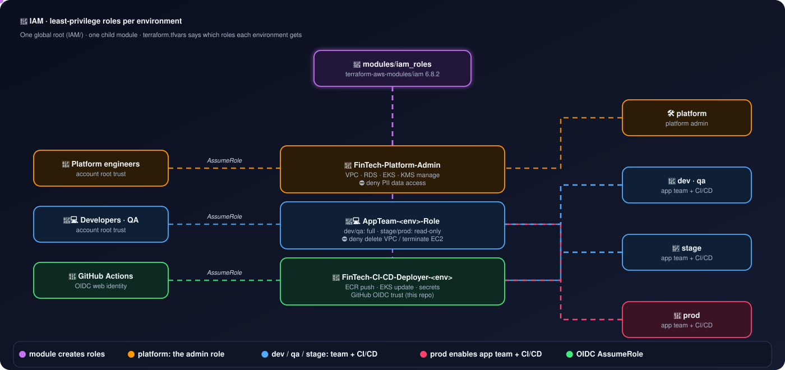
</div>

**📝 What this shows.** One module (`IAM/modules/iam_roles`) runs once for each entry in `role_sets` (`platform`, `dev`, `qa`, `stage`, `prod`) and creates only the roles that entry switches on.

| Role | Who uses it | What it may do | Guardrail (explicit Deny) |
|---|---|---|---|
| `FinTech-Platform-Admin` | Platform engineers | Manage VPC, RDS, EKS, KMS | Cannot read customer data (`s3:GetObject`, `rds-db:connect`, `kms:Decrypt`) |
| `AppTeam-<env>-Role` | Developers and QA | **Full** in `dev` and `qa`, **read-only** in `stage` and `prod` | Cannot delete VPCs, subnets, the Transit Gateway or terminate instances |
| `FinTech-CI-CD-Deployer-<env>` | GitHub Actions | Push images, update the cluster, read secrets | Trusts only this repository, through OIDC |

The module works out permissions **from the environment name**: anything listed in `read_only_environments` (`prod`, `stage`) automatically gets the restricted action list.

> 🎤 **Interview talking points**
> - "An explicit Deny always beats any Allow, so a guardrail cannot be bypassed by attaching another policy."
> - "Even the platform admin cannot read customer data. Running the infrastructure and reading the data are separate duties."
> - "The same module gives stricter rights in stage and prod without any environment-specific code."

### 4.2 S3 (global)

Two buckets, `muntaha-fintech-dvc-data-lake` and `muntaha-fintech-applog`, created by one module with `for_each`. The `muntaha-` prefix is there because S3 bucket names are **global across every AWS account**.

| Setting | Value | Why |
|---|---|---|
| Versioning | Enabled | An overwritten or deleted object can be recovered |
| Public access block | All four switches on | The bucket can never be made public, even by mistake |
| Default encryption | AWS KMS, with a bucket key | Every decrypt is permission-checked and logged |
| Current objects | 30 days → `STANDARD_IA` → 180 days → `GLACIER` → deleted after 730 days | Cold data moves to cheaper storage on its own; two years is a common audit retention |
| Old versions | 90 days → `GLACIER` → deleted after 180 days | Old versions do not pile up forever |
| Unfinished uploads | Deleted after 7 days | Failed multipart uploads would otherwise be billed invisibly |

> 🎤 **Interview talking points**
> - "Lifecycle rules automate cost optimisation: STANDARD, then Infrequent Access, then Glacier as data cools."
> - "Versioning protects against accidental deletes; the public access block protects against accidental exposure."

### 4.3 ECR (global)

One private repository per microservice: `fintech-ledgerservice`, `fintech-payment`, `fintech-bff`, `fintech-notifications`.

| Setting | Value | Why |
|---|---|---|
| Tag mutability | `IMMUTABLE` | A tag can never be overwritten, so the image that was scanned is the image that runs. Pipelines push a new tag (the git SHA) every time |
| Scan on push | On | Known vulnerabilities (CVEs) are reported before the image reaches the cluster |
| Encryption | AWS KMS | Access to images is permission-checked and logged |

> 🎤 **Interview talking points**
> - "Immutable tags make deployments reproducible and stop anyone silently replacing an approved image."
> - "Nodes pull images through VPC endpoints, so image traffic never leaves the AWS network."

### 4.4 Networking (per environment)

<div align="center">
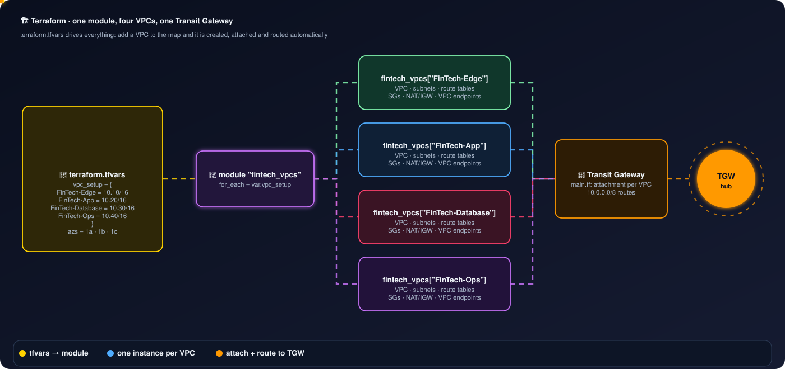
</div>

**📝 What this shows.** All four VPCs come from **one module**. The root loops over the `vpc_setup` map in `terraform.tfvars` with `for_each`; each entry becomes one complete VPC.

```hcl
module "fintech_vpcs" {
  source   = "../modules/vpc"
  for_each = var.vpc_setup          # one entry per VPC in terraform.tfvars

  vpc_name       = each.key         # e.g. "FinTech-App"
  vpc_cidr_block = each.value.cidr  # e.g. "10.20.0.0/16"
  tgw_id         = module.tgw.tgw_id
  # ...
}
```

One `terraform apply` on `Networking/Prod` creates **126 resources**:

| Resource | Count | Resource | Count |
|---|:-:|---|:-:|
| VPCs | 4 | Security groups (public, private, endpoint) | 11 |
| Subnets (9 public + 18 private) | 27 | Default security groups, locked | 4 |
| Route tables (3 public + 4 private) | 7 | S3 gateway endpoints | 4 |
| Internet Gateways | 3 | Interface endpoints | 5 |
| NAT Gateways + Elastic IPs | 2 + 2 | VPC Flow Logs (+ log group and IAM role each) | 4 |
| Transit Gateway + attachments | 1 + 4 | Routes and associations | the rest |

<div align="center">
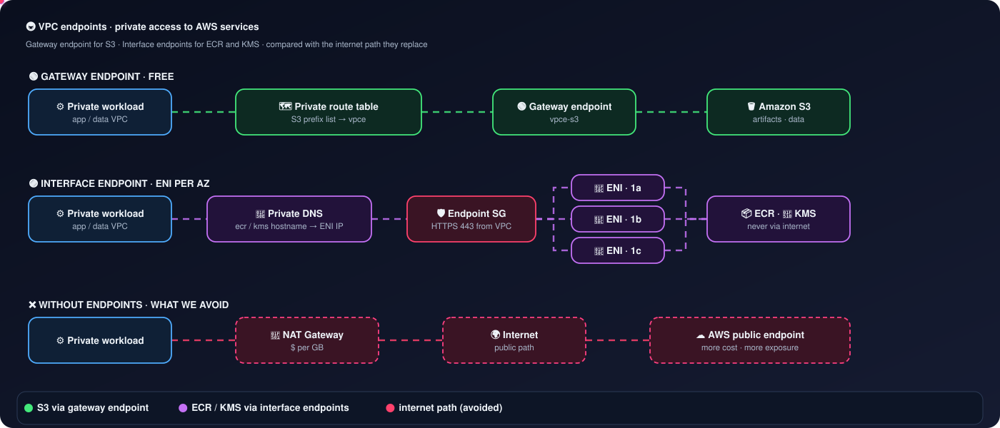
</div>

**📝 What this shows.** Two kinds of private tunnel to AWS services. The **gateway endpoint** for S3 is free and is just a route. **Interface endpoints** (ECR, KMS, Secrets Manager) are network cards in one private subnet per AZ, guarded by a security group that allows HTTPS from inside the VPC only. The bottom row is the internet path they replace.

> 🎤 **Interview talking points**
> - "I use `for_each` instead of `count`, so each VPC is tracked by name and removing one does not shift the others."
> - "Adding a VPC is a data change in tfvars, not a code change."
> - "Endpoints are cheaper than NAT traffic and remove the internet from the path completely."

### 4.5 EKS (per environment)

<div align="center">
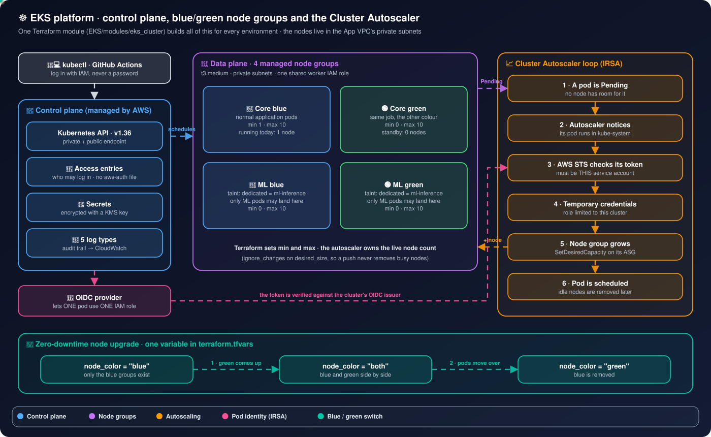
</div>

**📝 What this shows.** Everything the `eks_cluster` module builds:

- **Control plane (left).** Kubernetes 1.36, managed by AWS. Logins use **EKS access entries** (no `aws-auth` ConfigMap). Kubernetes **Secrets are encrypted** with a KMS key. All five log types, including the **audit log**, go to CloudWatch.
- **Data plane (middle).** Four managed node groups in the App VPC's private subnets. Only **Core blue** runs a node by default; the other three exist at **zero nodes** and cost nothing until needed. The **ML** groups are tainted (`dedicated=ml-inference:NoSchedule`), so only pods that tolerate the taint land there.
- **Cluster Autoscaler (right).** Adds a node when a pod cannot be scheduled and removes idle nodes later. Its pod gets AWS permissions through **IRSA**, with a role limited to this cluster's node groups.
- **Blue/green switch (bottom).** `node_color` goes `blue` → `both` → `green`: new nodes arrive before old ones leave.

**The two lines that make the blue/green switch work:**

```hcl
locals {
  create_blue  = var.node_color == "blue"  || var.node_color == "both"
  create_green = var.node_color == "green" || var.node_color == "both"
}
# each node group:  count = local.create_blue ? 1 : 0     (or create_green)
```

**Who controls the node count:**

| Setting | Controlled by | How |
|---|---|---|
| `min_size`, `max_size` | Terraform (your code) | The limits |
| `desired_size` | Cluster Autoscaler | `ignore_changes = [scaling_config[0].desired_size]`, so a pipeline run never removes busy nodes |

**Access to the cluster:** whoever runs Terraform becomes cluster-admin automatically. Every other principal in `cluster_admin_arns` gets an access entry, so you keep `kubectl` access whether the cluster was created from your laptop or from GitHub Actions.

> 🎤 **Interview talking points**
> - "IRSA gives one pod one IAM role, instead of every pod sharing the node's role."
> - "The trust policy checks `sub` (which service account) and `aud` (must be STS), so no other pod can assume the role."
> - "Scale-from-zero works because the autoscaler may call `eks:DescribeNodegroup` to learn a group's labels and taints when no node exists yet."
> - "Access entries replace the fragile aws-auth ConfigMap with IAM-native resources I can manage in Terraform."

---

## 5. Remote State

<div align="center">
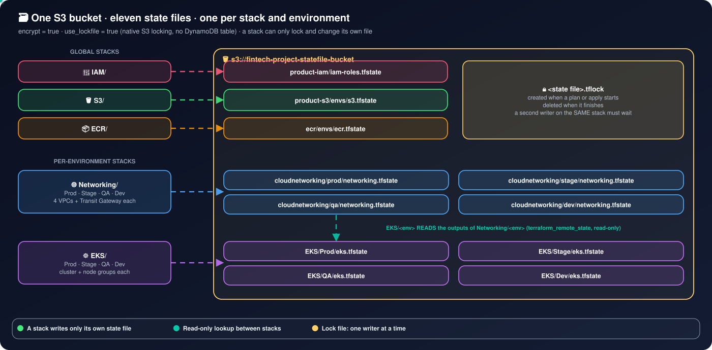
</div>

**📝 What this shows.** Terraform remembers what it built in a **state file**. Every stack and environment has **its own** file in one encrypted bucket:

| Stack | State key in `fintech-project-statefile-bucket` |
|---|---|
| IAM | `product-iam/iam-roles.tfstate` |
| S3 | `product-s3/envs/s3.tfstate` |
| ECR | `ecr/envs/ecr.tfstate` |
| Networking | `cloudnetworking/<prod\|stage\|qa\|dev>/networking.tfstate` |
| EKS | `EKS/<Prod\|Stage\|QA\|Dev>/eks.tfstate` |

The teal arrow is the only link between stacks. `EKS/<env>/main.tf` **reads** the outputs of `Networking/<env>`:

```hcl
data "terraform_remote_state" "networking" {
  backend = "s3"
  config = {
    bucket = var.networking_state_bucket
    key    = var.networking_state_key      # e.g. cloudnetworking/prod/networking.tfstate
    region = var.region
  }
}
```

It is read-only, so EKS can use the subnets but can never change the network.

<div align="center">
</div>

**📝 What this shows.** Two engineers apply the same stack. The first creates a `.tflock` file next to the state; the second sees it and stops instead of overwriting. When the first finishes, the lock disappears. This is Terraform's **native S3 locking** (`use_lockfile = true`), so no DynamoDB table is needed.

> 🎤 **Interview talking points**
> - "One state per stack means a small blast radius, faster plans and separate locks."
> - "`terraform destroy` empties the state file but does not delete it. The same file is reused next time."
> - "Who runs Terraform does not matter, only the state does. A stack created by the pipeline can be destroyed from a laptop because both read the same state."

---

## 6. Security Hardening with Checkov

<div align="center">
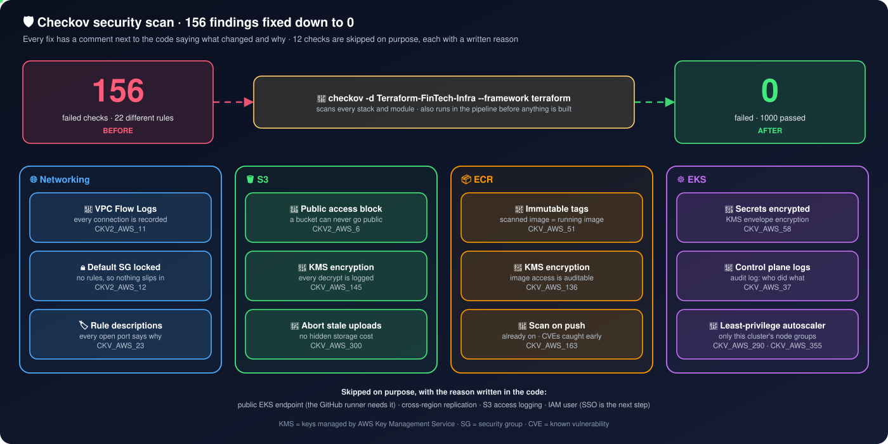
</div>

**📝 What this shows.** [Checkov](https://www.checkov.io/) compares the Terraform code with hundreds of security rules. The first scan reported **156 failures across 22 rules**; it now reports **0 failed and 1000 passed**. The same scan runs **in the deploy pipeline**, before anything is created.

Every fix has a comment next to the code. Search the repository for `CHECKOV FIX` to see them all:

```hcl
# CHECKOV FIX (CKV2_AWS_11)
# WHAT: added VPC Flow Logs (4 small resources: log group, IAM role, role policy, flow log).
# WHY:  flow logs record every accepted and rejected connection in the VPC. Without them you
#       cannot investigate an incident or prove network controls to an auditor (PCI-DSS, SOC 2).
```

**What was fixed**

| Stack | Check | What changed | Why it matters |
|---|---|---|---|
| Networking | `CKV2_AWS_11` | VPC Flow Logs on every VPC | A record of every connection, for incidents and audits |
| Networking | `CKV2_AWS_12` | Default security group has no rules | Anything launched without a security group gets no access |
| Networking | `CKV_AWS_23` | Description on every security group and rule | Every open port says why it is open |
| S3 | `CKV2_AWS_6` | Public access block | A bucket can never be exposed publicly |
| S3 | `CKV_AWS_145` | KMS encryption by default | Decrypts are permission-checked and logged |
| S3 | `CKV_AWS_300` | Abort unfinished uploads after 7 days | No hidden storage cost |
| ECR | `CKV_AWS_51` | Immutable tags | The scanned image is the running image |
| ECR | `CKV_AWS_136` | KMS encryption | Image access is auditable |
| EKS | `CKV_AWS_58` | Kubernetes Secrets encrypted with a KMS key | Secrets are unreadable even from an etcd backup |
| EKS | `CKV_AWS_37` | All five control-plane log types | The audit log shows who did what |
| EKS | `CKV_AWS_290`, `CKV_AWS_355` | Autoscaler policy split and scoped | It can only resize this cluster's own node groups |

**What is skipped on purpose** (the reason is written next to each `checkov:skip` in the code)

| Check | What it asks for | Why it is not done here |
|---|---|---|
| `CKV_AWS_38`, `CKV_AWS_39` | No public EKS endpoint | The GitHub-hosted runner and the engineer's machine are outside the VPC. Access is still protected by IAM and access entries |
| `CKV_AWS_339` | A "supported" Kubernetes version | 1.36 is current on EKS; this Checkov release's list is older |
| `CKV_AWS_144` | S3 cross-region replication | Needs a second region; planned with disaster recovery |
| `CKV_AWS_18` | S3 access logging | Needs a separate log bucket; planned with CloudTrail |
| `CKV2_AWS_62` | S3 event notifications | Nothing consumes bucket events yet |
| `CKV_AWS_158` | KMS key on CloudWatch log groups | Default CloudWatch encryption for now; a customer key is a later step |
| `CKV2_AWS_64` | Custom KMS key policy | The default key policy is what EKS expects |
| `CKV2_AWS_5` | Security groups attached to something | They are attached by other stacks (EKS uses the private one) |
| `CKV_AWS_273`, `CKV_AWS_40` | SSO instead of an IAM user | The IAM user is a course exercise; IAM Identity Center is next on the roadmap |
| `CKV_TF_1` | Module pinned to a commit hash | Pinned to exact version `6.8.2` from the official registry instead |

> 🎤 **Interview talking points**
> - "Scanning is shift-left: the pipeline fails on a misconfiguration before any resource exists."
> - "I neither blindly fix nor blindly suppress. Every skip has a written reason a reviewer can challenge."
> - "The autoscaler fix is a good least-privilege example: read actions on `*` because AWS requires it, write actions only on Auto Scaling Groups tagged for this cluster."

---

## 7. CI/CD Pipelines

<div align="center">
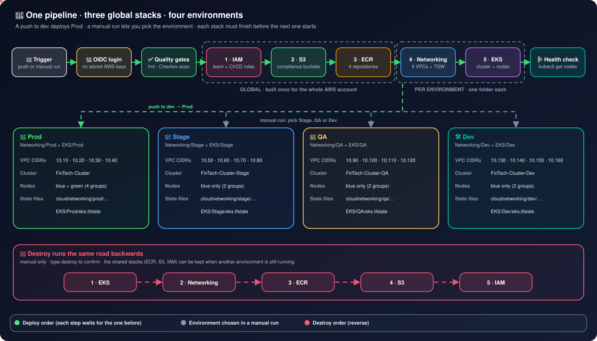
</div>

**📝 What this shows.**

- **Top row: deploy** ([`4.fintech-infra-deploy.yaml`](../.github/workflows/4.fintech-infra-deploy.yaml)). OIDC login, then two quality gates (`terraform fmt -check` and the Checkov scan), then the stacks **in dependency order** on one GitHub-hosted runner: IAM → S3 → ECR → Networking → EKS. A step starts only when the one before it has succeeded. Networking must finish before EKS because the cluster is placed inside the network's subnets.
- **Middle: environments.** A push to `dev` that touches Prod-related code deploys **Prod**. A manual run lets you choose Stage, QA or Dev.
- **Bottom: destroy** ([`5.fintech-infra-destroy.yaml`](../.github/workflows/5.fintech-infra-destroy.yaml)). Manual only, needs the word `destroy` typed in, and runs the same road **backwards**. The shared stacks (ECR, S3, IAM) can be left in place when another environment is still running.

| | Deploy (workflow 4) | Destroy (workflow 5) |
|---|---|---|
| Starts when | Push to `dev` (Prod paths only), or manual run | Manual run only |
| Environment | Push → Prod · manual → your choice | Your choice |
| Order | IAM → S3 → ECR → Networking → EKS | EKS → Networking → ECR → S3 → IAM |
| Safety | Format check + Checkov must pass first | Must type `destroy` · `dev` branch only |
| Each stack runs | `init` → `validate` → `plan -out plan1` → `apply plan1` | `init` → `plan -destroy -out destroyplan` → `apply destroyplan` |

<div align="center">
</div>

**📝 What this shows.** How the pipeline logs in to AWS with **no stored keys**. GitHub signs an identity token for the run, AWS STS checks it comes from **this repository**, and returns temporary credentials that expire on their own.

> 🎤 **Interview talking points**
> - "The plan is saved to a file and that exact file is applied, so what was reviewed is what runs."
> - "Deploy and destroy share a concurrency group with `cancel-in-progress: false`. They queue instead of overlapping, and a running apply is never killed halfway."
> - "Path filters stop a change to the Stage folder or the README from redeploying Prod."
> - "There are no long-lived AWS secrets in GitHub. Each run gets credentials that last minutes."

---

## 8. Conventions

| Rule | Example | Why |
|---|---|---|
| Terraform identifiers are `snake_case` | `aws_eks_cluster.eks_control_plane` | One style across every stack and module |
| AWS-facing names keep their own style | `FinTech-App`, `FinTech-Cluster-Role` | Renaming them would **replace** live resources |
| Reusable code lives in `modules/<name>/` | `Networking/modules/vpc` | Roots stay small; one fix reaches every environment |
| Environment stacks are `<stack>/<env>/` | `EKS/Prod`, `Networking/Stage` | Each environment has its own folder and state |
| Values come from `terraform.tfvars` | `node_color`, `vpc_setup` | Root variables have **no defaults**: configuration is explicit and reviewable |
| Module variables carry the standard defaults | `node_max_size = 10` | A root only passes what is different |
| One state file per stack and environment | `EKS/Prod/eks.tfstate` | Small blast radius, separate locks |
| `backend.tf` is never edited casually | — | Changing a key orphans the existing state |
| Every Checkov change is explained in place | `# CHECKOV FIX (...)` / `# checkov:skip=...` | The reason travels with the code |
| The same tags everywhere | `Project`, `Stack`, `Environment`, `Name` | Cost reports and audits can group resources |

---

## 9. How to Deploy and Destroy

**From GitHub (recommended)**

1. **Actions → "4. FinTech Infra - Deploy" → Run workflow**, branch `dev`, pick the environment.
2. When you are finished: **Actions → "5. FinTech Infra - Destroy" → Run workflow**, branch `dev`, pick the environment, type `destroy`.

**From your machine**

```bash
cd Terraform-FinTech-Infra

# Deploy, in this order (replace Prod with Stage, QA or Dev):
for stack in IAM S3 ECR Networking/Prod EKS/Prod; do
  ( cd "$stack" &&
    terraform init &&
    terraform fmt -check &&
    terraform validate &&
    terraform plan -var-file="terraform.tfvars" -out plan1 &&
    terraform apply plan1 ) || break          # stop at the first failure
done

kubectl get nodes                             # kubeconfig is written automatically after EKS

# Destroy, in the reverse order:
for stack in EKS/Prod Networking/Prod ECR S3 IAM; do
  ( cd "$stack" && terraform init && terraform destroy -var-file="terraform.tfvars" ) || break
done
```

**Run the security scan yourself**

```bash
checkov -d Terraform-FinTech-Infra --framework terraform --quiet --compact
```

> ⚠️ **Before destroying:** S3 buckets and ECR repositories must be empty, or AWS refuses to delete them. `force_destroy` is off on purpose, so data is never removed by accident.
>
> 💰 **Cost while running (before data charges):** 5 interface endpoints × 3 AZs ≈ $110/month, 2 NAT Gateways ≈ $66, 4 Transit Gateway attachments ≈ $146, EKS control plane ≈ $73, plus the worker node. Destroy the lab when you are not using it.

---

## 10. Known Issues and Roadmap

**Open items, stated honestly**

| # | Item | Status |
|:-:|---|---|
| 1 | On the last pipeline run the **Cluster Autoscaler image** (`registry.k8s.io`) could not be pulled through the NAT Gateway, so the Helm install timed out. The network configuration checked out; the failure was between that NAT IP and the registry | Fix planned: an **ECR pull-through cache**, so add-on images come through the VPC endpoint. `atomic = true` is already set, so a failed install cleans itself up |
| 2 | The EKS hardening in this version (KMS secrets encryption, control-plane logs, scoped autoscaler policy) is **validated but not yet applied** to a live cluster. IAM, S3, ECR and Networking were confirmed with a real `terraform plan` | Will be confirmed on the next deploy |
| 3 | Node groups use `create_before_destroy` with a **fixed name**. If Terraform ever has to *replace* a node group, the new one would clash with the old name | Use the blue/green switch for node changes; a name prefix is the long-term fix |
| 4 | The Database VPC security group opens `5432` (PostgreSQL), while the target architecture names MySQL (`3306`) | To be aligned when the data layer is built |
| 5 | Local runs still use the account's root credentials, and one IAM user exists for the course exercise | Next step: **IAM Identity Center (SSO)** |

<div align="center">
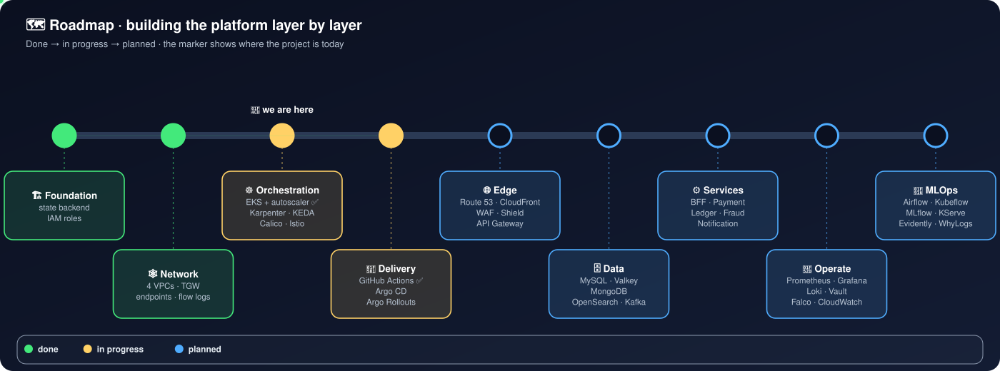
</div>

**📝 What this shows.** Foundation and Network are complete. **Orchestration** and **Delivery** are in progress: the cluster, the autoscaler and the infrastructure pipeline are built, and the platform add-ons (Karpenter, KEDA, Calico, Istio) and GitOps tools (Argo CD, Argo Rollouts) come next.

> 🎤 **Interview talking points**
> - "My next step is removing every long-lived credential: SSO for people, OIDC for pipelines."
> - "I keep a written list of known issues. Knowing where your system is weak is part of running it."

---

## 11. Interview Cheat Sheet

Short answers you can say out loud. Each one points to the section with the detail.

<details open>
<summary><b>Terraform</b></summary>

| Question | Answer |
|---|---|
| Why split into several stacks? | Smaller blast radius, faster plans, separate locks, and each stack has its own lifecycle (§1, §5) |
| How do stacks share data? | Outputs read with `terraform_remote_state`. It is read-only: a contract between producer and consumer (§5) |
| `count` or `for_each`? | `for_each` for things with names (VPCs, buckets), so removing one does not shift the rest. `count` for simple on/off switches like the blue/green groups (§4.4, §4.5) |
| How do you handle environments? | One folder per environment calling the same modules. Only `terraform.tfvars` differs (§3) |
| What does `terraform destroy` do to state? | Empties it. The file stays in S3 and is reused on the next apply (§5) |
| How is state locked? | Native S3 lock file, `use_lockfile = true`. No DynamoDB table (§5) |
| What is `ignore_changes` for? | To let something else own a field. Here the Cluster Autoscaler owns `desired_size` (§4.5) |
| What is drift? | Reality no longer matching the code, for example the autoscaler changing the node count (§4.5) |

</details>

<details open>
<summary><b>AWS networking</b></summary>

| Question | Answer |
|---|---|
| Public vs private subnet? | Public has a route to an Internet Gateway. Private does not (§2) |
| What does a NAT Gateway do? | Lets private workloads call out. Nothing outside can start a connection in (§2) |
| Why a Transit Gateway instead of peering? | Hub-and-spoke scales linearly. A mesh of peerings needs n(n-1)/2 links (§2) |
| Why VPC endpoints? | Private, cheaper path to AWS services. No internet, less NAT traffic (§4.4) |
| Route table vs security group? | Routes decide if a packet *can* get there. Security groups decide if it is *allowed* (§2) |
| How is the database tier protected? | No Internet Gateway, no NAT, and ingress only from the App CIDR on specific ports (§2) |
| What are VPC Flow Logs for? | A record of every connection, for incident response and audits (§6) |

</details>

<details open>
<summary><b>Kubernetes and EKS</b></summary>

| Question | Answer |
|---|---|
| Control plane vs data plane? | AWS runs the API servers and etcd. I run the worker nodes in my subnets (§4.5) |
| What is IRSA? | IAM Roles for Service Accounts: one pod, one IAM role, through the cluster's OIDC provider (§4.5) |
| How does the Cluster Autoscaler work? | A pending pod triggers a scale-up of the node group's Auto Scaling Group; idle nodes are removed later (§4.5) |
| What is a taint? | A "keep out" sign on a node. Only pods with a matching toleration may be scheduled there (§4.5) |
| How do you upgrade nodes without downtime? | Blue/green node groups: bring up green, move the pods, remove blue (§4.5) |
| How is cluster access managed? | EKS access entries mapped to IAM roles, not the aws-auth ConfigMap (§4.5) |
| How are Kubernetes Secrets protected? | Envelope encryption with a KMS key, plus the audit log in CloudWatch (§6) |

</details>

<details open>
<summary><b>Security and CI/CD</b></summary>

| Question | Answer |
|---|---|
| How does the pipeline log in to AWS? | GitHub OIDC. STS returns short-lived credentials; no keys are stored (§7) |
| What is shift-left security? | Finding problems before deployment. Checkov runs in the pipeline before `apply` (§6) |
| How do you treat scanner findings? | Fix the real gaps, and document every deliberate skip next to the code (§6) |
| Least privilege, an example? | The autoscaler role: read on `*`, write only on this cluster's tagged Auto Scaling Groups (§6) |
| Explicit Deny vs Allow? | Deny always wins. That is how the guardrails stay in force (§4.1) |
| Why immutable image tags? | The scanned image is exactly the running image (§4.3) |
| How do you stop two pipeline runs clashing? | A shared concurrency group, with `cancel-in-progress: false` (§7) |
| Why is the plan saved to a file? | So the reviewed plan is exactly what gets applied (§7) |

</details>
