<div align="center">

# 📘 DevOps · DevSecOps · MLOps — Course Notes

**WezvaTech FinTech Enterprise Program**

  

🎬 **Animated version:** open [`DevOps-Course-Notes-Animated.html`](DevOps-Course-Notes-Animated.html) in a browser (download it, or use [htmlpreview](https://htmlpreview.github.io/?https://github.com/muntaha747/FinTech-Enterprise-Project-Infra-Terraform/blob/dev/notes/DevOps-Course-Notes-Animated.html)).

</div>

## 📑 Contents

- **[MODULE 1 — Foundations](#-module-1--foundations)**
  - [1. Git & GitHub](#1-git--github)
  - [2. Lifecycles](#2-lifecycles)
  - [3. Building Applications](#3-building-applications)
  - [4. Deployment (Traditional)](#4-deployment-traditional)
  - [5. Docker](#5-docker)
  - [6. Kubernetes](#6-kubernetes)
  - [7. Terraform](#7-terraform)
- **[MODULE 2 — Enterprise Architecture](#-module-2--enterprise-architecture)**
  - [8. FinTech (B2B) Microservices](#8-fintech-b2b-microservices)
  - [9. Terraform Best Practices](#9-terraform-best-practices)
  - [10. GitHub Actions](#10-github-actions)
- **[MODULE 3 — AWS Infrastructure Setup](#-module-3--aws-infrastructure-setup)**
  - [11. Step 0 — IaC Pipeline Secrets](#11-step-0--iac-pipeline-secrets)
  - [12. Step 1 — IAM Roles per Environment](#12-step-1--iam-roles-per-environment)
  - [13. Step 2 — Network (VPC, Subnets, Endpoints, Gateways)](#13-step-2--network-vpc-subnets-endpoints-gateways)
  - [14. Step 3 — ECR Repos](#14-step-3--ecr-repos)
  - [15. Step 4 — S3 Buckets](#15-step-4--s3-buckets)
  - [16. Step 5 — Data Governance & Audit](#16-step-5--data-governance--audit)
- **[MODULE 4 — Enterprise Kubernetes](#-module-4--enterprise-kubernetes)**
  - [17. System Design Requirements](#17-system-design-requirements)
  - [18. Create EKS Cluster](#18-create-eks-cluster)
  - [19. EKS Version Upgrade (Blue/Green node groups)](#19-eks-version-upgrade-bluegreen-node-groups)
  - [20. Cluster Capacity Planning](#20-cluster-capacity-planning)
  - [21. Observability](#21-observability)
  - [22. Zero Trust Architecture](#22-zero-trust-architecture)
- **[MODULE 5 — Continuous Delivery Pipeline](#-module-5--continuous-delivery-pipeline)**
  - [23. Testing Stages](#23-testing-stages)
  - [24. Ledger Microservice (Java)](#24-ledger-microservice-java)
  - [25. Notification Microservice (Node.js)](#25-notification-microservice-nodejs)
  - [26. Payment Microservice (Golang)](#26-payment-microservice-golang)
  - [27. Responsibilities — Continuous Delivery](#27-responsibilities--continuous-delivery)

---

## 🧩 MODULE 1 — Foundations

### 1. Git & GitHub

<p align="center"><br><sub><b>Branching: feature → dev → main</b></sub></p>

#### ▸ Assignment

- Create a new repo with your name
- Branches: **main** and **dev**
- In **dev**, add folder `foundation/` with `assignment1.txt`, `assignment2.txt`, `assignment3.txt`
- Send an email to scmlearningcentre@gmail.com

#### ▸ One-time setup

```bash
git config --global user.name "ADAM M"
git config --global user.email scmlearningcentre@gmail.com
git config --global push.default simple
```

#### ▸ Everyday commands

```bash
git clone <Remote-Repo> <Local-Repo>
git clone https://github.com/learnwithadam/octnov2026batch workspace01

git status
git add .
git commit -m "first test commit"
git diff <file>
git log --oneline -2
git push
git pull                       # fetch metadata & update the workspace
```

#### ▸ Branching

```bash
git branch                     # local branches
git branch -a                  # all branches (incl. remote)
git checkout <Branch>
git merge <source> <dest>
git cherry-pick <CommitID>
```

### 2. Lifecycles

#### ▸ MLOps Lifecycle

<p align="center"><br><sub><b>MLOps — continuous loop</b></sub></p>

1. Dataset collection (previous / historic production data)
2. ML development
3. Build ML model (app)
4. Train the model
5. Evaluate / test the model
6. Deploy the model (inference)
7. Monitor the model

> [!TIP]
> Flow: **Develop → Build (create model) → Train → Deploy (env) → Test**  
> 2 builds — one on the Feature branch, one on Main (**Build Once, Deploy Many**)  

#### ▸ MLOps Testing Types

- **Pipeline Validation** — dry run: can the model run, take input, give output, and can we train it? *(Dev env)*
- **Model Validation** — split dataset 80/20: train on 80%, evaluate on 20%. Also check dependencies (DB, Kafka) — can it pull/push data? *(QA env)*
- **Inference Testing** — end-to-end test of the model inside the product ecosystem; load/performance tests.
- **Shadow Testing** — feed live production data and check the model predicts properly.

#### ▸ DevOps Lifecycle

<p align="center"><br><sub><b>DevOps — continuous loop</b></sub></p>

Develop → Test → Release

> [!TIP]
> Flow: **Develop → Build (create app) → Deploy (env) → Test**  

#### ▸ DevOps Testing Types

- **Functional** — validate the new/modified functionality
- **Regression** — validate existing + new functionality together
- **Performance** — load testing

#### ▸ DevSecOps Approach

<p align="center"><br><sub><b>The 4 C's of security (outer → inner)</b></sub></p>

- **Shift-Left** security: find & fix vulnerabilities during development (Feature/Dev branch)
- The **4 C's** of security: **Cloud · Compute · Container · Code**

### 3. Building Applications

#### ▸ Language types

- **Compiled** — every source file is converted into machine-understandable object files
- **Interpreted** — executed line by line

#### ▸ Java Build — 3 steps

<p align="center"><br><sub><b>Java build pipeline</b></sub></p>

**Compile → Unit Test → Package (.jar)**

```bash
sudo apt update
sudo apt install -y git openjdk-17-jdk maven
java --version
mvn --version

git clone https://github.com/wezva-fintech/ledger-build.git javabuild
git checkout feature
mvn clean package -Dmaven.test.skip=true

git checkout main
mvn clean package -Dmaven.test.skip=true
```

#### ▸ Node.js Build — 3 steps

<p align="center"><br><sub><b>Node.js build pipeline</b></sub></p>

**Install → Unit Test → Package** (no compilation; package = tar/zip of the needed *.js / *.html)

```bash
sudo apt install -y nodejs npm
node -v

git clone https://github.com/wezva-fintech/notification-build.git nodebuild
git checkout feature
npm install        # or: npm ci  (pulls dev modules: unit test, coverage, lint)
npm test
tar -cvf samplenode.tar app.js *html

git checkout main
npm install        # or: npm ci
npm test
tar -cvf samplenode.tar app.js *html
```

### 4. Deployment (Traditional)

#### ▸ The 3 core steps

1. Copy the app / artifact
2. Configure the app — DB, DB user, DB password, log level, log file, certificates, heap memory
3. Run the app

- **Log files:** server.log · access.log · users.log
- **Log levels:** INFO · WARN · ERROR · DEBUG · TRACE

#### ▸ Full checklist

<p align="center"><br><sub><b>Traditional deployment, step by step</b></sub></p>

1. Choose the server (based on env)
2. Run prerequisites — create user, create app folder, install OS packages / libraries
3. Switch to the app user
4. Switch to the app folder
5. Copy the app
6. Copy startup / healthcheck scripts
7. Copy the configuration file
8. Copy the certificates
9. Open the necessary port
10. Run the app (start script)

### 5. Docker

<p align="center"><br><sub><b>From Dockerfile to running container</b></sub></p>

> [!TIP]
> Build a **pre-configured Image**. Deployment = create a **container** (a box) from the image and run the app. *Creating a container is running an application.*  

#### ▸ Install

```bash
sudo apt update
sudo apt install -y docker.io
systemctl status docker
docker info
sudo usermod -a -G docker ubuntu
```

#### ▸ Image management goals

- Create images frequently
- Automate image creation
- Make creation fast

#### ▸ Dockerfile

A special file with instructions to build a Docker image. It automates image creation and reuses cached layers from `/var/lib/docker`.

- `ImageName = RepoName:TagName` (default tag: **latest**)
- `Image = <Registry>/<ImageName>:<TagName>`

| Instruction | Usage | Purpose |
|---|---|---|
| FROM | <BaseImage> | Base image for the intermediate container |
| RUN | <command> | Run an OS command inside the intermediate container |
| USER | <USERNAME> | Set the default user |
| WORKDIR | <PATH> | Set the default working dir |
| COPY | <SRC> <DEST> | Copy files from docker host into the image |
| EXPOSE | <PORT#> | Document the port the app listens on |
| CMD | ["exe","arg1"] | Default command — user command overrides it |
| ENTRYPOINT | ["exe","arg1"] | Always runs — user command becomes its arguments |

#### ▸ Example Dockerfile (Java)

```dockerfile
FROM ubuntu
RUN apt -y update
RUN apt install -y openjdk-17-jdk
RUN useradd -m wezvatech
RUN mkdir /etc/app
USER wezvatech
WORKDIR /etc/app
COPY ./javabuild/target/wezvatech-springboot-mysql-9739110917.jar .
COPY ./javabuild/startup.sh .
EXPOSE 8080
ENTRYPOINT ["./startup.sh"]          # or: CMD ["./startup.sh"]
```

#### ▸ Build & run

```bash
docker build -t <ImageName>:<TagName> . -f <Dockerfile-location>
docker build -t myimg:b1 .
docker images
docker run --rm -it myimg:b1
docker logs <containerID>
```

#### ▸ startup.sh

```bash
#!/bin/bash
echo "Running Startup Script .."
echo $0 $1 $2
echo "java -jar test.jar $1 $2"
```

> [!TIP]
> In DevOps, the deliverable of a build is a **Docker Image**.  
> Build steps: **Compile → Unit Test → Package (.jar) → Create Docker Image**  

#### ▸ Image layers vs Container layers

<p align="center"><br><sub><b>Container layers (bottom → top)</b></sub></p>

| Layer | Image | Container |
|---|---|---|
| 1. OS | ✔ | ✔ |
| 2. Framework (JDK/JRE/Node/Go/Python SDK) | ✔ | ✔ |
| 3. Application | ✔ | ✔ |
| 4. Scripts (startup/stop/healthcheck) | ✔ | ✔ |
| 5. Configuration (properties, secrets, certs) | — | ✔ |

> [!TIP]
> The **configuration layer** is injected at runtime — i.e. while creating the container.  

#### ▸ Example Dockerfile (Node)

```dockerfile
FROM node:16
WORKDIR /usr/app
COPY package.json ./
RUN npm install
COPY ./src ./src
COPY ./public ./public
RUN rm -rf node_modules
RUN npm ci --only=production
EXPOSE 3000
ENTRYPOINT ["node","src/index.js"]
```

#### ▸ Multi-Stage Dockerfile

<p align="center"><br><sub><b>Multi-stage build</b></sub></p>

- **Stage 1 (build):** full OS · full Node 16 · app `src/` & `public/` · `npm install` → node_modules
- **Stage 2 (runtime):** minimal OS · node binary only · `/usr/app` with `src/`, `public/`, `node_modules/`

#### ▸ Responsibilities (Module 1)

- Already had app + build/deploy process; converted traditional deployment to containers
- Adopted modern DevOps & MLOps lifecycle, branching strategies and code promotion
- Optimized image creation with multi-stage Dockerfiles, separating the configuration layer from the app image

### 6. Kubernetes

<p align="center"><br><sub><b>Kubernetes cluster anatomy</b></sub></p>

#### ▸ Setup Kind cluster (t3.medium + 15 GB disk)

```bash
sudo apt update
sudo apt install -y docker.io
sudo usermod -a -G docker ubuntu

curl -LO "https://dl.k8s.io/release/$(curl -L -s https://dl.k8s.io/release/stable.txt)/bin/linux/amd64/kubectl" && chmod +x ./kubectl && sudo mv ./kubectl /usr/local/bin/kubectl
sudo curl -L "https://kind.sigs.k8s.io/dl/v0.20.0/kind-$(uname)-amd64" -o /usr/local/bin/kind && sudo chmod +x /usr/local/bin/kind
curl https://raw.githubusercontent.com/helm/helm/main/scripts/get-helm-3 | bash

kind create cluster --name wezvatechdev --config=kindcluster.yml
kubectl get nodes      # reads ~/.kube/config to reach the cluster
```

#### ▸ kindcluster.yml

```yaml
kind: Cluster
apiVersion: kind.x-k8s.io/v1alpha4
nodes:
- role: control-plane
  extraPortMappings:
  - containerPort: 30000
    hostPort: 30000
    listenAddress: "0.0.0.0"
    protocol: TCP
  - containerPort: 30100
    hostPort: 30100
    listenAddress: "0.0.0.0"
    protocol: TCP
- role: worker
- role: worker
```

#### ▸ Analogy: Lunch bag = Deployment (Pod)

- Food → container(s)
- Hot / cold → resources
- Spoon / fork, tissue / towel → volumes, healthchecks, port mappings

Each **Pod** (application replica) holds 1+ containers, each with its image, capacity, volume, healthcheck and port mapping. Pods are spread across data-plane machines:

```bash
Data Plane Machine 1:  POD1, POD2, POD3
Data Plane Machine 2:  POD4
Data Plane Machine 3:  POD5, POD6
```

#### ▸ pod1.yml

```yaml
kind: Pod                         # Object type
apiVersion: v1                    # API version
metadata:                         # Data describing the object
  name: testpod                   # Object name
spec:                             # Desired state of the object
  containers:                     # Container details
    - name: main                  # Container name
      image: ubuntu               # Image used to create the container
      command: ["/bin/bash", "-c", "while true; do echo Hello-Adam; sleep 8 ; done"]
```

```bash
kubectl get pods
kubectl apply -f pod1.yml
kubectl get pods -o wide
kubectl describe pod testpod
kubectl logs -f testpod
kubectl exec testpod -- ps -ef
kubectl exec testpod -it -- /bin/bash
kubectl exec testpod -- env
```

> [!TIP]
> A Pod only creates & maintains its container — it **cannot recreate or scale itself**.  

- **Stateful app** — stores data inside the container (e.g. a database)
- **Stateless app** — stores data outside the container
- **Replication controlling objects** — let pods be recreated & scaled

#### ▸ Deployment (stateless apps: recreate, scale, rollback) — deploy1.yml

<p align="center"><br><sub><b>Deployment → ReplicaSet → Pods</b></sub></p>

```yaml
kind: Deployment
apiVersion: apps/v1
metadata:
  name: mydeploy
spec:
  replicas: 2
  selector:            # which pods this controller owns
    matchLabels:
      name: deployment
  template:            # pod template
    metadata:
      name: testpod
      labels:
        name: deployment
    spec:
      containers:
        - name: main
          image: ubuntu                 # ubuntu:22.10
          command: ["/bin/bash", "-c", "while true; do echo Hello-Adam; sleep 5; done"]
```

```bash
kubectl get deploy
kubectl get rs
kubectl describe deploy mydeploy
kubectl exec <POD> -- cat /etc/os-release
kubectl rollout status deploy/mydeploy
kubectl rollout history deploy/mydeploy
kubectl rollout undo deploy/mydeploy --to-revision=1
```

#### ▸ deploy2.yml — Resources, Env, NodeSelector

```yaml
kind: Deployment
apiVersion: apps/v1
metadata:
  name: mydeploy
spec:
  replicas: 2
  selector:
    matchLabels:
      name: deployment
  template:
    metadata:
      name: testpod
      labels:
        name: deployment
    spec:
      nodeSelector:              # which node to run the pod on
        mynode: demonode
      containers:
        - name: main
          image: ubuntu
          command: ["/bin/bash", "-c", "while true; do echo Hello-Adam; sleep 5; done"]
          resources:             # CPU & RAM for the container
            requests:
              memory: "64Mi"
              cpu: "100m"
            limits:
              memory: "200Mi"
              cpu: "200m"
          env:                   # environment variables
          - name: ORG
            value: WEZVATECH
          - name: SESSION
            value: PODS
```

```bash
kubectl label nodes <NODE-NAME> mynode=demonode
```

#### ▸ Healthchecks

<p align="center"><br><sub><b>Liveness vs readiness probes</b></sub></p>

- **livenessProbe** — container is **recreated** if the check fails
- **readinessProbe** — pod **gets no traffic** while the check fails
- Decide: what command/script to run, and how often
- Script must exist in the image and return **0 = healthy**, non-zero = unhealthy

```yaml
kind: Deployment
apiVersion: apps/v1
metadata:
  name: mydeploy
spec:
  replicas: 1
  selector:
    matchLabels:
      name: deployment
  template:
    metadata:
      name: testpod8
      labels:
        name: deployment
    spec:
      containers:
        - name: main
          image: httpd
          ports:
            - containerPort: 80
          livenessProbe:
            exec:
              command: ["ls", "/tmp/lp"]
            initialDelaySeconds: 30
            periodSeconds: 5
            timeoutSeconds: 10
          readinessProbe:
            exec:
              command: ["ls", "/tmp/rp"]
            initialDelaySeconds: 30
            periodSeconds: 5
            timeoutSeconds: 30
```

#### ▸ Container Patterns

<p align="center"><br><sub><b>Init + main + sidecar in one Pod</b></sub></p>

- **Init container** — runs *before* the main container: check DB is up, fetch/put data, download a file
- **Sidecar container** — runs *alongside* the main container: refresh credentials, control traffic

#### ▸ deploy3.yml — Init + Sidecar

```yaml
kind: Deployment
apiVersion: apps/v1
metadata:
  name: mydeploy
spec:
  replicas: 1
  selector:
    matchLabels:
      name: deployment
  template:
    metadata:
      name: testpod
      labels:
        name: deployment
    spec:
      initContainers:
      - name: init
        image: ubuntu
        command: ["/bin/sh", "-c", "echo WEZVATECH-KUBERNETES > /tmp/xchange/testfile; sleep 30"]
        volumeMounts:
        - name: xchange
          mountPath: "/tmp/xchange"
      containers:
      - name: main
        image: ubuntu
        command: ["/bin/bash", "-c", "while true; do echo `cat /tmp/data/testfile`; sleep 5; done"]
        volumeMounts:
        - name: xchange
          mountPath: "/tmp/data"
      - name: sidecar              # sidecar container
        image: httpd
        ports:
          - containerPort: 80
      volumes:
      - name: xchange
        emptyDir: {}
```

```bash
curl <podIP>:80
kubectl logs -f testpod -c main
kubectl logs -f testpod -c sidecar
kubectl exec testpod -c main -it -- /bin/bash
```

#### ▸ Persistent Volumes

<p align="center"><br><sub><b>Persistent storage chain</b></sub></p>

```yaml
# pv.yml
kind: PersistentVolume
apiVersion: v1
metadata:
  name: myebsvol
spec:
  capacity:
    storage: 2Gi
  accessModes:
    - ReadWriteOnce
  persistentVolumeReclaimPolicy: Recycle
  awsElasticBlockStore:
    volumeID: vol-00346b48f8947f458
    fsType: ext4
```

```bash
kubectl get pv
kubectl describe pv myebsvol
```

```yaml
# pvc.yml
kind: PersistentVolumeClaim
apiVersion: v1
metadata:
  name: myebsvolclaim
spec:
  accessModes:
    - ReadWriteOnce
  resources:
    requests:
      storage: 1Gi
```

```bash
kubectl get pvc
kubectl describe pvc myebsvolclaim
```

```yaml
# deploypv.yml
apiVersion: apps/v1
kind: Deployment
metadata:
  name: pvdeploy
spec:
  replicas: 1
  selector:
    matchLabels:
      app: mypv
  template:
    metadata:
      labels:
        app: mypv
    spec:
      containers:
      - name: main
        image: ubuntu
        command: ["/bin/bash", "-c", "sleep 10000"]
        volumeMounts:
        - name: mypv
          mountPath: "/tmp/persistent"
      volumes:
        - name: mypv
          persistentVolumeClaim:
            claimName: myebsvolclaim
```

#### ▸ ConfigMaps & Secrets (virtual memory)

<p align="center"><br><sub><b>Injecting the configuration layer</b></sub></p>

- **ConfigMap** — app config (Kafka, cache server, DB host/user/table, log level, heap memory)
- **Secret** — sensitive data (keystores, passwords, certificates)
- Object size must be **≤ 1 MB**

```bash
kubectl create configmap mymap --from-file=sample.conf
kubectl get cm
kubectl describe configmaps mymap
kubectl get configmap mymap -o yaml
```

```yaml
# Mount a ConfigMap
kind: Deployment
apiVersion: apps/v1
metadata:
  name: mydeployments
spec:
  replicas: 1
  selector:
    matchLabels:
      name: deployment
  template:
    metadata:
      name: testpod8
      labels:
        name: deployment
    spec:
      containers:
        - name: main
          image: ubuntu
          command: ["/bin/bash", "-c", "while true; do echo Hello-Adam; sleep 5; done"]
          volumeMounts:
          - name: appconfig
            mountPath: "/tmp/config"
      volumes:
      - name: appconfig
        configMap:
          name: mymap              # must match the ConfigMap name
          items:
          - key: sample.conf       # file name used when creating the map
            path: sample.conf
```

```bash
touch certificate; echo "YOUCANSEEME" > password.txt
kubectl create secret generic mypasswd --from-file=password.txt
kubectl create secret generic mycert --from-file=certificate
kubectl get secret
kubectl describe secret mycert
```

```yaml
# Method 1 — mount Secrets as files (read-only)
kind: Deployment
apiVersion: apps/v1
metadata:
  name: mydeployments
spec:
  replicas: 1
  selector:
    matchLabels:
      name: deployment
  template:
    metadata:
      name: testpod8
      labels:
        name: deployment
    spec:
      containers:
        - name: main
          image: ubuntu
          command: ["/bin/bash", "-c", "while true; do echo Hello-Adam; sleep 5; done"]
          volumeMounts:
          - name: passwdsecret
            mountPath: "/tmp/passwd"
          - name: certificate
            mountPath: "/tmp/certs"
      volumes:
      - name: passwdsecret
        secret:
          secretName: mypasswd
      - name: certificate
        secret:
          secretName: mycert
```

```yaml
# Method 2 — Secret as an environment variable
apiVersion: v1
kind: Pod
metadata:
  name: myenvsecret
spec:
  containers:
  - name: main
    image: ubuntu
    command: ["/bin/bash", "-c", "while true; do echo Hello-Adam; sleep 5 ; done"]
    env:
    - name: MYDBPASSWD           # env var name
      valueFrom:
        secretKeyRef:
          name: mypasswd         # secret name
          key: password.txt      # key inside the secret
```

#### ▸ Services

<p align="center"><br><sub><b>Request path into a pod</b></sub></p>

- Access the app without worrying about changing Pod IPs
- Load-balance traffic across pods

```yaml
# Deployment behind the service
kind: Deployment
apiVersion: apps/v1
metadata:
  name: mydeploy
spec:
  replicas: 2
  selector:
    matchLabels:
      name: deployment
  template:
    metadata:
      name: testpod8
      labels:
        name: deployment
    spec:
      containers:
        - name: main
          image: httpd
          ports:
            - containerPort: 80
```

```yaml
# ClusterIP service
kind: Service
apiVersion: v1
metadata:
  name: demoservice
spec:
  ports:
    - port: 80            # service port
      targetPort: 80      # pod port
  selector:
    name: deployment      # targets pods with this label
  type: ClusterIP
```

```bash
kubectl apply -f pod1.yml
kubectl exec testpod -it -- /bin/bash
  apt update && apt install -y curl
  curl <serviceIP>:80
```

```yaml
# NodePort service  (range 30000–32767)
kind: Service
apiVersion: v1
metadata:
  name: demoservice
spec:
  ports:
    - port: 80
      targetPort: 80
      nodePort: 30000
  selector:
    name: deployment
  type: NodePort
```

> [!TIP]
> Traffic path: **container → pod:80 → Service (ClusterIP):80 → Worker Node:30000 → Load Balancer**  

```bash
curl localhost:30000
kubectl exec mydeploy-5858c7658d-qpmsg -it -- /bin/bash
  echo "I AM POD1" > ./htdocs/index.html
```

#### ▸ DaemonSet

Runs one pod on **every worker node** — for admin tools: logging, monitoring, networking, security (Prometheus, Fluentd, Logstash, Calico, Falco).

```yaml
kind: DaemonSet
apiVersion: apps/v1
metadata:
  name: demodaemonset
spec:
  selector:
    matchLabels:
      env: demo
  template:
    metadata:
      labels:
        env: demo
    spec:
      containers:
      - name: demonset
        image: ubuntu
        command: ["/bin/bash", "-c", "while true; do echo Hello-Adam; sleep 8 ; done"]
```

| Object | Use for |
|---|---|
| Deployment | Stateless applications |
| DaemonSet | Admin tools — 1 replica on every worker node |
| StatefulSet | Stateful applications |

#### ▸ Namespaces

Group and control objects with:

- **Network** policies (inbound / outbound)
- **Resource** policies (count of pods/deployments/CMs/secrets/services, total resources)
- **User** policies (RBAC, Service Accounts)

```yaml
apiVersion: v1
kind: Namespace
metadata:
  name: demo
  labels:
    name: development
```

```bash
kubectl get ns
kubectl get pods -n demo
```

#### ▸ Taints & Tolerations

<p align="center"><br><sub><b>Taint on node, toleration on pod</b></sub></p>

- **Taint** — node property that refuses pods
- **Toleration** — pod property that allows it onto a tainted node

```bash
kubectl taint nodes <nodename> <key>=<value>:<effect>
kubectl taint nodes <nodename> taint=true:NoSchedule
kubectl describe node <nodename> | grep -i Taint
kubectl taint nodes <nodename> taint=true:NoSchedule-     # remove
```

```yaml
kind: Deployment
apiVersion: apps/v1
metadata:
  name: mydeploy
spec:
  replicas: 1
  selector:
    matchLabels:
      name: deployment
  template:
    metadata:
      name: testpod8
      labels:
        name: deployment
    spec:
      containers:
        - name: main
          image: httpd
      tolerations:
      - key: "taint"
        value: "true"
        effect: "NoSchedule"
```

#### ▸ Node Affinity (hard)

```yaml
apiVersion: apps/v1
kind: Deployment
metadata:
  name: node-affinity-hard
spec:
  replicas: 1
  selector:
    matchLabels:
      app: nginx
  template:
    metadata:
      labels:
        app: nginx
    spec:
      containers:
      - name: nginx
        image: nginx
      affinity:
        nodeAffinity:
          requiredDuringSchedulingIgnoredDuringExecution:
            nodeSelectorTerms:
            - matchExpressions:
              - key: myname
                operator: In
                values:
                - nodeaffinity
```

```bash
kubectl label nodes <node> myname=nodeaffinity
kubectl label nodes <node> myname-          # remove label
```

#### ▸ Minimal Kubernetes Deployment Template

<p align="center"><br><sub><b>Minimal app template</b></sub></p>

- **Namespace** — group the app, apply policies
- **Deployment** — scale, recreate, rollback
- **Pod** — container pattern · image · startup cmd · resources · healthcheck · env vars · port mapping · toleration · node affinity · volume
- **ConfigMap**
- **Secret**
- **Service**

### 7. Terraform

#### ▸ Install (t3.medium, 30 GB)

```bash
sudo apt update && sudo apt install -y gnupg software-properties-common curl
curl -fsSL https://apt.releases.hashicorp.com/gpg | sudo gpg --dearmor -o /usr/share/keyrings/hashicorp-archive-keyring.gpg
echo "deb [signed-by=/usr/share/keyrings/hashicorp-archive-keyring.gpg] https://apt.releases.hashicorp.com $(lsb_release -cs) main" | sudo tee /etc/apt/sources.list.d/hashicorp.list
sudo apt update && sudo apt install -y terraform
```

#### ▸ AWS credentials — ~/.aws/credentials

```ini
[default]
aws_access_key_id = <YOUR_ACCESS_KEY_ID>
aws_secret_access_key = <YOUR_SECRET_ACCESS_KEY>
```

> [!TIP]
> ⚠ Never paste real keys into notes or code. Rotate any key that has been shared.  

#### ▸ HCL basics

- HCL = HashiCorp Language (`*.tf` files)
- Everything is a **block** `{ }`; every block has a **type** and a **name**
- Every statement is `key = value`

```hcl
provider "providername" {
  key = value
}

resource "provider_resourcetype" "name" {
  key = value
}
```

#### ▸ First config — main.tf

```hcl
provider "aws" {
  region = "ap-south-1"
}

resource "aws_instance" "example" {
  ami           = "ami-0c7632fb77f35db43"
  instance_type = "t2.micro"
}

resource "aws_eip" "ip" {
  instance = aws_instance.example.id
}

resource "aws_s3_bucket" "example" {
  bucket = "wezvatech-adam-blr-s3-oct2026"
}
```

#### ▸ Workflow

<p align="center"><br><sub><b>Terraform workflow</b></sub></p>

```bash
terraform init
terraform validate
terraform plan -var "type=t2.micro" -out planfile
terraform plan -var-file="demo.tfvars" -out planfile
    # demo.tfvars:  type = "t2.large"   amiid = "ami-0c7632fb77f35db23"
terraform apply -auto-approve
terraform apply planfile
terraform show
terraform destroy
# or, planned destroy:
terraform plan -var-file="demo.tfvars" -out destroyfile -destroy
terraform apply destroyfile
```

#### ▸ Variables

```hcl
# variables.tf
variable "amiid" {
  default = "ami-0c7632fb77f35db43"
}
variable "type" {
  default = "t2.micro"
}

# main.tf
provider "aws" {
  region = "ap-south-1"
}
resource "aws_instance" "example" {
  ami           = var.amiid
  instance_type = var.type
}
```

> [!TIP]
> **Interpolation:** `RESOURCETYPE.RESOURCENAME.ATTRIBUTE`  

#### ▸ Dependencies

```hcl
provider "aws" {
  region = "ap-south-1"
}

# Explicit dependency
resource "aws_instance" "example" {
  ami           = "ami-0c7632fb77f35db43"
  instance_type = "t2.micro"
  depends_on    = [aws_s3_bucket.example]
}

# Implicit dependency
resource "aws_eip" "ip" {
  instance = aws_instance.example.id
}

resource "aws_s3_bucket" "example" {
  bucket = "wezvatech-adam-blr-s3-oct2026"
}
```

#### ▸ Remote backend — backend.tf

<p align="center"><br><sub><b>Remote state with native locking</b></sub></p>

```hcl
terraform {
  backend "s3" {
    bucket       = "wezvatech-nov-2026-tfstate"
    key          = "demo/demo.tfstate"
    region       = "ap-south-1"
    encrypt      = true
    use_lockfile = true      # S3 native locking
  }
}
```

#### ▸ Data block

```hcl
provider "aws" {
  region = "ap-south-1"
}

# Latest Ubuntu 26.04 LTS AMI
data "aws_ami" "ubuntu" {
  most_recent = true
  owners      = ["099720109477"]   # Canonical

  filter {
    name   = "name"
    values = ["ubuntu/images/hvm-ssd-gp3/ubuntu-resolute-26.04-amd64-server-*"]
  }
  filter {
    name   = "virtualization-type"
    values = ["hvm"]
  }
}

resource "aws_instance" "web_server" {
  ami           = data.aws_ami.ubuntu.id
  instance_type = "t3.micro"
  tags = {
    Name = "Ubuntu-26-Server"
  }
}
```

#### ▸ Import

```hcl
provider "aws" {
  region = "ap-south-1"
}
resource "aws_instance" "example1" {
  ami           = "ami-0c7632fb77f35db43"
  instance_type = "t2.micro"
}
resource "aws_instance" "example2" {
  ami           = "ami-0c7632fb77f35db43"
  instance_type = "t2.micro"
}
```

```bash
terraform import aws_instance.example2 i-04828223b3509f4aa
```

#### ▸ Modules (reusable code)

<p align="center"><br><sub><b>Root module wiring child modules</b></sub></p>

```hcl
# modules/instance/main.tf
provider "aws" {
  region = "ap-south-1"
}
resource "aws_instance" "example" {
  ami           = var.amiid
  instance_type = var.type
}

# modules/instance/variables.tf
variable "amiid" { default = "ami-0c7632fb77f35db43" }
variable "type"  { default = "t2.micro" }

# modules/instance/output.tf
output "instanceid" {
  value = aws_instance.example.id
}
```

```hcl
# modules/eip/main.tf
provider "aws" {
  region = "ap-south-1"
}
resource "aws_eip" "ip" {
  instance = var.instanceid
}

# modules/eip/variables.tf
variable "instanceid" {}
```

```hcl
# rootproj/main.tf
provider "aws" {
  region = "ap-south-1"
}
module "instance" {
  source = "../modules/instance"
  amiid  = var.instance_amiid
  type   = var.instance_type
}
module "eip" {
  source     = "../modules/eip"
  instanceid = module.instance.instanceid
}

# rootproj/variables.tf
variable "instance_amiid" { default = "ami-006d3995d3a6b963b" }
variable "instance_type"  { default = "t2.micro" }
```

#### ▸ Standard files

| File | Holds |
|---|---|
| versions.tf | Terraform / provider versions |
| backend.tf | Remote state + lock location |
| *.tfvars | Runtime values for variables |
| main.tf | Providers, resources, data |
| variables.tf | Input variables |
| output.tf | Output variables |

#### ▸ Built-in functions (try in `terraform console`)

```bash
max(1,31,12)
upper("hello")
split("a", "tomato")
substr("hello world", 1, 4)
index(["a", "b", "c"], "b")
length("adam")
length(["ab", "bc"])
lookup({a="1", b="2"}, "a", "novalue")
```

#### ▸ Loops — count

```hcl
provider "aws" {
  region = "ap-south-1"
}
variable "user_names" {
  description = "Create IAM users with these names"
  type        = list(string)
  default     = ["shiva","james","kim"]
}
resource "aws_iam_user" "example" {
  count = length(var.user_names)
  name  = var.user_names[count.index]
}
resource "aws_instance" "example" {
  count         = 0          # disables the resource
  ami           = "ami-0c7632fb77f35db43"
  instance_type = "t2.micro"
}
```

`count = 3` → index 0 = shiva, index 1 = james, index 2 = kim

#### ▸ Null resource

```hcl
resource "null_resource" "dummy" {
  provisioner "local-exec" {
    command = "touch MYFILE"
  }
}
```

> [!TIP]
> Need **many copies** of a resource → `count` loop.  
> Need **one** resource with many repeated properties (e.g. SG rules, subnets) → `dynamic` block.  

---

## 🧩 MODULE 2 — Enterprise Architecture

### 8. FinTech (B2B) Microservices

<p align="center"><br><sub><b>FinTech platform architecture</b></sub></p>

| Service | Language | Role |
|---|---|---|
| Ledger | Java | Master Accountant — immutable record of every transaction |
| Payment Gateway | Golang | Bank Runner — carries encrypted card data to banks |
| Fraud Detection | Python | Detective — blocks suspicious transactions in real time |
| Notification | Node.js | Postman — SMS / WhatsApp / push alerts |
| BFF | Node.js | Personal assistant — bundles backend data, forwards checkout clicks |
| Dashboard / Checkout UI | React / Vue.js | Merchant control panel & "digital cashier" |

- **Merchant Dashboard** — business owner's panel for daily sales, refunds, settle (payout) status
- **Checkout UI** — the "digital cashier" inside apps like Zomato that collects card / UPI details safely

#### ▸ Why ACID for Ledger & Payment?

- **Atomicity** (all or nothing) — a crash mid-transfer rolls the whole transaction back
- **Consistency** (follow the rules) — e.g. reject anything that makes a balance negative
- **Isolation** (no double counting) — two simultaneous ₹600 buys on ₹1000 are processed one by one
- **Durability** (permanent ink) — once "Payment Successful" shows, it's on disk, not just RAM

#### ▸ Databases

- MySQL — 2 DBs
- MongoDB — 2 DBs
- Valkey — 2 servers

> [!TIP]
> **Frontend** is static → deploy via **CDN**. **Backend core services** → deploy as **containers**.  

### 9. Terraform Best Practices

- 1 S3 bucket per app team (covering all envs)
- Separate state file per env (and per module)
- Use **S3 native locking** (`.tflock` next to the state) — no DynamoDB needed
- S3 bucket: versioning on (backup) · IAM policies · lifecycle policy (purge)

#### ▸ Enterprise-grade structure

<p align="center"><br><sub><b>Who owns what — modules vs environments</b></sub></p>

```text
## Managed by Platform Team
modules/                     (20–30 modules)
 ├── networking
 ├── security
 ├── container
 ├── database
 ├── user
 ├── storage
 └── loadbalancer

## Managed by each App Team / Client
environments/
 ├── qa/
 │   ├── networking/   state: s3://team/qa/network.tfstate
 │   │   ├── backend.tf
 │   │   ├── network.tfvars
 │   │   ├── main.tf        (calls network module)
 │   │   └── variables.tf
 │   ├── container/    state: s3://team/qa/container.tfstate
 │   │   ├── backend.tf
 │   │   ├── container.tfvars
 │   │   ├── main.tf        (calls k8s module)
 │   │   └── variables.tf
 │   └── database/     state: s3://team/qa/database.tfstate
 │       ├── backend.tf
 │       ├── database.tfvars
 │       ├── main.tf        (calls db module)
 │       └── variables.tf
 ├── stage/                 (same: networking / container / database)
 ├── production/            (same — s3://team/prod/...)
 ├── production-us-east1/   (same — s3://team/prod-us-east1/...)
 └── production-us-east2/   (same — s3://team/prod-us-east2/...)
```

#### ▸ Prereq — state bucket with versioning

```bash
git clone https://github.com/wezva-fintech/terraform-modules.git     # main branch
cd s3                      # update main.tf with your bucket name
terraform init
terraform plan
terraform apply -auto-approve
terraform destroy --auto-approve
```

> [!TIP]
> **Assignment:** modify the S3 module so versioning / lifecycle policy are enabled only when the user asks.  

#### ▸ Dev-branch check-in flow

1. Go to the Terraform dev server
2. `git clone` the repo
3. Checkout the dev branch
4. Run terraform to verify
5. Scan the Terraform code

#### ▸ Responsibilities

- Develop IaC Terraform modules to provision AWS infra
- Set up a CI pipeline implementing DevSecOps on Terraform code
- Set up an AIOps pipeline for automated code remediation when a PR is raised (guardrails with InfoSec)

### 10. GitHub Actions

A pipeline (workflow) that automates tasks: **Pipeline → Jobs → Steps**

- **Where** to run — runner (dedicated server or SaaS runner)
- **When** to run — trigger
- **What** to run — steps

#### ▸ GenAI prompt — IaC DevSecOps pipeline

<p align="center"><br><sub><b>IaC DevSecOps pipeline (dev branch)</b></sub></p>

1. Run only on dev branches in this repo
2. Trigger when a commit is pushed to dev
3. Use an Ubuntu runner
4. Use Checkov for the scan
5. Repo: https://github.com/wezva-fintech/terraform-modules.git
6. Steps: install git, terraform, checkov → `terraform init`, `plan` → run checkov (ignore errors) → `apply` & `destroy`
7. Take AWS creds from environment variables

#### ▸ GenAI prompt — AIOps PR remediation pipeline

<p align="center"><br><sub><b>AIOps — continuous loop</b></sub></p>

> [!TIP]
> Problem: a GitHub Actions pipeline that validates IaC PRs and auto-remediates with Kiro.  

1. Trigger on PR from dev → main
2. Ubuntu runner
3. Install git, terraform, checkov & kiro
4. Use Kiro headless for automated remediation
5. Push fixes back to dev if Kiro fixed Checkov failures
6. Update the PR with the modified code
7. Re-scan to verify Kiro's fix

---

## 🧩 MODULE 3 — AWS Infrastructure Setup

### 11. Step 0 — IaC Pipeline Secrets

Repo: https://github.com/wezva-fintech/terraform-modules.git

- **Settings → Secrets and variables → Actions → New repository secret**
- `AWS_ACCESS_KEY_ID` = your access key
- `AWS_SECRET_ACCESS_KEY` = your secret key

### 12. Step 1 — IAM Roles per Environment

<p align="center"><br><sub><b>Assume-role per environment</b></sub></p>

```bash
git clone https://github.com/wezva-fintech/terraform-modules.git     # main branch

cd iam/environments/product-ops-account
terraform init
terraform plan -var "account_id=640351538280" -out platformiamplan
terraform apply platformiamplan
terraform destroy -var "account_id=640351538280" --auto-approve

cd iam/environments/product-dev-qa-account
terraform init
terraform plan -var "account_id=640351538280" -out qaiamplan
terraform apply qaiamplan
terraform destroy -var "account_id=640351538280" --auto-approve

cd iam/environments/product-uat-account
terraform init
terraform plan -var "account_id=640351538280" -out uatiamplan
terraform apply uatiamplan
terraform destroy -var "account_id=640351538280" --auto-approve

cd iam/environments/product-prod-account
terraform init
terraform plan -var "account_id=640351538280" -out prodiamplan
terraform apply prodiamplan
terraform destroy -var "account_id=640351538280" --auto-approve
```

> [!TIP]
> Root workspace → calls IAM modules → calls open-source registry module → creates role + attaches policy.  
> For QA/Prod infra: take code from **main** and **assume the env role**.  

```hcl
provider "aws" {
  region = "ap-south-1"
  assume_role {
    role_arn     = "arn:aws:iam::111122223333:role/my-restricted-prod-role"
    session_name = "TerraformDeploymentProd"
  }
}
```

### 13. Step 2 — Network (VPC, Subnets, Endpoints, Gateways)

Goals: **Security · Traffic isolation · Compliance**

- Machine → subnet (AZ-specific) → network (region-specific)
- 1 region (Mumbai) = 3 availability zones (datacentres)
- VPC parts: Internet Gateway, Route Table, Subnet, Security Groups, NAT Gateway, VPC Endpoint

#### ▸ 4 VPCs · 24 Subnets (6 public, 18 private)

<p align="center"><br><sub><b>4-VPC network layout</b></sub></p>

| VPC | Public | Private | Key resources |
|---|---|---|---|
| A (Edge) | 0 | 3 | 3 private for API Gateway |
| B (App) | 3 | 6 | 3 public ALB/NAT · 3 private control plane · 3 private data plane |
| C (Data) | 0 | 6 | 3 private DBs (MySQL, MongoDB, Valkey) · 3 private Kafka & OpenSearch |
| D (Ops) | 3 | 3 | 3 private Prometheus/Grafana/Vault/MLflow · 3 public NAT |

- VPC B uses NAT to reach 3rd-party payment gateways
- VPC D uses NAT to send alerts (email, Slack, notifications)
- 3 subnets per tier for **high availability**
- **VPC Endpoints** let private subnets reach AWS services within the region
- 5 networks in total: QA, Stage, Prod × 3 regions

```bash
cd network
terraform init
terraform plan -out 4vpcplan
terraform apply 4vpcplan
terraform destroy --auto-approve
```

### 14. Step 3 — ECR Repos

- 3 base images: Java, Node, Golang
- 4 app images: Ledger, Payment, Notification, BFF

```bash
cd ecr
terraform init
terraform plan -out ecrplan
terraform apply ecrplan
```

### 15. Step 4 — S3 Buckets

```bash
cd s3                      # update main.tf with the bucket names
terraform init
terraform plan -out s3plan
terraform apply s3plan
terraform destroy --auto-approve
```

### 16. Step 5 — Data Governance & Audit

- **AWS Comprehend** — scan collected datasets before storing in the data lake (on need)
- **AWS Macie** — scan the whole account periodically

#### ▸ Macie — Data compliance guardrail

<p align="center"><br><sub><b>Macie alert pipeline</b></sub></p>

```bash
cd macie-compliance
terraform init
terraform plan -var="security_team_email=scmlearningcentre@gmail.com" -out macieplan
terraform apply macieplan
terraform destroy --auto-approve
```

> [!TIP]
> **Macie finds PII → Finding → EventBridge → SNS topic → Email lands in inbox**  

#### ▸ Comprehend — Real-time PII redaction

<p align="center"><br><sub><b>Real-time PII redaction</b></sub></p>

```bash
cd comprehend-PII-gateway
terraform init
terraform plan -var="raw_ingestion_bucket_id=wezvatech-nov-dvc-data-lake" -out piiplan
terraform apply piiplan
terraform destroy --auto-approve
```

#### ▸ Install AWS CLI

```bash
curl "https://awscli.amazonaws.com/awscli-exe-linux-x86_64.zip" -o "awscliv2.zip"
sudo apt install unzip && unzip awscliv2.zip
sudo ./aws/install --bin-dir /usr/bin --install-dir /usr/bin/aws-cli --update
aws --version
```

#### ▸ Test

```bash
aws s3 cp pii_test.csv s3://wezvatech-nov-dvc-data-lake/pii_test.csv
```

- CloudWatch → Logs → Log groups → `/aws/lambda/production-central-pii-gateway-worker`
- Download `pii_test.csv` from the data-lake bucket and verify redaction

#### ▸ Macie vs Comprehend

Both use the same AWS ML models to detect:

- **Personal:** names, addresses, phone numbers, emails
- **Financial:** card numbers, bank accounts, routing numbers
- **National IDs:** US SSN, Aadhaar, PAN
- **Credentials:** AWS keys, secret tokens, private keys

| | Macie | Comprehend |
|---|---|---|
| Applied to | Infrastructure security (account-wide audit) | Data ingestion (real-time inline cleansing) |
| Tells you | WHERE the PII is (bucket, file, line) | WHAT the PII is (exact text + char offsets) |
| Trigger | Scheduled / on-demand full bucket scan | Event-driven, per object |
| Redaction | Lambda opens file at path & scrubs | Replace exact offsets in memory |

#### ▸ Operational Security & Governance

<p align="center"><br><sub><b>Audit & threat detection</b></sub></p>

```bash
cd audit
terraform init
terraform plan -var="environment=wezvatech-demo" -out auditplan
terraform apply auditplan
terraform destroy --auto-approve
```

**Test 1 — AWS Config failure:** IAM → Users → create `unsecured-lab-developer` → AWS Config → Rules → see `iam-user-mfa-enabled-check`

**Test 2 — GuardDuty threat:**

```bash
aws guardduty list-detectors --query "DetectorIds[0]" --output text
aws guardduty create-sample-findings --detector-id <DETECTOR_ID> --finding-types "UnauthorizedAccess:EC2/MaliciousIPCaller.Custom"
```

GuardDuty → Findings → "Sample: The EC2 instance i-99999999 is communicating with an IP on a custom threat list."

**Test 3 — CloudTrail forensics:** CloudTrail → Event history → Lookup "Event name" = `CreateUser`

**Test 4:** check the S3 bucket `wezvatech-sec-logs-<accountID>`

#### ▸ AWS security services cheat-sheet

| Service | What it does |
|---|---|
| GuardDuty | Monitors for malicious activity & unauthorized behaviour |
| CloudTrail | Audits every API call (forensics, compliance) |
| AWS Config | Continuously checks infra vs. PCI-DSS / SOC2 rules |
| Macie | ML discovery & protection of sensitive data in S3 |
| Comprehend | NLP on unstructured text — entities, sentiment, PII |
| Shield | Managed DDoS protection |
| WAF | Blocks SQL injection, XSS and other web exploits |

---

## 🧩 MODULE 4 — Enterprise Kubernetes

### 17. System Design Requirements

1. **High Availability**
2. **Autoscaling** — scale data-plane nodes up/down (horizontal)
3. **Disaster Recovery** — recover without data loss
4. **Upgrade** — zero downtime (vertical)
5. **Observability** (MELT — Metrics, Events, Logs, Traces)
6. **Zero Trust**

> [!TIP]
> EKS limits: up to **30 node groups × 450 nodes = 13,500 nodes**  

#### ▸ Tools on the Terraform server

```bash
curl -LO "https://dl.k8s.io/release/$(curl -L -s https://dl.k8s.io/release/stable.txt)/bin/linux/amd64/kubectl" && chmod +x ./kubectl && sudo mv ./kubectl /usr/local/bin/kubectl
kubectl version
curl https://raw.githubusercontent.com/helm/helm/main/scripts/get-helm-3 | bash
# + AWS CLI (see Module 3)
```

#### ▸ EKS modes

- **Managed** — EKS runs the control plane; we run the data plane
- **Auto Mode (serverless)** — EKS runs both
- **Node group:** min / max servers · scale policy · instance type · 3 private subnets for HA
- **ASG** alone can only scale on CPU/RAM %

### 18. Create EKS Cluster

<p align="center"><br><sub><b>EKS cluster layout</b></sub></p>

```bash
cd eks
terraform init
terraform plan -var="eksversion=1.34" -var="caversion=v1.34.4" -out eks1.34
terraform apply eks1.34

# check Cluster Autoscaler is running
kubectl get pods -l app.kubernetes.io/name=aws-cluster-autoscaler -n kube-system

terraform destroy --auto-approve
```

#### ▸ Test autoscaling

```bash
kubectl apply -f testapp.yml
kubectl get pods --watch
kubectl get nodes --watch
```

#### ▸ Cluster backup — Velero

<p align="center"><br><sub><b>Velero — continuous loop</b></sub></p>

```bash
wget https://github.com/vmware-tanzu/velero/releases/download/v1.16.0/velero-v1.16.0-linux-amd64.tar.gz
tar zxvf velero-v1.16.0-linux-amd64.tar.gz
sudo mv velero-v1.16.0-linux-amd64/velero /usr/local/bin/velero

# create the S3 bucket first
velero install \
  --provider aws \
  --plugins velero/velero-plugin-for-aws:v1.10.0 \
  --bucket wezvatech-eks-backup-2026-nov \
  --secret-file /home/ubuntu/.aws/credentials \
  --backup-location-config region=ap-south-1 \
  --snapshot-location-config region=ap-south-1
kubectl get pods -n velero

velero backup create backup.1
velero backup get
velero backup describe backup.1
velero restore create --from-backup backup.1
velero uninstall
```

> [!TIP]
> **Assignment:** Terraform code for S3 cross-region replication.  

### 19. EKS Version Upgrade (Blue/Green node groups)

<p align="center">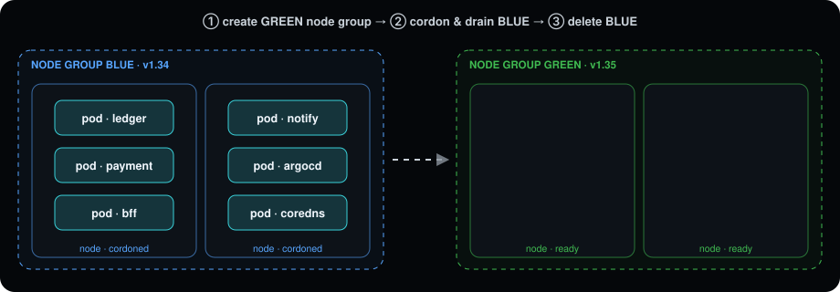<br><sub><b>Blue/green node group upgrade</b></sub></p>

```bash
terraform init
terraform plan -var="eksversion=1.34" -var="caversion=v1.34.4" -out eks1.34plan
terraform apply eks1.34plan

# Step 1 — upgrade control plane + create green node groups
terraform plan -var="eksversion=1.35" -var="caversion=v1.35.2" -var="node_color=both" -out eks1.35
terraform apply eks1.35

# Step 2 — cordon & drain blue nodes, then remove them
kubectl get nodes -l eks.amazonaws.com/nodegroup=system-apps-pool-blue
kubectl cordon <BLUE-NODE>
kubectl drain <BLUE-NODE> --ignore-daemonsets --delete-emptydir-data
terraform plan -var="eksversion=1.35" -var="caversion=v1.35.2" -var="node_color=green" -out eks1.35green
terraform apply eks1.35green

terraform destroy -auto-approve
```

> [!TIP]
> 1. Separate node groups properly with **labels & taints**.  
> 2. Give app pods proper **labels, affinity and PDBs**.  

### 20. Cluster Capacity Planning

#### ▸ 4 kinds of workloads in every cluster

<p align="center"><br><sub><b>Cluster workload tiers</b></sub></p>

1. K8s system components — kube-proxy, kubelet, CoreDNS
2. Platform tools / add-ons — Calico, ArgoCD, Cluster Autoscaler, logging, monitoring, security, MLflow, KServe
3. Core backend microservices
4. ML microservices

- **Node Group 1** — platform server tools, core microservices, platform client tools
- **Node Group 2** — MLOps tools (KServe), ML microservice, platform client tools

#### ▸ Worker node sizing

**Core backend (per service):** main app 2 GB / 1 CPU · init 300 MB / 0.2 CPU

**Add-ons (examples):**

| Add-on | RAM | vCPU |
|---|---|---|
| Calico agent | 600 MB | 0.3 |
| Argo Rollouts | 200 MB | 0.2 |
| ArgoCD | 2 GB | 1 |
| Grafana Alloy | 1.5 GB | 0.5 |
| Istio | 2 GB | 1 |

Others: Prometheus exporters, Loki, Fluent Bit, Falco, Falcosidekick, Cluster Autoscaler, kube-proxy, CoreDNS, Velero, OpenTelemetry, Vault Operator.

> [!TIP]
> **Node Group 1:** 16 vCPU / 24 GB core + 5 vCPU / 10 GB platform + tax (10% CPU, 20% RAM) ≈ **22 vCPU / 45 GB** → **3 × m6i.2xlarge** (8 vCPU, 32 GiB)  

**ML (KServe InferenceService pod):**

- Fraud predictor: 2 vCPU / 4 GB / 1 GPU (24 GB VRAM)
- Queue-proxy sidecar: 0.5 vCPU / 0.5 GB
- Storage-initializer (pulls model from S3): 0.2 vCPU / 0.5 GB

> [!TIP]
> **Node Group 2:** ≈ **5 vCPU / 10 GB / 1 NVIDIA L4** → **2 × g6.2xlarge** (8 vCPU, 32 GiB, 1× L4)  

- Per product: 3 release clusters — **QA, Stage, Prod** (+ dedicated Dev cluster, or a Dev node group in QA for small teams)
- Multiple products in a BU → one large multi-tenant Dev cluster
- Global customers → one prod cluster per region (US-East, US-West, Frankfurt, London, Mumbai, Singapore, Canada) → **5–10 clusters to maintain**

### 21. Observability

<p align="center"><br><sub><b>Metrics, events and runtime alerts</b></sub></p>

- **Prometheus** — time-series monitoring, scrapes targets frequently
- **Grafana** — dashboards / visualization
- Prometheus + exporters + Grafana → cluster health, pod/container health
- Grafana Alloy → captures K8s events
- **Alloy** = telemetry collector (processes, events, traces) · **Loki** = log aggregation & storage

#### ▸ Kind cluster (t3a.xlarge + 25 GB)

Same install as before, with extra NodePorts:

```yaml
kind: Cluster
apiVersion: kind.x-k8s.io/v1alpha4
nodes:
- role: control-plane
  extraPortMappings:
  - { containerPort: 30000, hostPort: 30000, listenAddress: "0.0.0.0", protocol: TCP }
  - { containerPort: 30100, hostPort: 30100, listenAddress: "0.0.0.0", protocol: TCP }
  - { containerPort: 31000, hostPort: 31000, listenAddress: "0.0.0.0", protocol: TCP }
  - { containerPort: 31100, hostPort: 31100, listenAddress: "0.0.0.0", protocol: TCP }
  - { containerPort: 32000, hostPort: 32000, listenAddress: "0.0.0.0", protocol: TCP }
  - { containerPort: 32100, hostPort: 32100, listenAddress: "0.0.0.0", protocol: TCP }
- role: worker
- role: worker
```

#### ▸ Prometheus & Grafana

```bash
helm repo add prometheus-community https://prometheus-community.github.io/helm-charts
helm install prometheus prometheus-community/prometheus --set prometheus.prometheusSpec.serviceMonitorSelectorNilUsesHelmValues=false --create-namespace -n monitoring
helm list -n monitoring
kubectl get pods -n monitoring
kubectl expose service prometheus-server --type=NodePort --target-port=9090 --name=prometheus-server-np -n monitoring
kubectl edit svc prometheus-server-np -n monitoring        # set NodePort 30000

helm repo add grafana https://grafana.github.io/helm-charts
helm install grafana grafana/grafana -n monitoring
kubectl expose service grafana --type=NodePort --target-port=3000 --name=grafana-np -n monitoring
kubectl edit svc grafana-np -n monitoring                  # set NodePort 30100
kubectl get secret --namespace monitoring grafana -o jsonpath="{.data.admin-password}" | base64 --decode ; echo
```

- Data source: Prometheus → `http://prometheus-server:80`
- Dashboards: **6417**, **14623** (cluster health) · **15760** (pod-level)

#### ▸ Loki

```bash
git clone https://github.com/wezva-fintech/k8sgpt_diagnose.git
kubectl apply -f inotify.yml
helm install loki grafana/loki -n loki --create-namespace -f lokivalues.yaml
kubectl get pods -n loki
kubectl logs -f loki-0 -n loki
```

#### ▸ Grafana Alloy

```bash
helm install alloy grafana/k8s-monitoring --version "^2.0.0" -n loki -f alloyvalues.yml
# older version: helm install alloy grafana/k8s-monitoring -n loki -f alloyvalues.yml
kubectl logs -f <alloy-singleton-pod> -n loki
kubectl events
kubectl apply -f pod.yml
```

- Grafana → Add data source → **Loki** → URL `http://loki.loki.svc.cluster.local:3100` (NAMESPACE.SERVICE.CLUSTER)
- HTTP header `X-Scope-OrgID` = `1`
- Explore → Loki → Label filter **job = integrations/kubernetes/eventhandler** → Run query
- Event dashboards: grafana.com/grafana/dashboards/**20018** and **16967**

#### ▸ Application logging

<p align="center"><br><sub><b>Application log pipeline</b></sub></p>

Logs: console, http-request.log, access.log, core.log

- **Fluent Bit / Logstash** — log collector
- **OpenSearch** (Elasticsearch + Kibana) — storage & visualization

```bash
# 1. S3 backup bucket "wezvatech-nov-rawdata-applog"
cd s3
terraform init
terraform plan -out s3opensearchplan
terraform apply s3opensearchplan

# 2. OpenSearch Serverless (update variables.tf: VPC ID, subnets, SG)
cd opensearchserverless
terraform init
terraform plan -out opensearch
terraform apply opensearch

# 3. Fluent Bit
git clone https://github.com/wezva-fintech/k8s-ledger-mysql.git
cd k8s-ledger-mysql/logging
kubectl create ns logging
#   update OpenSearch endpoint & S3 bucket in fluentbit-configmap.yml
#   update AWS creds in fluentbit-secret.yml
kubectl apply -f .
kubectl logs -n logging -f <ANY-FLUENT-POD>
```

**View logs:** OpenSearch Dashboards → ☰ → Stack Management → Index Patterns → Create → name `logstash-*`, time field `@timestamp` → Discover

### 22. Zero Trust Architecture

<p align="center"><br><sub><b>Zero-trust layers (bottom → top)</b></sub></p>

**I. Infra level** — network segregation

**II. Cluster level**

1. **User policies (RBAC)** — user accounts, service accounts, Roles, ClusterRoleBindings
2. **Network policies** — ingress, egress, CNI
3. **Resource policies** — limit object counts and total CPU/RAM per namespace
4. **Runtime security**

**III. App level**

5. Continuous verification (YAML) + Docker image verification

```bash
kind get clusters
kind delete clusters <ClusterName>
```

#### ▸ New Kind cluster with Calico CNI

```bash
git clone https://github.com/wezva-fintech/k8s-ledger-mysql.git deployments
cd deployments
kind create cluster --name wezvatechprod --config=kindcluster.yml
curl https://raw.githubusercontent.com/helm/helm/main/scripts/get-helm-3 | bash

kubectl create -f https://raw.githubusercontent.com/projectcalico/calico/v3.27.3/manifests/tigera-operator.yaml
kubectl create -f https://raw.githubusercontent.com/projectcalico/calico/v3.27.3/manifests/custom-resources.yaml
kubectl get pods -n calico-system --watch
kubectl get nodes
```

#### ▸ Falco + Falcosidekick (runtime security)

- **Falco** — detects zero-day exploits at runtime
- **Falcosidekick** — forwards alerts to a dashboard or Loki/Grafana

```bash
helm repo add falcosecurity https://falcosecurity.github.io/charts
helm install falco falcosecurity/falco \
  --set falcosidekick.enabled=true \
  --set falcosidekick.webui.enabled=true \
  --set falcosidekick.config.loki.hostport="http://loki.loki.svc.cluster.local:3100"
kubectl logs -f <falco-pod> -c falco
kubectl logs -f <falco-falcosidekick-pod> | grep -i loki
#   expect:  [INFO] : Enabled Outputs: [Loki WebUI]
#            [INFO] : Loki - POST OK (204)

kubectl expose service falco-falcosidekick-ui --type=NodePort --target-port=2802 --name=falcosidekick-ui-np
kubectl edit svc falcosidekick-ui-np        # set NodePort 31000
```

UI on port **31000** (admin / admin)

```yaml
# sample pod
apiVersion: v1
kind: Pod
metadata:
  name: nginx-pod
  labels:
    app: nginx
spec:
  containers:
  - name: nginx
    image: nginx:1.21
    ports:
    - containerPort: 80
```

> [!TIP]
> **Assignment:** migrate from Grafana Loki to OpenSearch — collect K8s events with Alloy and push them to OpenSearch.  

---

## 🧩 MODULE 5 — Continuous Delivery Pipeline

### 23. Testing Stages

<p align="center"><br><sub><b>Testing stages</b></sub></p>

| Test | Who | Purpose |
|---|---|---|
| Unit | Developers | Their modified files/feature work before commit |
| Functional | QA | New/modified functionality of the whole service |
| Integration | QA | All new features working together |
| Regression | QA | New + existing functionality together |
| UAT | QA / Ops | End-to-end, real-world, prod-like env |

> [!TIP]
> **Continuous Development (Dev) → Continuous Integration (We) → Continuous Deployment (We) → Continuous Testing (QA)**  

#### ▸ Branch flows

<p align="center"><br><sub><b>Feature vs main branch promotion</b></sub></p>

```text
Feature branch:  Code + Unit test (Dev) → Build (We) → Deploy QA (We) → Functional test (QA)

Main branch:     Merge FB → Main (Dev) → Build (We)
                    → Deploy QA    → Integration / Regression test
                    → Deploy STAGE → UAT
                    → Deploy PROD  → RELEASE
```

- 1 build pipeline per Feature branch (on push) · 1 build pipeline for Main (pull_request)
- 1 deployment pipeline for QA · 1 for Stage & Prod

| Quality gate | Feature branch | Main branch |
|---|---|---|
| Code coverage | 70–80% | 90% |
| Duplication | ≤ 5% | — |
| Vulnerabilities | B rating, no Critical | A rating, no Critical/High |

- With a self-hosted GitHub runner in AWS, attach a CI/CD **role/policies** so it can reach ECR
- **Configuration layer:** startup property files (DB/Kafka/cache details, creds, log files, args), certificates
- **GitHub Actions** = source repo + pipeline automation, no dedicated VMs (uses runners)

### 24. Ledger Microservice (Java)

#### ▸ SonarCloud setup

1. Sign in at https://sonarcloud.io/login with GitHub
2. Make the repo public — Settings → General → Change repository visibility → Public
3. **+** (top right) → Analyze project → select repo → Set up → New code = "Previous version" → Create
4. Project → Administration → Analysis method → **disable Automatic Analysis**
5. My Account → Security → create token

#### ▸ GitHub secrets

- `sonarcloud` — SonarCloud token
- AWS credentials
- `GH_PAT` — GitHub personal access token

#### ▸ GenAI prompt — DevSecOps build pipeline (Spring Boot)

1. Trigger on commit to feature branch
2. Input params: ECR URL, docker repo name, ECR region
3. Ubuntu runner
4. Install Java 17, Trivy, ECR creds, SonarQube token
5. Checkout & build Spring Boot
6. Run JaCoCo via Maven
7. Run Trivy (SCA)
8. Run SonarQube (SAST) → push to SonarCloud + quality gate
9. Build & push image to ECR tagged `fb<buildnumber>`
10. Fetch ECR scan results for High/Critical vulns
11. Fail the pipeline on High or Critical

#### ▸ Traditional CI/CD challenges

1. Build pipeline can access the production cluster
2. Redeployment not possible
3. Multiple deployments not possible
4. No visibility of deployments

> [!TIP]
> 4 deployments = 4 copies of YAML. Instead build a **Helm chart** (YAML templates) and pass a different `values.yml` per env.  

#### ▸ Setup ArgoCD

<p align="center"><br><sub><b>GitOps delivery with Argo CD</b></sub></p>

```bash
kubectl create namespace argocd
kubectl apply -n argocd --server-side --force-conflicts -f https://raw.githubusercontent.com/argoproj/argo-cd/stable/manifests/install.yaml
kubectl get crd applicationsets.argoproj.io
kubectl get pods -n argocd -l app.kubernetes.io/name=argocd-applicationset-controller

kubectl patch svc argocd-server -n argocd -p '{"spec": {"type": "NodePort"}}'
kubectl edit svc argocd-server -n argocd          # set NodePort 32000

# admin password (v1.9+)
kubectl -n argocd get secret argocd-initial-admin-secret -o jsonpath="{.data.password}" | base64 -d && echo
```

Add GitHub credentials in ArgoCD settings, then apply the ApplicationSet:

```bash
git clone https://github.com/wezva-fintech/ledger-deployment.git
cd ledger-deployment
kubectl apply -f applicationset-ledger.yml
```

### 25. Notification Microservice (Node.js)

1. Add the Notification build repo to SonarCloud
2. GitHub secrets: `sonarcloud`, AWS creds, `GH_PAT`

```bash
npm install        # download modules
node <app.js>      # run
```

> [!TIP]
> Uses the full node image (npm + node CLI).  

### 26. Payment Microservice (Golang)

1. Add the Payment build repo to SonarCloud
2. GitHub secrets: `sonarcloud`, AWS creds, `GH_PAT`

```bash
go mod download    # download modules
go build
```

Add GitHub creds in ArgoCD, then:

```bash
git clone https://github.com/wezva-fintech/payment-deployment.git
cd payment-deployment
kubectl apply -f applicationset-payment.yaml
```

### 27. Responsibilities — Continuous Delivery

1. Understand the release process — where dev happens, what testing, where
2. Containerize the microservice / app
3. Set up the build pipeline
4. Create the Helm package + env-based `values.yml`, then the deployment pipeline
5. Set up CI/CD pipelines and the continuous delivery process